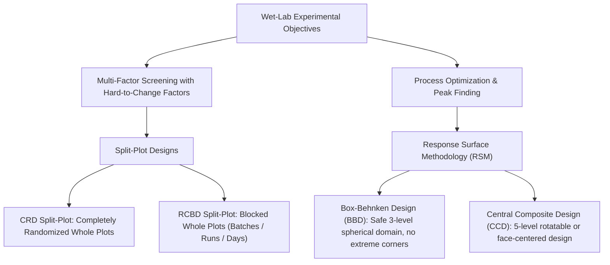
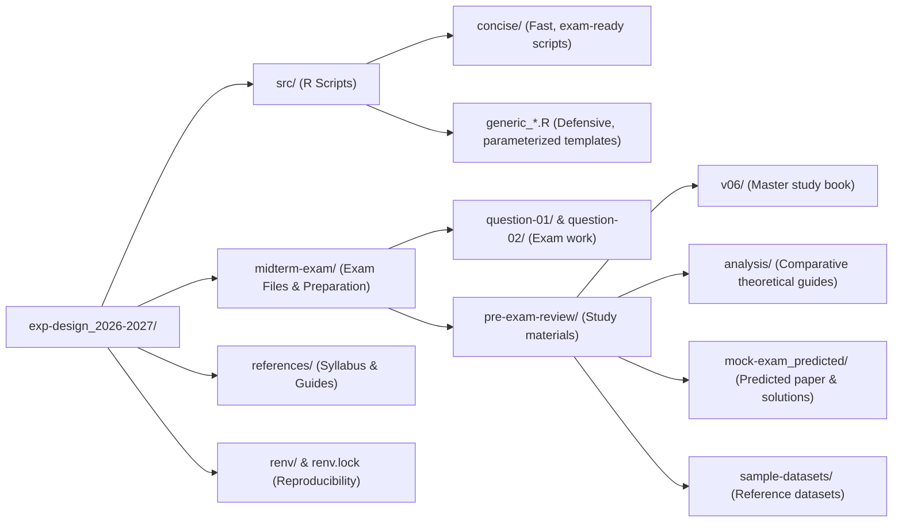

# BT317IU: Experimental Design & Biostatistics

Personal coursework and laboratory analysis repository for **BT317IU – Experimental Design & Biostatistics** at International University – VNU-HCM (HCMIU). 

This repository archives study notes, practice problem sets, reference exam papers, and reproducible R scripts focused on statistical design for wet-lab biological systems.

---

## Course Scope & Design Context

In biomedical science, bioprocessing, and wet-lab experiments (e.g., bioreactor fermentation, enzymatic cell lysis, biomaterial synthesis), standard completely randomized ANOVA assumptions often do not hold:
* **Logistical Constraints:** Resetting physical equipment (such as incubator temperatures, autoclave cycles, or large culture vessels) between individual runs is impractical or prohibitively expensive. This requires **Split-Plot Designs**, which separate hard-to-change factors (Whole Plots) from easy-to-change factors (Subplots).
* **Non-Linear Biological Responses:** Living systems exhibit bell-shaped or non-monotonic response curves (e.g., enzymatic reaction rates that peak before thermal denaturation causes sharp declines). Finding these optimal operating windows requires curved **Response Surface Methodology (RSM)** rather than simple linear screening.



---

## Repository Layout



### Directory Overview

| Directory / File | Description | Details |
| :--- | :--- | :--- |
| **[`src/concise/`](src/concise/)** | High-efficiency scripts | Minimal-line, fast-execution Base R scripts (`crd.R`, `rcbd.R`, `bbd.R`, `ccd.R`) tailored for direct terminal execution under exam constraints. |
| **[`src/`](src/)** | Generic analysis pipelines | Parameterized, defensive R scripts with column validation (`generic_bbd-analysis.R`, `generic_ccd-analysis.R`, `generic_crd-split-plot-analysis.R`, `generic_rcbd-split-plot-analysis.R`) and instructor reference (`dr-khoi_bbd.R`). |
| **[`midterm-exam/`](midterm-exam/)** | Midterm examination workspace | Live exam question folders (`question-01/` CRD Split-Plot, `question-02/` BBD RSM) and previous review archives. |
| **[`midterm-exam/pre-exam-review/v06/`](midterm-exam/pre-exam-review/v06/)** | Master Self-Study Book (v06) | 7-part study guide translating complex biostatistical concepts into plain-English wet-lab biology intuition. |
| **[`midterm-exam/pre-exam-review/analysis/`](midterm-exam/pre-exam-review/analysis/)** | In-depth technical guides | Detailed comparative notes (BBD vs. CCD, CRD vs. RCBD split-plots, second-order coefficient interpretation, 2022 exam walkthrough). |
| **[`midterm-exam/pre-exam-review/mock-exam_predicted/`](midterm-exam/pre-exam-review/mock-exam_predicted/)** | Mock exam suite | Predicted exam papers, mock CSV datasets, and complete model solutions. |
| **[`midterm-exam/pre-exam-review/sample-datasets/`](midterm-exam/pre-exam-review/sample-datasets/)** | Benchmark datasets | Reference datasets and metadata for BBD, CCD, CRD, and RCBD split-plots. |
| **[`references/`](references/)** | Course documentation | BT317IU syllabus, Russell Lenth's `rsm` documentation, and split-plot tutorials. |
| **[`renv.lock`](renv.lock)** | Package lockfile | R environment state managed via `renv`. |

---

## Experimental Design Comparison

### 1. Split-Plot Designs (CRD vs. RCBD)
When a factor is hard to change (Whole Plot, e.g., temperature in large incubators or pasture conditions), easy-to-change factors (Subplots, e.g., formulation, irradiation, mineral feed) are nested within each whole plot unit.

| Design Attribute | CRD Split-Plot | RCBD Split-Plot |
| :--- | :--- | :--- |
| **Whole-Plot Randomization** | Completely randomized to experimental units | Restricted within homogenous blocks (batches, days, litters) |
| **Error Strata** | 2 strata: Whole-Plot Unit Error and Subplot Error | 3 strata: Block, Whole-Plot Error (`Block:WP`), Subplot Error |
| **R Formula Syntax** | `aov(y ~ wp * sp + Error(unit), data = dat)` | `aov(y ~ wp * sp + Error(block / wp), data = dat)` |
| **Whole-Plot Significance** | $F_{WP} = \frac{MS_{WP}}{MS_{\text{WP Error}}}$ | $F_{WP} = \frac{MS_{WP}}{MS_{\text{Block:WP}}}$ |
| **Analysis Script** | [`src/concise/crd.R`](src/concise/crd.R) | [`src/concise/rcbd.R`](src/concise/rcbd.R) |

### 2. Response Surface Methodology (BBD vs. CCD)
Used for modeling continuous second-order quadratic surfaces to locate optimal operating conditions ($y_{\max}$).

| Feature | Box-Behnken Design (BBD) | Central Composite Design (CCD) |
| :--- | :--- | :--- |
| **Factor Levels** | 3 levels ($-1, 0, +1$) | 5 levels ($-\alpha, -1, 0, +1, +\alpha$) |
| **Point Placement** | Factorial edge midpoints + center points | Cube corners + axial star points + center points |
| **Extreme Corner Runs** | None (spherical domain; protects fragile reagents) | Yes (tests extreme simultaneous combinations) |
| **Wet-Lab Application** | Ideal for enzymes, live cells, or heat-sensitive compounds | Ideal for robust chemical synthesis with wide operating windows |
| **Runs ($k=3$)** | 15 runs (12 edges + 3 center replicates) | 20 runs (8 factorial + 6 star + 6 center replicates) |
| **Analysis Script** | [`src/concise/bbd.R`](src/concise/bbd.R) | [`src/concise/ccd.R`](src/concise/ccd.R) |

---

## Setup & Running Scripts

### 1. Package Management (`renv`)
Dependencies are locked with `renv` to maintain consistency across workstations.

```bash
Rscript -e "renv::restore()"
```

### 2. Running the Analysis Scripts
The scripts in `src/concise/` expect a `data.csv` file in the working directory:

```bash
# Split-plot analysis (CRD)
Rscript src/concise/crd.R

# Split-plot analysis (RCBD with blocks)
Rscript src/concise/rcbd.R

# Box-Behnken RSM analysis
Rscript src/concise/bbd.R

# Central Composite RSM analysis
Rscript src/concise/ccd.R
```

### 3. Interpreting RSM Script Diagnostics
The RSM scripts ([`bbd.R`](src/concise/bbd.R) and [`ccd.R`](src/concise/ccd.R)) print standard diagnostic sections:
1. **Factor Coding:** Converts natural units into dimensionless coordinates:
   $$x_i = \frac{X_i - \text{Midpoint}}{\text{Step}}$$
2. **Second-Order Coefficients:** Displays linear slope, quadratic curvature, and pairwise interaction estimates.
3. **ANOVA Decomposition:** Evaluates First-Order (FO), Two-Way Interaction (TWI), and Pure Quadratic (PQ) effects.
4. **Lack-of-Fit Test:** Compares model error against pure experimental error. An adequate fit requires failing to reject $H_0$ ($p > 0.05$).
5. **Stationary Point ($\mathbf{x}_0$):** Coded critical coordinates computed via $\mathbf{x}_0 = -\frac{1}{2} \mathbf{B}^{-1} \mathbf{b}$.
6. **Physical Decoding:** Converts coded coordinates back to physical laboratory units (°C, mg/mL, minutes).
7. **Canonical Eigenanalysis:** Evaluates surface topology via eigenvalue signs ($\lambda_i$):
   * **All negative ($\lambda_i < 0$):** Unique Local Maximum (Optimum Peak).
   * **All positive ($\lambda_i > 0$):** Unique Local Minimum (Valley).
   * **Mixed signs:** Saddle Point (Minimax surface).
8. **Predicted Response:** Estimated yield at the stationary point ($y_{\text{opt}}$).

---

## Study Guide Index (`v06`)

The self-study book located in [`midterm-exam/pre-exam-review/v06/`](midterm-exam/pre-exam-review/v06/) covers the course syllabus in sequence:

| Chapter | File | Core Content |
| :--- | :--- | :--- |
| **00** | [`00_biostats_crash_course.md`](midterm-exam/pre-exam-review/v06/00_biostats_crash_course.md) | Practical breakdown of variance, sum of squares, degrees of freedom, $F$-statistic, and $p$-values. |
| **01** | [`01_split_plot_design_and_analysis.md`](midterm-exam/pre-exam-review/v06/01_split_plot_design_and_analysis.md) | Split-Plot principles, ANOVA strata, Excel ToolPak calculations, and Base R implementation. |
| **02** | [`02_rsm_ccd_bbd.md`](midterm-exam/pre-exam-review/v06/02_rsm_ccd_bbd.md) | Biological curvature intuition, 3-point factor coding, BBD vs. CCD safety, Lack of Fit, and eigenvalue rules. |
| **03** | [`03_question1_split_plot_exam_practice.md`](midterm-exam/pre-exam-review/v06/03_question1_split_plot_exam_practice.md) | 50-point practice problem: Bioreactor monoclonal antibody production analyzed via Excel and R. |
| **04** | [`04_question2_rsm_exam_practice.md`](midterm-exam/pre-exam-review/v06/04_question2_rsm_exam_practice.md) | 50-point practice problem: Enzymatic cell lysis optimization analyzed using R's `rsm` library. |
| **05** | [`05_a4_cheat_sheet_handwritten_guide.md`](midterm-exam/pre-exam-review/v06/05_a4_cheat_sheet_handwritten_guide.md) | Layout guide for preparing a handwritten A4 reference sheet for closed-book/offline exams. |
| **06** | [`06_midterm_scripts-guide.md`](midterm-exam/pre-exam-review/v06/06_midterm_scripts-guide.md) | Operational guide for executing and troubleshooting analysis scripts in the terminal. |
