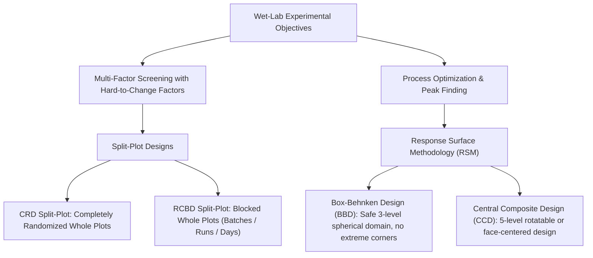

# BT317IU: Experimental Design & Biostatistics

Personal coursework and laboratory analysis repository for **BT317IU – Experimental Design & Biostatistics** at International University – VNU-HCM (HCMIU). 

This repository archives study notes, practice problem sets, reference exam papers, and reproducible R scripts focused on statistical design for wet-lab biological systems.

---

## Course Scope & Design Context

In biomedical science, bioprocessing, and wet-lab experiments (e.g., bioreactor fermentation, enzymatic cell lysis, biomaterial synthesis), standard completely randomized ANOVA assumptions often do not hold:
* **Logistical Constraints:** Resetting physical equipment (such as incubator temperatures, autoclave cycles, or large culture vessels) between individual runs is impractical or prohibitively expensive. This requires **Split-Plot Designs**, which separate hard-to-change factors (Whole Plots) from easy-to-change factors (Subplots).
* **Non-Linear Biological Responses:** Living systems exhibit bell-shaped or non-monotonic response curves (e.g., enzymatic reaction rates that peak before thermal denaturation causes sharp declines). Finding these optimal operating windows requires curved **Response Surface Methodology (RSM)** rather than simple linear screening.



---

## Repository Layout

```text
exp-design-2026/
├── midterm-exam/              # Examination tasks, mock reviews, and master study guides
├── references/                # Course syllabus and official statistical package documentation
├── renv/                      # R package environment isolation manifests
└── src/                       # Production and exam-optimized biostatistical R scripts
```

### Domain Architecture

| Domain | Role | Key Components |
|:---|:---|:---|
| **[`src/`](src/)** | R Analysis Scripts | Minimal-line exam scripts (`src/concise/`) and defensive parameterized templates (`generic_*.R`) for Split-Plot and RSM evaluations. |
| **[`midterm-exam/`](midterm-exam/)** | Examination Workspace | Problem solutions (`question-01/`, `question-02/`), predicted mock papers, comparative analysis notes, and the Master Self-Study Guide (`study-guide/`). |
| **[`references/`](references/)** | Reference Documentation | Syllabus guidelines, Russell Lenth's `rsm` documentation, and split-plot computational guides. |
| **[`renv.lock`](renv.lock)** | Reproducibility | Locked R environment state managed via `renv`. |

---

## Experimental Design Comparison

### 1. Split-Plot Designs (CRD vs. RCBD)
When a factor is hard to change (Whole Plot, e.g., temperature in large incubators or pasture conditions), easy-to-change factors (Subplots, e.g., formulation, irradiation, mineral additives) are nested inside whole plots.

| Feature | Completely Randomized Split-Plot (CRD) | Randomized Complete Block Split-Plot (RCBD) |
|:---|:---|:---|
| **Whole-Plot Assignment** | Whole plots assigned completely at random | Whole plots arranged in homogeneous blocks |
| **Error Strata** | 2 error strata: Whole-Plot Error & Subplot Error | 2 error strata: Block:Whole-Plot Error & Subplot Error |
| **R Formula** | `aov(y ~ wp * sp + Error(wp_unit), data = dat)` | `aov(y ~ wp * sp + Error(block / wp), data = dat)` |
| **Whole-Plot Significance** | $F_{WP} = \frac{MS_{WP}}{MS_{\text{WP Error}}}$ | $F_{WP} = \frac{MS_{WP}}{MS_{\text{Block:WP}}}$ |
| **Analysis Script** | [`src/concise/crd.R`](src/concise/crd.R) | [`src/concise/rcbd.R`](src/concise/rcbd.R) |

### 2. Response Surface Methodology (BBD vs. CCD)
Used for modeling continuous second-order quadratic surfaces to locate optimal operating conditions ($y_{\max}$).

| Feature | Box-Behnken Design (BBD) | Central Composite Design (CCD) |
|:---|:---|:---|
| **Factor Levels** | 3 levels ($-1, 0, +1$) | 5 levels ($-\alpha, -1, 0, +1, +\alpha$) |
| **Point Placement** | Factorial edge midpoints + center points | Cube corners + axial star points + center points |
| **Extreme Corner Runs** | None (spherical domain; protects fragile reagents) | Yes (tests extreme simultaneous combinations) |
| **Wet-Lab Application** | Ideal for enzymes, live cells, or heat-sensitive compounds | Ideal for robust chemical synthesis with wide operating windows |
| **Runs ($k=3$)** | 15 runs (12 edges + 3 center replicates) | 20 runs (8 factorial + 6 star + 6 center replicates) |
| **Analysis Script** | [`src/concise/bbd.R`](src/concise/bbd.R) | [`src/concise/ccd.R`](src/concise/ccd.R) |

---

## Setup & Running Scripts

### 1. Package Management (`renv`)
Dependencies are locked with `renv` to maintain consistency across workstations:

```bash
Rscript -e "renv::restore()"
```

### 2. Running Analysis Scripts
The scripts in `src/concise/` expect a `data.csv` file in the working directory:

```bash
# Split-plot analysis (CRD)
Rscript src/concise/crd.R

# Split-plot analysis (RCBD with blocks)
Rscript src/concise/rcbd.R

# Box-Behnken RSM analysis
Rscript src/concise/bbd.R

# Central Composite RSM analysis
Rscript src/concise/ccd.R
```

### 3. Interpreting RSM Script Diagnostics
The RSM scripts ([`bbd.R`](src/concise/bbd.R) and [`ccd.R`](src/concise/ccd.R)) evaluate standard diagnostic metrics:
1. **Factor Coding:** Converts natural units into dimensionless coordinates:
   $$x_i = \frac{X_i - \text{Midpoint}}{\text{Step}}$$
2. **Second-Order Coefficients:** Displays linear slope, quadratic curvature, and pairwise interaction estimates.
3. **ANOVA Decomposition:** Evaluates First-Order (FO), Two-Way Interaction (TWI), and Pure Quadratic (PQ) effects.
4. **Lack-of-Fit Test:** Compares model error against pure experimental error ($p > 0.05$ indicates adequate fit).
5. **Stationary Point ($\mathbf{x}_0$):** Coded critical coordinates computed via $\mathbf{x}_0 = -\frac{1}{2} \mathbf{B}^{-1} \mathbf{b}$.
6. **Physical Decoding:** Converts coded coordinates back to physical laboratory units (°C, mg/mL, minutes).
7. **Canonical Eigenanalysis:** Evaluates surface topology via eigenvalue signs ($\lambda_i$):
   * **All negative ($\lambda_i < 0$):** Unique Local Maximum (Optimum Peak).
   * **All positive ($\lambda_i > 0$):** Unique Local Minimum (Valley).
   * **Mixed signs:** Saddle Point (Minimax surface).
8. **Predicted Response:** Estimated yield at the stationary point ($y_{\text{opt}}$).

---

## Reference Guides & Study Materials

- **Master Self-Study Guide:** For detailed chapter breakdowns, arithmetic derivations, Excel ToolPak walk-throughs, and plain-English wet-lab intuitions, see [`midterm-exam/pre-exam-review/study-guide/`](midterm-exam/pre-exam-review/study-guide/README.md).
- **Comparative Analysis Notes:** Side-by-side design guides and 2022 exam post-mortems in [`midterm-exam/pre-exam-review/analysis/`](midterm-exam/pre-exam-review/analysis/).
- **Mock Exam Suite:** Model exam papers and verified solutions in [`midterm-exam/pre-exam-review/mock-exam-predicted/`](midterm-exam/pre-exam-review/mock-exam-predicted/).
