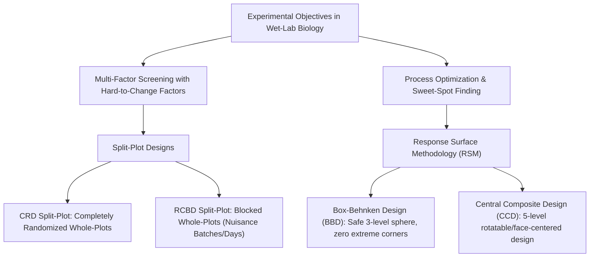
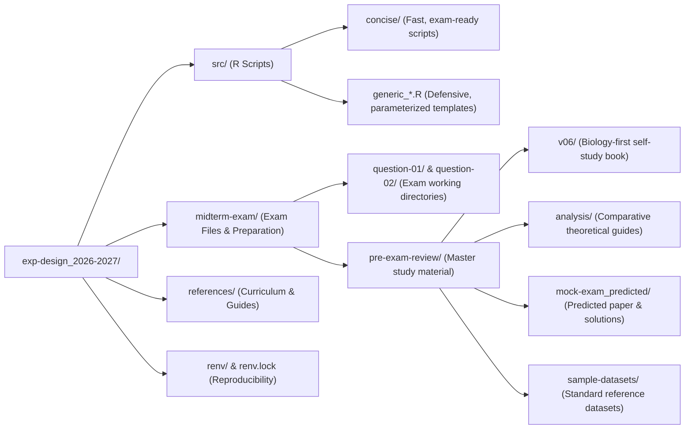

# BT317IU: Experimental Design & Biostatistics (2026–2027)

A comprehensive codebase and study repository for undergraduate **Experimental Design & Biostatistics (BT317IU)**. Designed for biomedical, bioinformatics, and wet-lab researchers, this repository bridges theoretical statistical design with practical, reproducible data analysis in **R** and spreadsheet environments.

---

## 🔬 Course & Experimental Design Focus

Wet-lab biological systems (bioreactors, enzymatic assays, fermentation, cell cultures) present constraints that violate classical standard ANOVA assumptions:
*   **Logistical Constraints:** Some physical knobs (e.g., incubation temperature, main vat, pasture) are difficult or costly to reset between runs, necessitating **Split-Plot Designs**.
*   **Non-Linear Biological Sweet Spots:** Living organisms and enzymes exhibit non-monotonic responses (rising activity until thermal denaturation/inhibition causes sharp declines), requiring curved **Response Surface Methodology (RSM)** rather than simple linear models.



---

## 📁 Repository Structure



### Detailed Component Overview

| Directory / File | Description | Focus & Contents |
| :--- | :--- | :--- |
| **[`src/concise/`](src/concise/)** | High-efficiency R scripts | Streamlined scripts (`crd.R`, `rcbd.R`, `bbd.R`, `ccd.R`) tailored for minimal lines of code, rapid execution, and clear terminal outputs. |
| **[`src/`](src/)** | Generic analysis scripts | Full-featured, parameterized pipelines (`generic_bbd-analysis.R`, `generic_ccd-analysis.R`, `generic_crd-split-plot-analysis.R`, `generic_rcbd-split-plot-analysis.R`, and `dr-khoi_bbd.R`). |
| **[`midterm-exam/`](midterm-exam/)** | Exam materials & workspace | Live working questions (`question-01/` Split-Plot, `question-02/` BBD RSM) and previous review folders. |
| **[`midterm-exam/pre-exam-review/v06/`](midterm-exam/pre-exam-review/v06/)** | Master Self-Study Book (v06) | 7-part plain-English study guide translating complex biostatistical formulas into wet-lab biological intuition. |
| **[`midterm-exam/pre-exam-review/analysis/`](midterm-exam/pre-exam-review/analysis/)** | In-depth technical guides | Detailed comparisons (BBD vs. CCD, CRD vs. RCBD split-plots, second-order coefficient interpretations, 2022 exam solutions). |
| **[`midterm-exam/pre-exam-review/mock-exam_predicted/`](midterm-exam/pre-exam-review/mock-exam_predicted/)** | Mock exam suite | Predicted exam papers, mock CSV datasets, and fully annotated model solutions. |
| **[`midterm-exam/pre-exam-review/sample-datasets/`](midterm-exam/pre-exam-review/sample-datasets/)** | Benchmark datasets | Reference datasets and metadata for BBD, CCD, CRD, and RCBD split-plots. |
| **[`references/`](references/)** | Primary source references | Course syllabus, Russell Lenth's `rsm` documentation, and split-plot instructional papers. |
| **[`renv.lock`](renv.lock)** | Package lockfile | R environment dependency state managed via `renv`. |

---

## 🧪 Experimental Design Archetypes

### 1. Split-Plot Designs (CRD vs. RCBD)
When a factor is hard to change (Whole-Plot factor, e.g., temperature in large incubators or pasture plots), multiple easy-to-change factor levels (Subplots, e.g., formulation, mineral feed) are nested inside each whole-plot unit.

| Design Attribute | CRD Split-Plot | RCBD Split-Plot |
| :--- | :--- | :--- |
| **Whole-Plot Randomization** | Completely randomized to experimental units | Restricted within homogenous blocks (batches, days, animal litters) |
| **Error Strata** | 2 strata: Whole-Plot Unit Error and Subplot Error | 3 strata: Block, Whole-Plot Error (`Block:WP`), Subplot Error |
| **R Formula Syntax** | `aov(y ~ wp * sp + Error(unit), data = dat)` | `aov(y ~ wp * sp + Error(block / wp), data = dat)` |
| **Key Significance Test** | $F_{WP} = \frac{MS_{WP}}{MS_{\text{WP Error}}}$ | $F_{WP} = \frac{MS_{WP}}{MS_{\text{Block:WP}}}$ |
| **Primary Script** | [`src/concise/crd.R`](src/concise/crd.R) | [`src/concise/rcbd.R`](src/concise/rcbd.R) |

### 2. Response Surface Methodology (BBD vs. CCD)
Used for modeling continuous quadratic curvature and locating optimal biological yields ($y_{\max}$).

| Feature | Box-Behnken Design (BBD) | Central Composite Design (CCD) |
| :--- | :--- | :--- |
| **Number of Levels** | 3 levels ($-1, 0, +1$) | 5 levels ($-\alpha, -1, 0, +1, +\alpha$) |
| **Geometric Geometry** | Factorial edge midpoints + center points | Factorial cube corners + axial star points + center points |
| **Extreme Corner Runs** | None (spherical design; avoids combined extremes) | Yes (full corner combinations tested) |
| **Biological Fit** | Ideal for fragile enzymes/cells prone to denaturing | Ideal when factor boundaries are wide and safe to explore |
| **Total Runs ($k=3$)** | 15 runs (12 edges + 3 center replicates) | 20 runs (8 factorial + 6 star + 6 center replicates) |
| **Primary Script** | [`src/concise/bbd.R`](src/concise/bbd.R) | [`src/concise/ccd.R`](src/concise/ccd.R) |

---

## 🚀 Environment Setup & Usage

### 1. R Environment (`renv`)
All packages (including `rsm`, `tidyverse`, and base dependencies) are managed with `renv` to guarantee reproducible execution.

```bash
# Restore project dependencies
Rscript -e "renv::restore()"
```

### 2. Running Concise Exam Scripts
The concise scripts automatically process a `data.csv` placed in the current directory or specified path:

```bash
# Split-plot analysis (CRD)
Rscript src/concise/crd.R

# Split-plot analysis (RCBD with blocks)
Rscript src/concise/rcbd.R

# Box-Behnken RSM analysis
Rscript src/concise/bbd.R

# Central Composite RSM analysis
Rscript src/concise/ccd.R
```

### 3. Understanding RSM Script Outputs
When running [`bbd.R`](src/concise/bbd.R) or [`ccd.R`](src/concise/ccd.R), the output produces eight diagnostic sections:
1.  **Input Data & Factor Coding:** Validates continuous conversion:
    $$x_i = \frac{X_i - \text{Midpoint}}{\text{Step}}$$
2.  **Second-Order Model Coefficients:** Identifies linear direction, quadratic curvature, and pairwise interactions.
3.  **ANOVA Decomposition:** Tests First-Order (FO), Two-Way Interaction (TWI), and Pure Quadratic (PQ) contributions.
4.  **Lack-of-Fit Diagnostic:** Tests model adequacy against pure experimental error. Desired result: $p > 0.05$ (Fail to reject $H_0$; model fits well).
5.  **Stationary Point ($\mathbf{x}_0$):** Coded coordinates of the critical point ($\mathbf{x}_0 = -\frac{1}{2} \mathbf{B}^{-1} \mathbf{b}$).
6.  **Physical Decoding:** Translates coded $\mathbf{x}_0$ back into natural bench units (°C, mg/mL, minutes).
7.  **Canonical Eigenanalysis:** Evaluates the signs of eigenvalues ($\lambda_i$):
    *   **All negative ($\lambda_i < 0$):** Unique Local Maximum (Optimum Peak).
    *   **All positive ($\lambda_i > 0$):** Unique Local Minimum (Valley).
    *   **Mixed signs:** Saddle Point (Minimax surface).
8.  **Predicted Response:** Estimated yield at the stationary point ($y_{\text{opt}}$).

---

## 📖 Master Study Guide Navigation (`v06`)

For structured study, follow the sequence in [`midterm-exam/pre-exam-review/v06/`](midterm-exam/pre-exam-review/v06/):

| Chapter | Document | Core Topic |
| :--- | :--- | :--- |
| **00** | [`00_biostats_crash_course.md`](midterm-exam/pre-exam-review/v06/00_biostats_crash_course.md) | Variance, Sum of Squares, degrees of freedom, $F$-ratio, and $p$-values explained for wet-lab scientists without math jargon. |
| **01** | [`01_split_plot_design_and_analysis.md`](midterm-exam/pre-exam-review/v06/01_split_plot_design_and_analysis.md) | Split-Plot logic, ANOVA error strata breakdown, Excel ToolPak workflow, and the Base R equivalent. |
| **02** | [`02_rsm_ccd_bbd.md`](midterm-exam/pre-exam-review/v06/02_rsm_ccd_bbd.md) | Intuitive curvature explanation, 3-point bench coding dial, BBD vs. CCD safety, Lack of Fit, and eigenvalue sign rules. |
| **03** | [`03_question1_split_plot_exam_practice.md`](midterm-exam/pre-exam-review/v06/03_question1_split_plot_exam_practice.md) | Full 50-point practice problem for Split-Plot design (Bioreactor mAb production) with dual Excel and R solutions. |
| **04** | [`04_question2_rsm_exam_practice.md`](midterm-exam/pre-exam-review/v06/04_question2_rsm_exam_practice.md) | Full 50-point practice problem for BBD optimization (Enzymatic cell lysis) solved using `rsm`. |
| **05** | [`05_a4_cheat_sheet_handwritten_guide.md`](midterm-exam/pre-exam-review/v06/05_a4_cheat_sheet_handwritten_guide.md) | High-density 2-page handwritten cheat sheet layout for exam preparation. |
| **06** | [`06_midterm_scripts-guide.md`](midterm-exam/pre-exam-review/v06/06_midterm_scripts-guide.md) | Quick operational execution guide for running and troubleshooting scripts in terminal environments. |

---

## 📋 Coding Conventions & Guidelines

*   **R Language:** Clear, readable Base R and standard libraries (`tidyverse`, `rsm`). Avoid complex abstractions or non-standard external packages.
*   **Indentation:** 4 spaces throughout scripts and documentation.
*   **Diagrams & Visuals:** Obsidian-compatible Mermaid flowcharts and standard Markdown tables for biological readability.
*   **Data File Formats:** UTF-8 CSV datasets formatted with clean, trimmed column headers.
