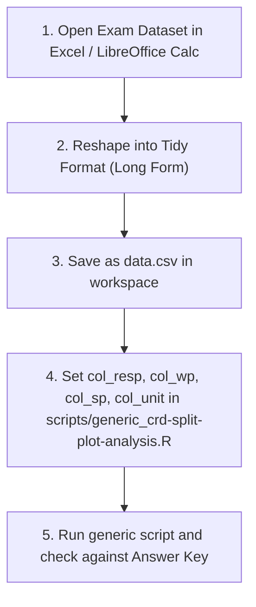

# CRD Split-Plot Practice Problems (Exam-Format Datasets)

This directory contains three raw, wide-format practice datasets simulating real-world biomedical split-plot exam questions.

---

## Practice Workflow

---

## Problem 1: Enzyme Digestion Yield (Case A – Minimal Table)

* **Raw Data File:** [`examples/case_a_exam_data.csv`](file:///home/ht2905/projects/exp-design_2026-2027/examples/case_a_exam_data.csv)
* **Biological Scenario:** A protein biochemistry lab tests two **Incubation Temperatures** (`37C` vs `45C`) and four **Enzyme Concentrations** (`1x`, `2x`, `5x`, `10x`) on **Protein Yield** ($\text{mg/mL}$). Six independent reaction flasks (3 per temperature) were incubated, and aliquots from each flask were treated with the four enzyme concentrations.
* **Exam Paper Layout (Wide Grid, No Vessel Labels):**

| temperature | conc_1x | conc_2x | conc_5x | conc_10x |
| :---: | :---: | :---: | :---: | :---: |
| 37C | 25.25 | 28.93 | 35.11 | 37.25 |
| 37C | 22.01 | 27.50 | 29.62 | 34.00 |
| 37C | 22.49 | 27.83 | 31.88 | 33.82 |
| 45C | 26.50 | 33.94 | 37.50 | 40.07 |
| 45C | 27.73 | 33.50 | 38.67 | 40.65 |
| 45C | 26.85 | 30.60 | 36.85 | 39.68 |

### Student Practice Task
1. Reshape the 6 rows $\times$ 4 concentration columns into a 24-row tidy CSV with 3 columns: `temperature`, `conc`, `protein_yield`.
2. Configure [`scripts/generic_crd-split-plot-analysis.R`](file:///home/ht2905/projects/exp-design_2026-2027/scripts/generic_crd-split-plot-analysis.R):
   - `col_resp <- "protein_yield"`
   - `col_wp <- "temperature"`
   - `col_sp <- "conc"`
   - `col_unit <- NULL`
3. Run the script and compare against the Answer Key below.

### Answer Key (Problem 1)

| Stratum | Source of Variation | Df | Sum of Squares (SS) | Mean Square (MS) | F Value | p-value |
| :--- | :--- | :---: | :---: | :---: | :---: | :---: |
| **Whole-Plot Unit** | `temperature` | 1 | 134.66 | 134.66 | 17.72 | 0.0136 |
| **Whole-Plot Unit** | Residuals (WP Error) | 4 | 30.39 | 7.60 | — | — |
| **Within (Subplot)** | `conc` | 3 | 536.70 | 178.89 | 236.12 | 6.22e-11 |
| **Within (Subplot)** | `temperature:conc` | 3 | 2.40 | 0.81 | 1.07 | 0.399 |
| **Within (Subplot)** | Residuals (SP Error) | 12 | 9.10 | 0.76 | — | — |

---

## Problem 2: Mammalian Cell Viability (Case B – Replicates Repeated)

* **Raw Data File:** [`examples/case_b_exam_data.csv`](file:///home/ht2905/projects/exp-design_2026-2027/examples/case_b_exam_data.csv)
* **Biological Scenario:** A tissue engineering group evaluates **Basal Media Formulation** (`DMEM` vs `RPMI`) and **Serum Supplementation Level** (`0%`, `2%`, `5%`, `10%`) on **Cell Viability** ($\%$). For each media formulation, 3 cell culture batches were prepared (labeled Replicates 1, 2, 3), and each batch was sub-cultured into 4 serum concentrations.
* **Exam Paper Layout (Wide Grid with Repeated Replicate Numbers):**

| media | replicate | serum_0pct | serum_2pct | serum_5pct | serum_10pct |
| :---: | :---: | :---: | :---: | :---: | :---: |
| DMEM | 1 | 59.5 | 73.0 | 84.9 | 86.3 |
| DMEM | 2 | 57.2 | 73.5 | 79.0 | 84.0 |
| DMEM | 3 | 55.7 | 71.7 | 80.3 | 81.4 |
| RPMI | 1 | 54.6 | 74.0 | 81.8 | 83.9 |
| RPMI | 2 | 59.2 | 71.7 | 82.4 | 86.0 |
| RPMI | 3 | 57.4 | 70.8 | 81.3 | 86.4 |

### Student Practice Task
1. Reshape into a 24-row tidy CSV with 4 columns: `media`, `replicate`, `serum`, `viability`.
2. Configure [`scripts/generic_crd-split-plot-analysis.R`](file:///home/ht2905/projects/exp-design_2026-2027/scripts/generic_crd-split-plot-analysis.R):
   - `col_resp <- "viability"`
   - `col_wp <- "media"`
   - `col_sp <- "serum"`
   - `col_unit <- "replicate"`
3. Run the script and observe that the script's automatic guard keeps Whole-Plot Error at $4$ Df.

### Answer Key (Problem 2)

| Stratum | Source of Variation | Df | Sum of Squares (SS) | Mean Square (MS) | F Value | p-value |
| :--- | :--- | :---: | :---: | :---: | :---: | :---: |
| **Whole-Plot Unit** | `media` | 1 | 12.91 | 12.91 | 0.822 | 0.416 |
| **Whole-Plot Unit** | Residuals (WP Error) | 4 | 62.83 | 15.71 | — | — |
| **Within (Subplot)** | `serum` | 3 | 2813.50 | 937.80 | 493.13 | 7.93e-13 |
| **Within (Subplot)** | `media:serum` | 3 | 6.20 | 2.10 | 1.085 | 0.393 |
| **Within (Subplot)** | Residuals (SP Error) | 12 | 22.80 | 1.90 | — | — |

---

## Problem 3: Bacterial Bioreactor Optimization (Case C – Explicit Vessel Labels)

* **Raw Data File:** [`examples/case_c_exam_data.csv`](file:///home/ht2905/projects/exp-design_2026-2027/examples/case_c_exam_data.csv)
* **Biological Scenario:** A microbial fermentation facility optimizes biomass density ($\text{OD}_{600}$) across 6 numbered pilot bioreactors (`Tank_1` through `Tank_6`). Three tanks were randomly assigned to **Dissolved Oxygen Control** `DO_Low` and three tanks to `DO_High`. Samples from each bioreactor were split into shake flasks containing three **Carbon Sources** (`glucose`, `glycerol`, `sucrose`).
* **Exam Paper Layout (Wide Grid with Explicit Tank Labels):**

| bioreactor | dissolved_oxygen | glucose | glycerol | sucrose |
| :---: | :---: | :---: | :---: | :---: |
| Tank_1 | DO_Low | 8.34 | 11.42 | 7.07 |
| Tank_2 | DO_Low | 8.94 | 11.03 | 7.11 |
| Tank_3 | DO_Low | 9.21 | 11.38 | 7.25 |
| Tank_4 | DO_High | 14.05 | 16.93 | 12.51 |
| Tank_5 | DO_High | 11.76 | 14.48 | 11.22 |
| Tank_6 | DO_High | 13.85 | 16.58 | 12.19 |

### Student Practice Task
1. Reshape the 6 rows $\times$ 3 carbon sources into an 18-row tidy CSV with 4 columns: `bioreactor`, `dissolved_oxygen`, `carbon`, `od600`.
2. Configure [`scripts/generic_crd-split-plot-analysis.R`](file:///home/ht2905/projects/exp-design_2026-2027/scripts/generic_crd-split-plot-analysis.R):
   - `col_resp <- "od600"`
   - `col_wp <- "dissolved_oxygen"`
   - `col_sp <- "carbon"`
   - `col_unit <- "bioreactor"`
3. Run the script and extract tank means directly from `=== Whole-Plot Unit Means ===`.

### Answer Key (Problem 3)

| Stratum | Source of Variation | Df | Sum of Squares (SS) | Mean Square (MS) | F Value | p-value |
| :--- | :--- | :---: | :---: | :---: | :---: | :---: |
| **Whole-Plot Unit** | `dissolved_oxygen` | 1 | 97.16 | 97.16 | 53.48 | 0.00186 |
| **Whole-Plot Unit** | Residuals (WP Error) | 4 | 7.27 | 1.82 | — | — |
| **Within (Subplot)** | `carbon` | 2 | 51.21 | 25.605 | 235.18 | 7.82e-08 |
| **Within (Subplot)** | `dissolved_oxygen:carbon` | 2 | 0.16 | 0.079 | 0.722 | 0.515 |
| **Within (Subplot)** | Residuals (SP Error) | 8 | 0.87 | 0.109 | — | — |
