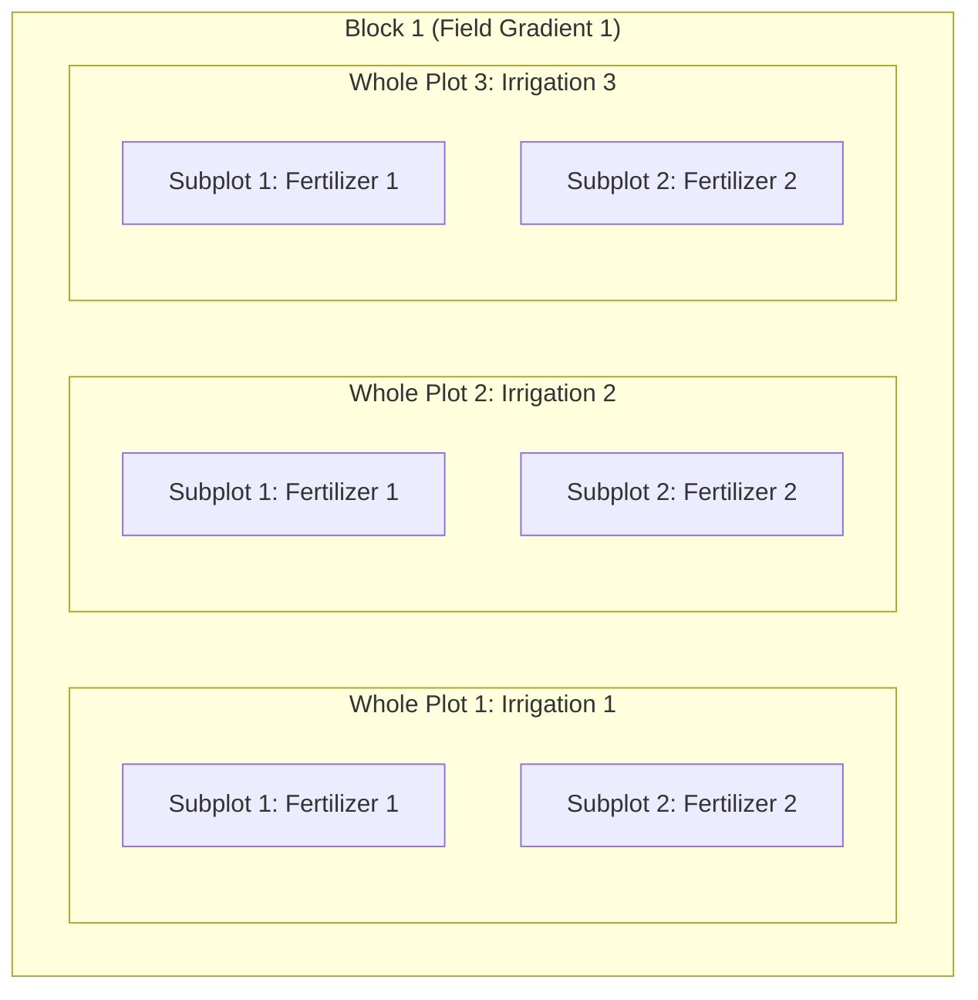

# A Layman's Guide to Experimental Design: Blocking, CRD, RCBD, and Split-Plot

> **The Golden Rule of Experimental Design:**  
> *"Block what you can control, and randomize what you cannot."*

---

## 1. The Core Problem in Wet-Lab Science: Signal vs. Noise

Imagine you are testing a new plant growth nutrient. You want to see if your nutrient (**the Signal**) genuinely makes plants grow taller.

In a textbook math world, every single plant would be an exact clone, the soil would be 100% identical everywhere, the sunlight would be completely uniform, and the temperature would never fluctuate.

In the real wet lab (or greenhouse/field), biology is messy:
- The soil at the north end of the field is damper than the south end.
- The top shelf of your incubator is 1.5°C warmer than the bottom shelf.
- Experiment Day 1 was run by Alice; Experiment Day 2 was run by Bob.
- Cell batch A came from a frozen vial thawed on Monday; batch B came from Wednesday.

All of these external nuisances create **background noise** (experimental error). If the noise is too loud, it will drown out your true biological effect. Even worse, if you accidentally put all your treated plants on the sunny shelf and all your control plants on the shady shelf, you won't know if the plants grew because of your nutrient or because of the sun (**confounding**).

To solve this, statisticians invented structured designs: **CRD**, **RCBD**, and **Split-Plot**.

---

## 2. What is "Blocking"?

**Blocking** is simply grouping similar experimental units together to isolate known, predictable differences.

Think of a "block" as a shield. When you know an unwanted factor will cause variation (like 4 different days of lab work, or 4 different litters of mice, or 4 different field locations), you group your experiment into 4 blocks.

### Why do we do this?
When you analyze your data with ANOVA, the total variation is split into pieces:
$$\text{Total Variation} = \text{Treatment Effect} + \text{Unexplained Error}$$

If you **don't** block:
- All the day-to-day or location-to-location noise gets dumped into **Unexplained Error**.
- The error term becomes huge.
- Your $F$-statistic ($\frac{\text{Treatment}}{\text{Error}}$) shrinks, making your p-value large and insignificant. You miss real discoveries (Type II error).

If you **do** block:
- The variation caused by the blocks is measured separately ($\text{SS}_{\text{Block}}$) and **subtracted out** from the error pool:
$$\text{Total Variation} = \text{Treatment Effect} + \text{Block Effect} + \text{Residual Error}$$
- Your **Residual Error** shrinks dramatically.
- Your test for the treatment becomes much more sensitive and statistically powerful.

---

## 3. The Core Designs Explained in Plain English

### A. CRD: Completely Randomized Design
- **The Concept:** A free-for-all lottery. Every experimental unit has an equal chance of receiving any treatment.
- **Example:** You have 24 petri dishes with identical media from the same batch placed in the exact same incubator. You randomly assign 12 dishes to Drug A and 12 dishes to Control using a coin flip.
- **When to use it:** When your experimental units and environment are **homogeneous** (practically identical).
- **Pros:** Maximum degrees of freedom for error; simplest math.
- **Cons:** If there *is* an environmental gradient (e.g., edge effects in a 96-well plate or light gradients on a bench), CRD fails because that gradient inflates the error.

```text
[ CRD: Complete Randomization ]
Dish:   1   2   3   4   5   6   7   8  ... 24
Drug:   A   B   B   A   A   B   A   B  ... (Completely random)
```

---

### B. RCBD: Randomized Complete Block Design (also called CRBD)
*(Note: Students and papers sometimes say **CRBD**—"Completely Randomized Block Design". In standard textbooks, this is formally called **RCBD**—"Randomized Complete Block Design". They refer to the exact same design.)*

Let's break down the three words:
1. **Block:** You divide your experimental units into groups (blocks) where units inside the same block are as similar as possible.
2. **Complete:** Every single treatment appears at least once inside **every** block.
3. **Randomized:** Within each block, treatments are assigned to positions/units in random order.

#### Wet-Lab Example:
You want to test 3 different cell media formulations (M1, M2, M3).
Because you can only prep one batch of cells per day, you repeat the experiment over 4 separate days:
- **Block 1 (Monday):** Run M1, M2, M3 in random order.
- **Block 2 (Tuesday):** Run M1, M2, M3 in random order.
- **Block 3 (Wednesday):** Run M1, M2, M3 in random order.
- **Block 4 (Thursday):** Run M1, M2, M3 in random order.

```text
[ RCBD Structure ]
Block 1 (Day 1):  [ M2 ]  [ M1 ]  [ M3 ]   <- Treatments randomized within Day 1
Block 2 (Day 2):  [ M3 ]  [ M2 ]  [ M1 ]   <- Treatments randomized within Day 2
Block 3 (Day 3):  [ M1 ]  [ M3 ]  [ M2 ]   <- Treatments randomized within Day 3
Block 4 (Day 4):  [ M2 ]  [ M3 ]  [ M1 ]   <- Treatments randomized within Day 4
```

Any day-to-day differences (humidity, pipette calibration, cell passage differences) are captured cleanly by the "Block" factor and removed from the residual error!

---

### C. Other Common Designs ("And So On")

1. **Latin Square Design (Two Nuisance Factors):**
   - What if you have *two* sources of nuisance noise at once?
   - *Example:* You are testing 4 treatments, but variation comes from both **Day of the week (4 days)** and **Technician (4 operators)**.
   - A Latin Square arranges treatments like a Sudoku puzzle: every treatment appears exactly once in each row (Day) and once in each column (Technician).

2. **BIBD: Balanced Incomplete Block Design:**
   - What if your block is too small to fit every treatment?
   - *Example:* You want to compare 4 drugs, but each mouse litter only has 3 pups. You can't run a "Complete" block. A BIBD carefully balances which pairs of drugs appear together across litters so the comparison remains fair.

---

## 4. Connecting to Exercise 01: What is a Split-Plot Design?

Now, look at your actual lab data in `exercise-01`:
- You have **Irrigation** (3 types)
- You have **Fertilizer** (2 types)
- You have **4 Blocks**

Why can't you just run this as a regular RCBD with $3 \times 2 = 6$ treatment combinations in each block?

### The "Hard-to-Change" (HTC) Dilemma
Imagine setting up irrigation pipes in a field or greenhouse:
- You cannot irrigate Plant #1 with Drip, Plant #2 with Sprinkler, and Plant #3 with Flood if they are right next to each other. Irrigation requires plumbing an entire plot of land! It is **Hard to Change**.
- Applying fertilizer, however, is easy: you just sprinkle Fertilizer 1 on one half of the plot and Fertilizer 2 on the other half. Fertilizer is **Easy to Change**.

This physical restriction creates a **Split-Plot Design**:
1. **Whole Plot:** A large section receiving one Irrigation type.
2. **Subplot:** That large section is *split* into smaller patches to receive different Fertilizers.



### Why Split-Plot Requires Two Error Terms
Because there are two different sizes of experimental units, there are two distinct levels of noise:
1. **Whole-Plot Level (Between Irrigation Plots):**
   - Noise between whole plots is large (soil differences between entire plots, irrigation pump fluctuations).
   - `irrigation` is tested against **Whole-Plot Error** (`block:irrigation`, $df = 6$).
2. **Subplot Level (Within Irrigation Plots):**
   - Subplots sitting right next to each other inside the same irrigation plot share the exact same soil and water conditions. The noise between them is much smaller!
   - `fertilizer` and the `irrigation:fertilizer` interaction are tested against **Subplot Error** (`Within`, $df = 9$).

If you ignored this and ran a regular Two-Way ANOVA, you would test Irrigation against the tiny subplot error, resulting in an artificially inflated $F$-statistic and false positives (**Type I error**).

---

## 5. Summary Cheat Sheet

| Design | Key Feature | Best Used When... | Practical Example |
| :--- | :--- | :--- | :--- |
| **CRD** *(Completely Randomized)* | No grouping. Pure lottery. | Experimental units and environment are completely uniform. | Cell culture flasks from 1 batch placed randomly in 1 incubator. |
| **RCBD** *(Randomized Complete Block)* | Units grouped into blocks; all treatments appear in each block. | One primary nuisance factor or gradient exists. | Testing 3 media recipes across 4 different days or 4 mouse litters. |
| **Latin Square** | Two blocking factors simultaneously (Rows & Columns). | Two known nuisance gradients exist. | 4 treatments tested across 4 Days (rows) and 4 Technicians (cols). |
| **Split-Plot (in RCBD)** | Two sizes of units (Whole-plot and Subplot) because one factor is hard to change. | One factor is bulky/slow to adjust, while the second factor is easy to adjust. | Irrigation (whole plot) + Fertilizer (subplot) across 4 field blocks. |

