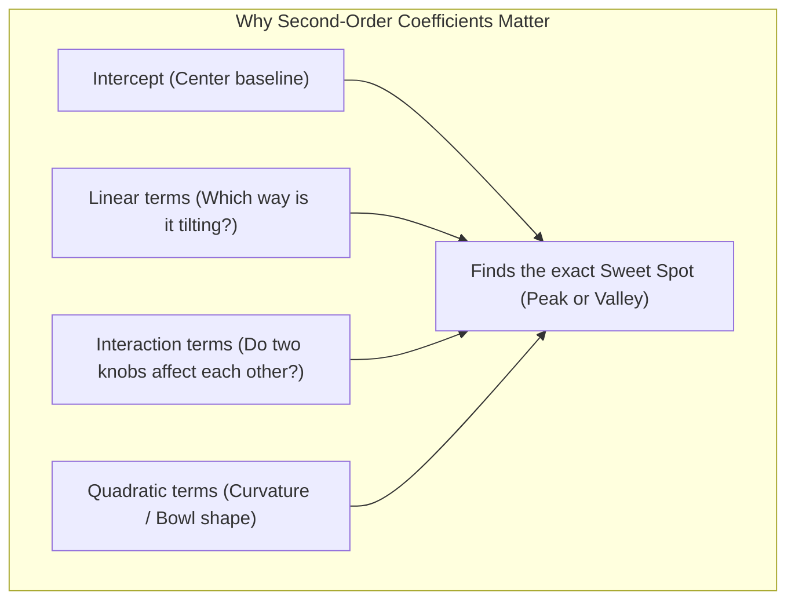

The updated, equation-light guide has been written to [artifacts/experimental_design_guide.md](file:///home/ht2905/projects/exp-design_2026-2027/artifacts/experimental_design_guide.md).

Here are the direct answers to your questions in plain English:

---

### 1. What Are Second-Order Model Coefficients & Why Do You Care?

Imagine you are adjusting oven temperature to bake bread:
* A **first-order (linear)** model is just a **straight line** ($y = mx + b$). A straight line can only tell you if output goes continuously up or down. It assumes that if you raise temperature to $500^\circ\text{C}$, the bread will just be infinitely better. **A straight line has no peak and no valley.**
* In reality, if it's too cold the dough stays raw; if it's too hot the bread burns. There is a **sweet spot in the middle**.

A **second-order model** creates a **curved surface (a bowl or a hill)**. The coefficients tell you the exact shape of that surface:

| Coefficient Type | Plain English Meaning | Why You Care |
|---|---|---|
| **Intercept** | The baseline performance when all dials are at the center ($0, 0, 0$). | Gives your benchmark starting point. |
| **Linear Terms** (`x1`, `x2`, `x3`) | The general slope near the center. Positive means turning the dial up increases response; negative means it decreases it. | Tells you which direction to push each dial. |
| **Interaction Terms** (`x1:x2`) | Synergy between knobs. Does the effect of temperature depend on how much enzyme you add? | Prevents optimizing one dial in isolation when two knobs influence each other. |
| **Quadratic Terms** (`x1^2`, `x2^2`) | **Curvature (the bowl shape)**. • **Negative values** mean an upside-down bowl (a **Peak / Maximum**). • **Positive values** mean an upright bowl (a **Valley / Minimum**). | **Most critical for optimization.** Confirms that a true maximum or minimum exists inside your experimental range. |

---

### 2. Quick Rule-of-Thumb for Reading Any Output

* **In ANOVA tables ([`crd.R`](file:///home/ht2905/projects/exp-design_2026-2027/src/concise/crd.R) & [`rcbd.R`](file:///home/ht2905/projects/exp-design_2026-2027/src/concise/rcbd.R)):**
  * Look at `Pr(>F)` ($p$-value).
  * If **$p < 0.05$**: The factor has a **real, statistically significant effect** (it matters).
  * If **$p > 0.05$**: The factor has **no significant effect** (it's just random noise).
* **In Response Surface tables ([`bbd.R`](file:///home/ht2905/projects/exp-design_2026-2027/src/concise/bbd.R) & [`ccd.R`](file:///home/ht2905/projects/exp-design_2026-2027/src/concise/ccd.R)):**
  * **Lack of Fit**: You want **$p > 0.05$** (Good news! The model fits well and is not missing curvature).
  * **Distance $\|\mathbf{x}_0\|$**: You want **$\le 1.0$** (for BBD) or **$\le 1.682$** (for CCD) (The sweet spot is inside your tested range, not an unsafe extrapolation).
  * **Topology**: "Unique Local Maximum" means a true peak.

---

### 3. How to Answer the Midterm Exam 2022 Questions

Complete model answers for [`references/midterm-exam_2022.pdf`](file:///home/ht2905/projects/exp-design_2026-2027/midterm-review/references/midterm-exam_2022.pdf):

#### Problem 1: Pasture and Mineral Trial on Milk Yield (50 pts)

* **1a. Design & Hypotheses (10 pts)**
  * **Design:** **Split-Plot in a Randomized Complete Block Design (RCBD)**.
    * Blocks = 3 Seasons (nuisance factor).
    * Whole-Plot = 4 Pastures.
    * Subplot = 2 Minerals.
  * **Hypotheses:**
    1. *Pasture ($H_0$):* All 4 pastures produce equal mean milk yield vs *($H_1$):* At least one pasture differs.
    2. *Mineral ($H_0$):* Both minerals produce equal mean milk yield vs *($H_1$):* Mineral yields differ.
    3. *Interaction ($H_0$):* Pasture and Mineral do not interact vs *($H_1$):* Pasture effect depends on the mineral.
* **1b. Hard vs Easy Factor (10 pts)**
  * **Hard-to-Change (Whole-Plot):** **Pasture**. Fencing and maintaining entire grazing plots for cow herds is labor-intensive and costly; you cannot easily switch pastures cow-by-cow.
  * **Easy-to-Change (Subplot):** **Mineral Supplement**. Fed directly in individual troughs within each pasture plot.
* **1c. Number of Actual Factors (10 pts)**
  * **3 factors total:** Season (Blocking factor, 3 levels), Pasture (Treatment factor, 4 levels), Mineral (Treatment factor, 2 levels).
* **1d. Conclusion on Effects (20 pts)** *(from [`rcbd.R`](file:///home/ht2905/projects/exp-design_2026-2027/src/concise/rcbd.R))*:
  * **Pasture ($p = 0.0178 < 0.05$):** Statistically significant. Pasture 4 gave the highest milk yield (~$34\text{ kg}$).
  * **Mineral ($p = 0.0497 < 0.05$):** Statistically significant. Mineral 2 outperforms Mineral 1 (+$1.33\text{ kg}$).
  * **Interaction ($p = 0.2740 > 0.05$):** Not significant. Pasture and mineral act additively.
  * **Recommendation:** Farmers should use **Pasture 4 with Mineral 2** to maximize milk production. *(Note: Row 20's $3\text{ kg}$ was an exam typo for $33\text{ kg}$).*

---

#### Problem 2: Box-Behnken Process Optimization (50 pts)

* **2a. Designing Process (15 pts)**
  * **Purpose:** Find the parameter settings ($L, D_{\text{in}}, D_{\text{out}}$) that **minimize the output mass $M$**.
  * **Choosing Levels:** Test each factor at 3 evenly spaced levels: Low ($-1$), Center ($0$), High ($+1$) (e.g. $L = 80, 90, 100\text{ mm}$). Box-Behnken was chosen because it tests edge centers and **avoids extreme corner combinations** (where all dials are pushed to maximum simultaneously), protecting equipment while requiring only 13–15 runs.
  * **Using Data:** Fit a second-order curved surface, calculate the point where slope is zero (stationary point), and verify that all curvatures are positive (creating a valley/minimum).
* **2b. Perform Calculations / Optimized Parameters (25 pts)** *(from [`bbd.R`](file:///home/ht2905/projects/exp-design_2026-2027/src/concise/bbd.R))*:
  1. Fit second-order model $M \sim \text{SO}(x_1, x_2, x_3)$ to obtain coefficients.
  2. Compute stationary point $\mathbf{x}_0$ where slope equals zero.
  3. Verify that eigenvalues are all positive ($\lambda > 0 \implies$ Local Minimum / Valley).
  4. Convert coded dials back to real millimeters using $\text{Setting} = \text{Center} + (x_0 \times \text{Step})$.
* **2c. What is the Last Step in Optimization? (10 pts)**
  * **The Last Step:** **Conduct Confirmation / Validation Runs**.
  * **Why:** The calculated sweet spot is only a statistical prediction. The engineer must set the machine to the calculated optimal dimensions ($L_{\text{opt}}, D_{\text{in, opt}}, D_{\text{out, opt}}$) and run 3–5 real experimental trials in the plant to verify that observed output matches the model's predicted interval before changing production lines.