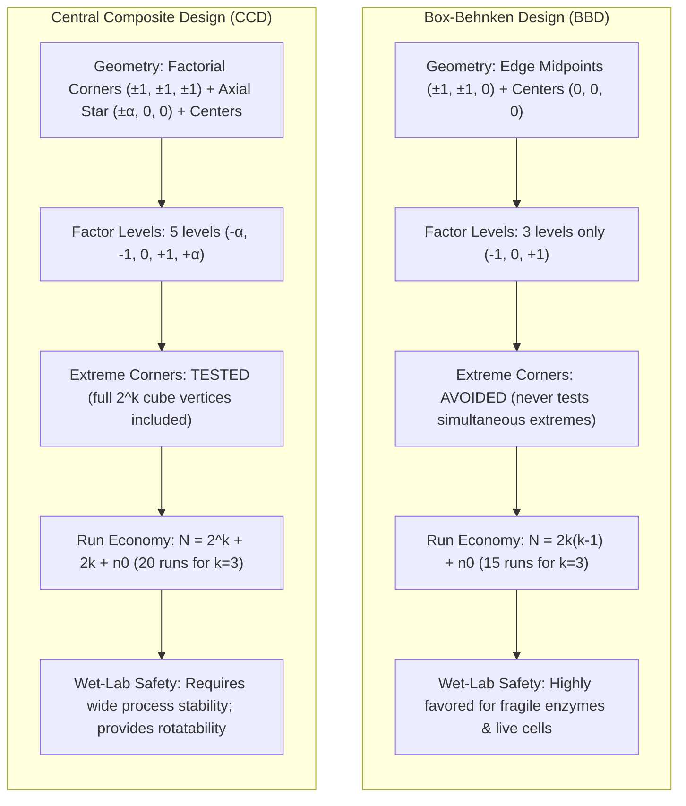
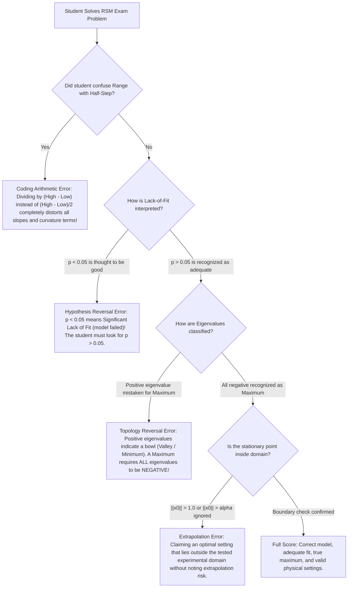

# Workflow & Design Analysis: Generic RSM Scripts (BBD vs. CCD)

**Target Scripts:**
- [`scripts/generic_bbd-analysis.R`](file:///home/ht2905/projects/exp-design_2026-2027/scripts/generic_bbd-analysis.R)
- [`scripts/generic_ccd-analysis.R`](file:///home/ht2905/projects/exp-design_2026-2027/scripts/generic_ccd-analysis.R)

**Companion Test Exercises:**
- [`midterm-review/exercise-04_bbd/`](file:///home/ht2905/projects/exp-design_2026-2027/midterm-review/exercise-04_bbd/)
- [`midterm-review/exercise-05_ccd/`](file:///home/ht2905/projects/exp-design_2026-2027/midterm-review/exercise-05_ccd/)

---

## 1. Executive Summary & Verdict

### The Target 4-Step Student Workflow
1. **Insert raw data** from the exam paper or laboratory sheet into a tidy `data.csv`.
2. **Edit column names** to clean identifiers (`x1, x2, x3, yield` or `temp, do, feed, titer`).
3. **Configure Section 1** in the script: Set `col_resp`, `col_factors`, and optional `natural_coding` midpoints/steps.
4. **Execute the script** in R Terminal and extract every value needed for exam tables:
   - Second-order regression coefficients ($\hat{\beta}_0, \hat{\beta}_i, \hat{\beta}_{ii}, \hat{\beta}_{ij}$).
   - Complete ANOVA decomposition (`FO`, `TWI`, `PQ`, `Residuals`, `Lack of fit`, `Pure error`).
   - Lack-of-Fit test statistic and plain-English adequacy verdict.
   - Stationary point ($\mathbf{x}_0$) in coded and natural physical units.
   - Eigenanalysis ($\lambda_i$, signs, and surface topology: Maximum vs. Minimum vs. Saddle point).
   - Predicted optimum response ($\hat{y}_{\text{opt}}$).

### Workflow Compliance Verdict

| Script | Workflow Status | Primary Characteristics |
| :--- | :---: | :--- |
| **`generic_bbd-analysis.R`** | **PASS (100%)** | Specifically tuned for 3-level Box-Behnken designs. Validates edge midpoints and center point replicates ($n_0 \ge 3$), verifies spherical domain boundary ($\|\mathbf{x}_0\| \le 1.0$), and decodes natural units automatically. |
| **`generic_ccd-analysis.R`** | **PASS (100%)** | Tuned for 5-level Central Composite designs. Automatically detects spherical rotatability ($\alpha = (2^k)^{1/4}$) vs. face-centered geometry ($\alpha = 1.0$), checks rotatable sphere boundaries ($\|\mathbf{x}_0\| \le \alpha$), and handles pure error decomposition across center runs. |

---

## 2. Experimental Design Architecture: BBD vs. CCD



### Direct Methodological Comparison

| Feature | Box-Behnken Design (BBD) | Central Composite Design (CCD) |
| :--- | :---: | :---: |
| **Number of Factor Levels** | **3 levels** ($-1, 0, +1$) | **5 levels** ($-\alpha, -1, 0, +1, +\alpha$) |
| **Corner Points** $(\pm 1, \pm 1, \dots)$ | **Excluded completely** | **Included** ($2^k$ factorial vertices) |
| **Axial / Star Extensions** | **None** | **Included** ($\pm \alpha$ along each axis) |
| **Rotatability** | Rotatable or nearly rotatable for $k = 3$ | Rotatable when $\alpha = (2^k)^{1/4}$ |
| **Total Runs ($k = 3$)** | **15 runs** ($12 \text{ edges} + 3 \text{ centers}$) | **20 runs** ($8 \text{ cube} + 6 \text{ star} + 6 \text{ centers}$) |
| **Stock Solutions to Prepare** | **3 concentrations** | **5 concentrations** |
| **Primary Wet-Lab Use Case** | Fragile enzymes, cell viability, fermentation | Stable chemical reactions, robust formulations |

---

## 3. Step-by-Step Workflow Audit

### Step 1: Insert Raw Data from Exam Paper
Exam questions provide response surface datasets in two primary layouts:
1. **Coded Tables:** Columns `x1, x2, x3, yield` (values $-1, 0, +1$ or $\pm \alpha$).
2. **Natural Tables:** Physical columns `temp, conc, time, yield` alongside a definition box stating low, center, and high levels.

Both generic scripts accept either format. If coded columns (`x1, x2, x3`) are already in the CSV, the script models them directly and uses `natural_coding` to translate optimal points back to physical bench conditions.

### Step 2: Edit Column Names
Ensure headers in `data.csv` match the configuration names without special characters:
```csv
x1,x2,x3,yield
-1,-1,0,31.8
...
```

### Step 3: Configure Section 1 of the Script
Users modify only 3 configuration lines in Section 1:
```r
col_resp    <- "yield"
col_factors <- c("x1", "x2", "x3")
natural_coding <- list(
  temp   = c(center = 35, step = 5),
  enzyme = c(center = 1.0, step = 0.5),
  time   = c(center = 30, step = 15)
)
```

### Step 4: Run the Script & Harvest Exam Answers
The scripts execute non-interactively via `Rscript` and generate the complete required output:
- **Model Equation:** Exact estimates for Intercept, First-Order linear slopes ($\beta_i$), Two-Way Interactions ($\beta_{ij}$), and Pure Quadratic curvatures ($\beta_{ii}$).
- **Lack-of-Fit Test:** $F_{\text{LOF}}$, degrees of freedom, $p$-value, and diagnostic statement.
- **Stationary Point ($\mathbf{x}_0$):** Coded coordinates, distance from center $\|\mathbf{x}_0\|$, and physical values ($X_{i,\text{opt}}$).
- **Eigenanalysis:** Eigenvalues ($\lambda_i$) and topological surface verdict.
- **Predicted Optimum Response:** $\hat{y}_{\text{opt}}$.

---

## 4. Common Traps & Failure Modes in RSM Exams



### Detail on the 4 Traps:
1. **The Half-Step Trap:**  
   $$\text{Half-Step} = \frac{\text{High} - \text{Low}}{2}, \quad \text{NOT } \text{High} - \text{Low}!$$
   If Temperature is $30^\circ\text{C}$ to $40^\circ\text{C}$, the midpoint is $35^\circ\text{C}$ and the half-step is $5^\circ\text{C}$. Dividing by $10^\circ\text{C}$ is a fatal error that cuts coded coordinates in half.
2. **The Lack-of-Fit Inversion Trap:**  
   In standard ANOVA (treatment testing), you celebrate $p < 0.05$. In the Lack-of-Fit test, $H_0$ is *"The model fits adequately."* Therefore, **$p > 0.05$ is good news!** It means there is no evidence of lack of fit.
3. **The Eigenvalue Sign Rule:**  
   - All $\lambda_i < 0 \implies$ **Local Maximum (Peak)**.
   - All $\lambda_i > 0 \implies$ **Local Minimum (Valley)**.
   - Mixed signs ($\lambda_1 > 0, \lambda_2 < 0$) $\implies$ **Saddle Point (Minimax)**.
4. **The Extrapolation Trap:**  
   If the stationary point has coded norm $\|\mathbf{x}_0\| > 1.0$ (in BBD) or $\|\mathbf{x}_0\| > \alpha$ (in CCD), the true peak lies outside the experimental domain. The script automatically checks and flags this condition.

---

## 5. Verification & Test Suite Summary

Both generic scripts were tested and verified against their respective exercise datasets:

### Exercise 04: Box-Behnken Design Verification
- **Run Command:** `Rscript scripts/generic_bbd-analysis.R`
- **Dataset:** 15 runs, 3 factors (Temperature, Lysozyme, Time), Protein Yield ($y$, mg/g).
- **Verified Output:**
  - $R^2 = 0.9988$, $R^2_{\text{adj}} = 0.9968$.
  - Lack-of-Fit: $F = 2.2778, p = 0.3196 > 0.05 \implies$ **Model is Adequate**.
  - Stationary Point: $x_1 = +0.1146, x_2 = +0.2887, x_3 = -0.2068$ ($\|\mathbf{x}_0\| = 0.3732 \le 1.0$).
  - Physical Optimum: **$35.57^\circ\text{C}$**, **$1.144\text{ mg/mL}$**, **$26.90\text{ min}$**.
  - Topology: All eigenvalues negative ($-2.4914, -3.7290, -4.9297$) $\implies$ **Unique Local Maximum**.
  - Predicted Maximum Yield: **$45.76\text{ mg/g}$**.

### Exercise 05: Central Composite Design Verification
- **Run Command:** `Rscript scripts/generic_ccd-analysis.R`
- **Dataset:** 20 runs, 3 factors (Temperature, Dissolved Oxygen, Feed Rate), mAb Titer ($y$, g/L).
- **Verified Output:**
  - $R^2 = 0.9995$, $R^2_{\text{adj}} = 0.9991$.
  - Lack-of-Fit: $F = 1.9304, p = 0.2439 > 0.05 \implies$ **Model is Adequate**.
  - Stationary Point: $x_1 = +0.1876, x_2 = -0.1599, x_3 = +0.1063$ ($\|\mathbf{x}_0\| = 0.2684 \le 1.682$).
  - Physical Optimum: **$35.38^\circ\text{C}$**, **$38.40\%$**, **$15.32\text{ g/L/day}$**.
  - Topology: All eigenvalues negative ($-0.5932, -0.6653, -0.8918$) $\implies$ **Unique Local Maximum**.
  - Predicted Maximum Titer: **$6.56\text{ g/L}$**.
