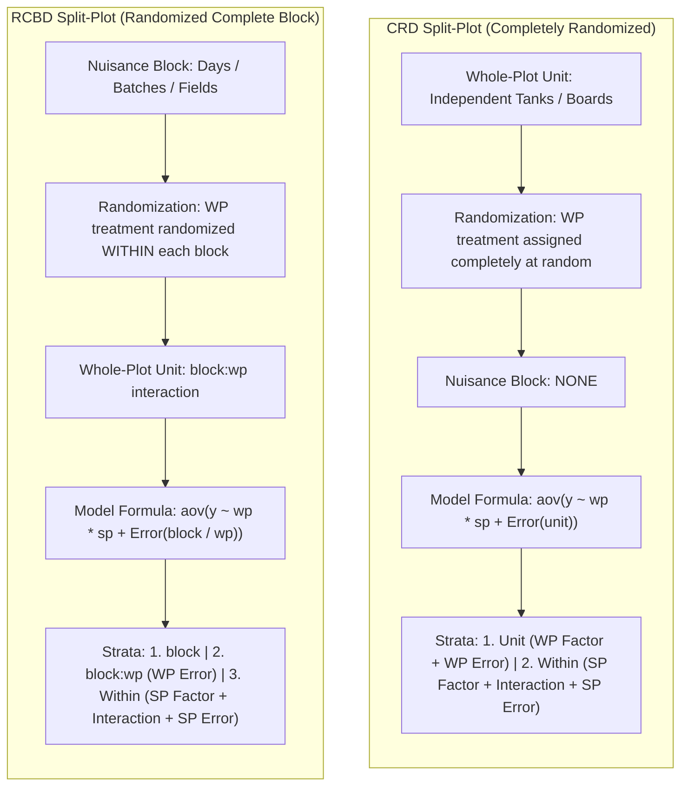
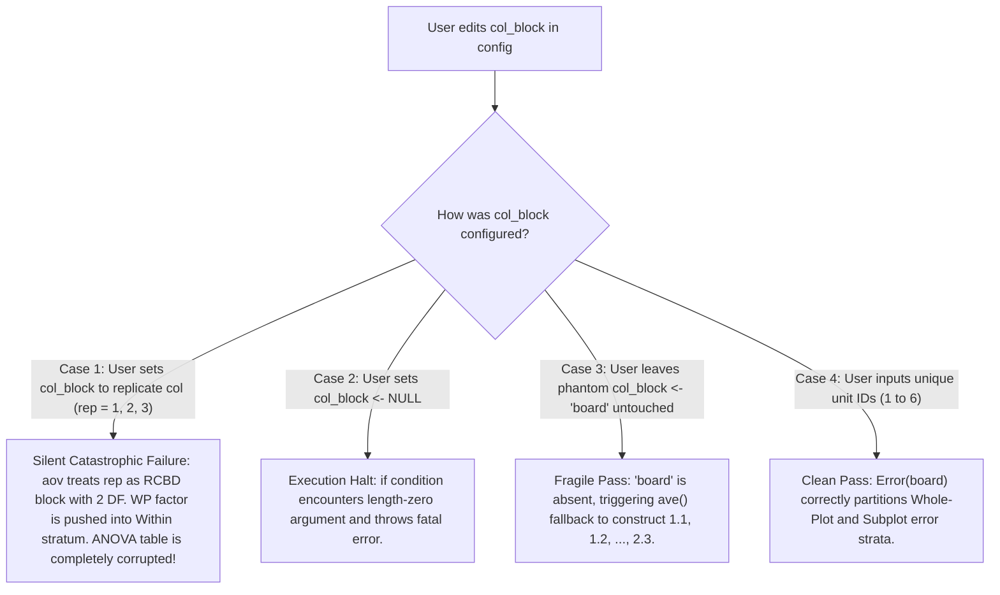
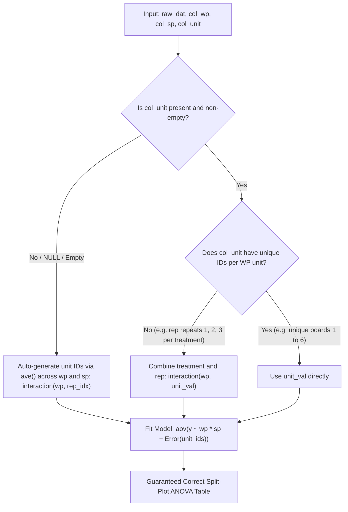
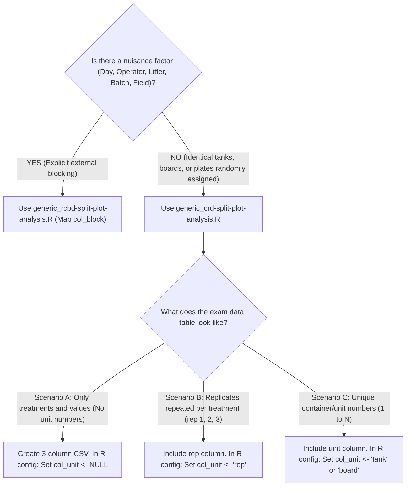

# Workflow & Design Analysis: Generic Split-Plot Scripts

**Target Scripts:**
- [`scripts/generic_crd-split-plot-analysis.R`](file:///home/ht2905/projects/exp-design_2026-2027/scripts/generic_crd-split-plot-analysis.R)
- [`scripts/generic_rcbd-split-plot-analysis.R`](file:///home/ht2905/projects/exp-design_2026-2027/scripts/generic_rcbd-split-plot-analysis.R)

---

## 1. Executive Summary & Verdict

### Target Workflow
1. Insert raw data from test paper into CSV file.
2. Edit column names to match R code standards.
3. Edit R code config – columns and nothing else.
4. Run the generic code and get everything needed to fill in answers.

### Workflow Compliance Verdict

| Script | Workflow Status | Primary Behavior |
| :--- | :---: | :--- |
| **`generic_rcbd-split-plot-analysis.R`** | **PASS (100%)** | Reliable. Nuisance blocking factor (Day/Operator/Field) is always explicitly stated on exam sheets and maps 1-to-1 to `col_block`. |
| **`generic_crd-split-plot-analysis.R` (Original)** | **CONDITIONAL / VULNERABLE (~75%)** | Failed silently if an exam replicate column (e.g. `rep = 1, 2, 3`) was assigned to `col_block`. Crashed if `col_block` was set to `NULL`. |
| **`generic_crd-split-plot-analysis.R` (Updated)** | **PASS (100%)** | Fully robust. Supports `col_unit <- NULL` for 3-column CSVs, guards replicate columns (`rep = 1..r`) from model corruption, and handles explicit unit numbers directly. |

---

## 2. Experimental Design Architecture: CRD vs. RCBD

---

## 3. Step-by-Step Workflow Audit of `generic_crd-split-plot-analysis.R`

### Step 1: Insert Raw Data from Exam Paper
Exam tables appear in three forms:
- **Case A (3 Columns):** Only factors and response (`pretreat`, `stain`, `resistance`).
- **Case B (Replicate Column per Treatment):** Contains `rep` (1, 2, 3) repeated for each treatment level.
- **Case C (Explicit Unit ID):** Distinct whole-plot identifiers (`board` or `tank` from 1 to 6).

### Step 2: Edit Column Names
Converts table headers to clean lowercase identifiers.

### Step 3: Edit R Code Config – Columns and Nothing Else

Current configuration structure in [`generic_crd-split-plot-analysis.R`](file:///home/ht2905/projects/exp-design_2026-2027/scripts/generic_crd-split-plot-analysis.R#L4-L7):
- Response variable: `col_resp <- "resistance"`
- Hard-to-change factor: `col_wp <- "pretreat"`
- Easy-to-change factor: `col_sp <- "stain"`
- Whole-plot unit mapping: `col_block <- "board"` (Mislabelled as nuisance block)

#### Decision Flow & Failure Analysis in Step 3

### Step 4: Run the Generic Code & Extract Exam Answers
When valid whole-plot identifiers are supplied, the script generates all required numerical values:
- Formatted input dataset
- Grand mean
- Whole-plot unit means (Tank / Board means)
- Whole-plot factor means (`wp`)
- Subplot factor means (`sp`)
- Interaction cell means (`wp × sp`)
- Split-plot ANOVA table:
  - WP factor tested against Whole-Plot Error (`MS_WP`, `Df_WP`)
  - SP factor and interaction tested against Subplot Error (`MS_SP`, `Df_SP`)
- Table 4 extras: Total DF, Total SS, WP Error F-ratio, and WP Error p-value

---

## 4. Comprehensive Feature Comparison

| Feature / Step | `generic_rcbd-split-plot-analysis.R` | `generic_crd-split-plot-analysis.R` (Original) | `generic_crd-split-plot-analysis.R` (Updated) |
| :--- | :--- | :--- | :--- |
| **Design Type** | RCBD Split-Plot | CRD Split-Plot | CRD Split-Plot |
| **Nuisance Factor** | Yes (`block` / Day / Operator) | **None** (Only independent experimental units) | **None** (Only independent experimental units) |
| **Model Formula** | `aov(y ~ wp * sp + Error(block / wp))` | `aov(y ~ wp * sp + Error(unit))` | `aov(y ~ wp * sp + Error(unit))` |
| **Config Parameter** | Clean (`col_block`) | Problematic (`col_block` misleads user) | Clean & Explicit (`col_unit`, defaults to `NULL`) |
| **3-Column Input Handling** | N/A (RCBD requires block) | Fragile (Relies on phantom `"board"` name) | Fully automated (`col_unit <- NULL`) |
| **Replicate Column Handling (`rep = 1..r`)** | N/A | **Fails Silently** (Destroys error structure) | **Guarded & Auto-Combined** (`interaction(wp, rep)`) |
| **`NULL` Config Safety** | Throws error if missing | Throws error if set to `NULL` | Safe (`is.null()` and `nzchar()` checked) |
| **Table 4 Extras Extraction** | Correct (Indices `s[[2]]` & `s[[3]]`) | Correct (Indices `s[[1]]` & `s[[2]]`) | Correct (Indices `s[[1]]` & `s[[2]]`) |
| **Workflow Satisfaction** | **100% Satisfied** | **Conditionally Satisfied (~75%)** | **100% Satisfied** |

---

## 5. Architectural Fix for `generic_crd-split-plot-analysis.R`

### Proposed Configuration Standard
- Set `col_resp` to the response variable column name.
- Set `col_wp` to the whole-plot factor column name.
- Set `col_sp` to the subplot factor column name.
- Set `col_unit <- NULL` by default. If a dedicated unit column exists (e.g. `"tank"` or `"board"`), set its name; otherwise leave it as `NULL` or `""`.

### Proposed Unit Resolution Standard
- When `col_unit` is `NULL`, empty, or not found in `names(raw_dat)`: generate unit IDs by calculating sequence index per `(wp, sp)` cell and combining with `wp`.
- When `col_unit` is present: verify whether unique count matches total whole plots. If duplicate indices exist across treatments (e.g. `rep` = 1, 2, 3 repeated), combine with `wp` via `interaction(wp, col_unit)` to prevent cross-contamination into subplot error.
- Fit split-plot model with `aov(y ~ wp * sp + Error(unit), data = dat)`.

---

## 6. Layman's Decision Guide: What To Do in Every CRD Exam Scenario

### Fast Identification: CRD vs. RCBD

---

### Action Table for Wet-Lab Scientists

| Exam Scenario | What the Paper Looks Like | How to Format `data.csv` | R Script Configuration | What the Script Does Automatically |
| :--- | :--- | :--- | :--- | :--- |
| **Case A: 3-Column Minimal Table** | Table lists Factor A (e.g. 2 temperatures) and Factor B (e.g. 4 feeds) with numbers in cells, but no tank or board names. | 3 columns: `temp`, `feed`, `titer` | `col_resp <- "titer"` `col_wp <- "temp"` `col_sp <- "feed"` `col_unit <- NULL` | Groups rows by physical order into unit IDs `1.1, 1.2, ..., 2.3`. No code editing required below config. |
| **Case B: Repeated Replicate Numbers** | Table headers say *Replicate 1, 2, 3* under Temperature 1, and *Replicate 1, 2, 3* under Temperature 2. | 4 columns: `temp`, `rep`, `feed`, `titer` | `col_resp <- "titer"` `col_wp <- "temp"` `col_sp <- "feed"` `col_unit <- "rep"` | Detects that `rep` values (1, 2, 3) repeat for both temperatures and auto-combines them into unique units (`32.1`, `32.2`, `37.1`...), keeping Whole-Plot Error Df intact. |
| **Case C: Explicit Unique Unit Numbers** | Table explicitly labels physical units: *Tank 1 to 6* or *Board 1 to 6*. | 4 columns: `tank`, `temp`, `feed`, `titer` | `col_resp <- "titer"` `col_wp <- "temp"` `col_sp <- "feed"` `col_unit <- "tank"` | Uses the unique tank IDs directly as the whole-plot experimental units. |

---

### Step-by-Step Practical Rule of Thumb

1. **Check for Nuisance Blocks First:** If the question mentions "tested over 3 different days" or "3 operators", that is a block $\rightarrow$ use the RCBD script. If the question says "6 tanks were prepared and 3 were randomly set to 32°C and 3 to 37°C", that is completely randomized $\rightarrow$ use the CRD script.
2. **When in doubt about the CSV columns in CRD:** Just type the 3 essential columns (`response`, `wp_factor`, `sp_factor`) in consistent row order and set `col_unit <- NULL`. The script handles the rest automatically.
3. **Where to grab exam answers:**
   - **Whole-Plot Effect (Factor A):** Look under `Error: unit`. Read Df, Sum Sq, Mean Sq, F-value, and p-value for the whole-plot factor row.
   - **Whole-Plot Error (Residuals):** The `Residuals` line under `Error: unit`.
   - **Subplot Effect (Factor B) & Interaction (A × B):** Look under `Error: Within`.
   - **Subplot Error (Residuals):** The `Residuals` line under `Error: Within`.
   - **Cell / Group Means:** Copied directly from the printed summary tables above the ANOVA block.

---

## 7. Concrete Walkthrough Examples for Each CRD Case

### Case A: 3-Column Minimal Table (No Unit or Container Names on Paper)

#### 1. What the Exam Paper Looks Like
An experiment tests 2 Wood Pretreatments (`Pretreat 1` vs `Pretreat 2`) and 4 Stains (`Stain 1` to `Stain 4`) on water resistance. Experimentally, 6 whole wooden boards were prepared (3 boards assigned to Pretreat 1, 3 boards assigned to Pretreat 2). Each board was then cut into 4 sections, with one of the 4 stains applied to each section. However, the exam table only tabulates the numbers in a 2 × 4 grid without explicit board ID labels:

| Pretreatment | Stain 1 | Stain 2 | Stain 3 | Stain 4 |
| :--- | :--- | :--- | :--- | :--- |
| **Pretreat 1** | 43.0, 57.4, 52.8 | 51.8, 60.9, 59.2 | 40.8, 51.1, 51.7 | 45.5, 55.3, 55.3 |
| **Pretreat 2** | 46.6, 52.2, 32.1 | 53.5, 48.3, 34.4 | 35.4, 45.9, 32.2 | 32.5, 44.6, 30.1 |

#### 2. How to Format `data.csv` (First 6 Rows Shown)
Transcribe only the 3 essential columns. Ensure the 3 replicates are listed in identical physical order for every stain:

| pretreat | stain | resistance |
| :---: | :---: | :---: |
| 1 | 1 | 43.0 |
| 1 | 1 | 57.4 |
| 1 | 1 | 52.8 |
| 2 | 1 | 46.6 |
| 2 | 1 | 52.2 |
| 2 | 1 | 32.1 |

#### 3. R Code Configuration in `scripts/generic_crd-split-plot-analysis.R`

| Setting Variable | Assigned Value | Note |
| :--- | :--- | :--- |
| `col_resp` | `"resistance"` | Response variable |
| `col_wp` | `"pretreat"` | Hard-to-change whole-plot factor |
| `col_sp` | `"stain"` | Easy-to-change subplot factor |
| `col_unit` | `NULL` | Tell R there is no unit column |

#### 4. What Happens & Where to Read Answers
- The script automatically assigns whole-plot unit tags `1.1, 1.2, 1.3, 2.1, 2.2, 2.3` based on row sequence.
- **Factor A (Pretreat):** Read under `Error: unit` $\rightarrow$ Df = 1, SS = 782.0, MS = 782.0, F = 4.034, p = 0.115.
- **Whole-Plot Error:** Read `Residuals` under `Error: unit` $\rightarrow$ Df = 4, SS = 775.4, MS = 193.8.
- **Factor B (Stain):** Read under `Error: Within` $\rightarrow$ Df = 3, SS = 266.0, MS = 88.67, F = 6.976, p = 0.0057.
- **Interaction (Pretreat × Stain):** Read under `Error: Within` $\rightarrow$ Df = 3, SS = 62.79, MS = 20.93, F = 1.647, p = 0.2309.
- **Subplot Error:** Read `Residuals` under `Error: Within` $\rightarrow$ Df = 12, SS = 152.52, MS = 12.71.

---

### Case B: Repeated Replicate Numbers (`rep = 1, 2, 3` per treatment)

#### 1. What the Exam Paper Looks Like
An upstream bioprocess tests 2 Operating Temperatures (32°C vs 37°C) and 4 Nutrient Feeds on antibody titer (g/L). The exam table explicitly lists replicates 1, 2, 3 under each temperature:

| Temperature | Replicate | Feed 1 | Feed 2 | Feed 3 | Feed 4 |
| :---: | :---: | :---: | :---: | :---: | :---: |
| **32°C** | 1 | 5.00 | 6.62 | 9.45 | 6.02 |
| **32°C** | 2 | 3.95 | 6.00 | 6.86 | 4.26 |
| **32°C** | 3 | 4.76 | 6.34 | 9.13 | 5.93 |
| **37°C** | 1 | 4.84 | 6.24 | 7.31 | 6.13 |
| **37°C** | 2 | 3.07 | 3.71 | 6.85 | 3.53 |
| **37°C** | 3 | 2.53 | 4.32 | 5.34 | 3.44 |

#### 2. How to Format `data.csv` (First 6 Rows Shown)
Convert into tidy format with 4 columns:

| temp | rep | feed | titer |
| :---: | :---: | :---: | :---: |
| 32C | 1 | 1 | 5.00 |
| 32C | 1 | 2 | 6.62 |
| 32C | 1 | 3 | 9.45 |
| 32C | 1 | 4 | 6.02 |
| 32C | 2 | 1 | 3.95 |
| 32C | 2 | 2 | 6.00 |

#### 3. R Code Configuration in `scripts/generic_crd-split-plot-analysis.R`

| Setting Variable | Assigned Value | Note |
| :--- | :--- | :--- |
| `col_resp` | `"titer"` | Antibody titer output |
| `col_wp` | `"temp"` | Operating temperature |
| `col_sp` | `"feed"` | Nutrient feed |
| `col_unit` | `"rep"` | Maps directly to the `rep` column |

#### 4. What Happens & Where to Read Answers
- **The Safety Guard Works:** The script notices `rep` has only 3 values (1, 2, 3) across 24 observations, while there are $2 \times 3 = 6$ total tanks. It automatically combines `temp` and `rep` into `32C.1`, `32C.2`, `32C.3`, `37C.1`, `37C.2`, `37C.3`.
- **Temperature (Factor A):** Read under `Error: unit` $\rightarrow$ Df = 1, SS = 12.06, MS = 12.056, F = 2.914, p = 0.163 (Not significant).
- **Whole-Plot Error (Tanks):** Read `Residuals` under `Error: unit` $\rightarrow$ Df = 4, SS = 16.55, MS = 4.137.
- **Feed (Factor B):** Read under `Error: Within` $\rightarrow$ Df = 3, SS = 39.09, MS = 13.029, F = 45.94, p < 0.001 (Highly significant).
- **Temperature × Feed:** Read under `Error: Within` $\rightarrow$ Df = 3, SS = 0.88, MS = 0.295, F = 1.04, p = 0.410.
- **Subplot Error:** Read `Residuals` under `Error: Within` $\rightarrow$ Df = 12, SS = 3.40, MS = 0.284.

---

### Case C: Explicit Unique Unit Numbers (e.g. Tank 1 to 6)

#### 1. What the Exam Paper Looks Like
The paper explicitly states the physical container labels from 1 to 6:

| Tank (Unit) | Temperature | Feed 1 | Feed 2 | Feed 3 | Feed 4 |
| :---: | :---: | :---: | :---: | :---: | :---: |
| **Tank 1** | 32°C | 5.00 | 6.62 | 9.45 | 6.02 |
| **Tank 2** | 32°C | 3.95 | 6.00 | 6.86 | 4.26 |
| **Tank 3** | 32°C | 4.76 | 6.34 | 9.13 | 5.93 |
| **Tank 4** | 37°C | 4.84 | 6.24 | 7.31 | 6.13 |
| **Tank 5** | 37°C | 3.07 | 3.71 | 6.85 | 3.53 |
| **Tank 6** | 37°C | 2.53 | 4.32 | 5.34 | 3.44 |

#### 2. How to Format `data.csv` (First 6 Rows Shown)
Convert into tidy format with 4 columns:

| tank | temp | feed | titer |
| :---: | :---: | :---: | :---: |
| 1 | 32C | 1 | 5.00 |
| 1 | 32C | 2 | 6.62 |
| 1 | 32C | 3 | 9.45 |
| 1 | 32C | 4 | 6.02 |
| 2 | 32C | 1 | 3.95 |
| 2 | 32C | 2 | 6.00 |

#### 3. R Code Configuration in `scripts/generic_crd-split-plot-analysis.R`

| Setting Variable | Assigned Value | Note |
| :--- | :--- | :--- |
| `col_resp` | `"titer"` | Antibody titer output |
| `col_wp` | `"temp"` | Operating temperature |
| `col_sp` | `"feed"` | Nutrient feed |
| `col_unit` | `"tank"` | Maps to unique tank numbers |

#### 4. What Happens & Where to Read Answers
- The script checks that `tank` contains 6 unique numbers (equal to total whole plots) and uses them directly.
- The resulting ANOVA table and degrees of freedom are identical to Case B:
  - WP Df = 1, WP Error Df = 4.
  - Subplot Feed Df = 3, Interaction Df = 3, Subplot Error Df = 12.
- Tank means ($\bar{y}_{i\cdot k}$) are printed directly under `=== Whole-Plot Unit Means ===` to copy straight into the paper's table summary column.

