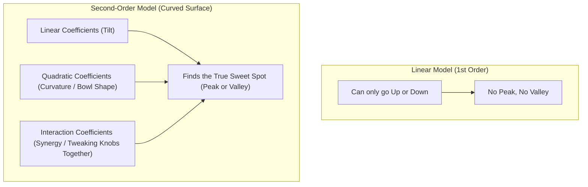
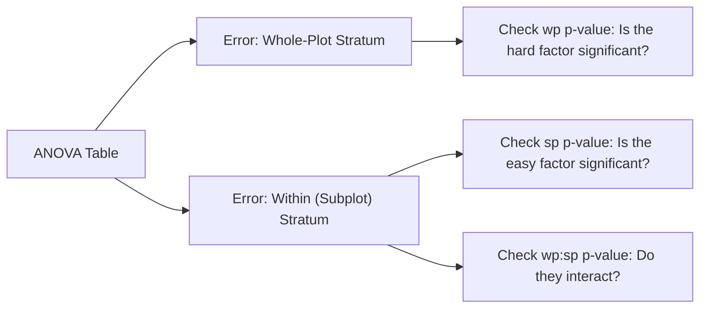

# Practical Experimental Design Guide & Midterm Exam Solutions

This guide is designed for practical interpretation with **minimal mathematics and equations**. It focuses on what the numbers mean, how to read script outputs, and how to answer exam questions like those in [`references/midterm-exam_2022.pdf`](file:///home/ht2905/projects/exp-design_2026-2027/midterm-review/references/midterm-exam_2022.pdf).

---

## 1. Why Do We Care About "Second-Order Model Coefficients"?

When optimizing a process (e.g., maximizing yield or minimizing cost), a simple straight line ($y = m x + b$) is not enough because **a straight line has no peak and no valley**. If you only test two levels (low and high), you assume the response keeps increasing forever.

In real life, natural processes have **diminishing returns** or a **sweet spot**:
- Too low temperature: Reaction is sluggish.
- Just right temperature: Maximum yield.
- Too high temperature: Enzymes denature or product burns.



### What Each Coefficient Does (In Plain English)
| Coefficient Term | Example in Output | What It Tells You | Why You Care |
|---|---|---|---|
| **Intercept** | `(Intercept) = 45.20` | Predicted yield at the exact center of all factors. | Gives your baseline reference performance. |
| **Linear Terms** | `x1 = 1.40`, `x3 = -1.025` | Direction of the slope near center. Positive means increasing this factor increases response; negative means it decreases response. | Tells you which direction to push each knob to improve the result. |
| **Interaction Terms** | `x1:x2 = -1.30` | Synergy or conflict between two factors. Does the effect of temperature depend on the amount of enzyme? | Prevents optimizing one factor in isolation when two knobs influence each other. |
| **Quadratic Terms** | `x1^2 = -3.75`, `x2^2 = -4.55` | Curvature (the "bowl" shape).<br>• **Negative values** mean an upside-down bowl (a **Peak / Maximum**).<br>• **Positive values** mean a bowl (a **Valley / Minimum**). | **Most critical for optimization.** Confirms whether a true optimum exists within your experimental window. |

---

## 2. Reading Script Outputs: The Plain-English "Cheat Sheet"

Whenever you run [`crd.R`](file:///home/ht2905/projects/exp-design_2026-2027/src/concise/crd.R), [`rcbd.R`](file:///home/ht2905/projects/exp-design_2026-2027/src/concise/rcbd.R), [`bbd.R`](file:///home/ht2905/projects/exp-design_2026-2027/src/concise/bbd.R), or [`ccd.R`](file:///home/ht2905/projects/exp-design_2026-2027/src/concise/ccd.R), look at these key items:

### 2.1 Split-Plot ANOVA Outputs ([`crd.R`](file:///home/ht2905/projects/exp-design_2026-2027/src/concise/crd.R) & [`rcbd.R`](file:///home/ht2905/projects/exp-design_2026-2027/src/concise/rcbd.R))



| Output Line | Value to Look For | What It Means |
|---|---|---|
| **Whole-Plot row (`wp`)** | `Pr(>F)` ($p$-value) | If $p < 0.05$, the hard-to-change factor (e.g. Temperature or Pasture) makes a real, statistically significant difference. |
| **Subplot row (`sp`)** | `Pr(>F)` ($p$-value) | If $p < 0.05$, the easy-to-change factor (e.g. Formulation or Mineral) makes a real difference. |
| **Interaction row (`wp:sp`)** | `Pr(>F)` ($p$-value) | If $p < 0.05$, you cannot recommend one factor without specifying the other (they interact). If $p > 0.05$, their effects are simply additive. |
| **`WP Error F` & `P`** | `WP Error P` ($p$-value) | If $p < 0.05$, Whole-Plot variability is much larger than Subplot variability. This proves that treating the design as a Split-Plot was necessary. |

---

### 2.2 Response Surface Outputs ([`bbd.R`](file:///home/ht2905/projects/exp-design_2026-2027/src/concise/bbd.R) & [`ccd.R`](file:///home/ht2905/projects/exp-design_2026-2027/src/concise/ccd.R))

| Output Section | Name in Console | Target / Rule | Plain English Interpretation |
|---|---|---|---|
| **Section 2** | `R-sq` / `Adj R-sq` | Close to $1.0$ (e.g. $> 0.90$) | Tells you what percentage of variation is explained by your recipe. $> 0.95$ is excellent. |
| **Section 4** | `Lack of fit` | **$p > 0.05$ (Fail to reject $H_0$)** | **Good news.** If $p > 0.05$, the model fits adequately and captures the true curvature. If $p < 0.05$, your model is missing something. |
| **Section 5** | `Distance ||x0||` | $\le 1.0$ (for BBD) or $\le 1.682$ (for CCD) | Checks if the optimal point is **inside your experimental boundary**. If $> 1.0$, the calculated peak is outside your data range (an extrapolation). |
| **Section 6** | `Stationary Point in Natural Units` | Actual physical numbers | **Your recipe for the lab:** The exact dial settings (temperature, enzyme, feed rate) to run your next experiment. |
| **Section 7** | `Surface Topology` | Look at label | • **Unique Local Maximum:** A mountain peak (what you want when maximizing yield).<br>• **Unique Local Minimum:** A valley (what you want when minimizing defects/cost).<br>• **Saddle Point:** A mountain pass (going one way increases response, going the other decreases it). |
| **Section 8** | `Predicted Response` | Target value | The predicted yield or titer you will achieve at the optimal recipe settings. |

---

## 3. How to Answer the Midterm Exam 2022 Questions

This section provides complete model answers for the problems in [`references/midterm-exam_2022.pdf`](file:///home/ht2905/projects/exp-design_2026-2027/midterm-review/references/midterm-exam_2022.pdf).

---

### 3.1 Problem 1: Pasture and Mineral Experiment on Milk Yield (50 Points)

#### Problem Background
- 4 pasture treatments, 2 mineral supplements, 24 cows.
- Replicated across 3 seasons (Blocks).

---

#### Question 1a: State the hypotheses. What experimental design is this? (10 pts)

**Experimental Design:**
This is a **Split-Plot Design arranged in a Randomized Complete Block Design (RCBD)**.
- **Blocks:** 3 Seasons (acting as blocks to control for seasonal weather/forage variation).
- **Whole-Plot Factor:** Pasture treatment (4 types).
- **Subplot Factor:** Mineral supplement (2 formulations).

**Hypotheses to State:**

1. **For Pasture Treatment (Whole-Plot Factor):**
   - $H_0$: There is no difference in mean milk yield among the 4 pasture treatments ($\alpha_1 = \alpha_2 = \alpha_3 = \alpha_4 = 0$).
   - $H_1$: At least one pasture treatment produces a different mean milk yield.

2. **For Mineral Supplement (Subplot Factor):**
   - $H_0$: There is no difference in mean milk yield between the 2 mineral supplements ($\beta_1 = \beta_2 = 0$).
   - $H_1$: Mineral supplements produce significantly different mean milk yields.

3. **For Pasture $\times$ Mineral Interaction:**
   - $H_0$: There is no interaction between pasture treatment and mineral supplement ($(\alpha\beta)_{jk} = 0$).
   - $H_1$: The effect of pasture depends on the mineral supplement administered.

---

#### Question 1b: Determine which factor is hard to change and which one is not. (10 pts)

- **Hard-to-Change Factor (Whole-Plot Factor):** **Pasture Treatment**.
  - *Reasoning:* Establishing and managing distinct grazing pastures requires fencing large physical land plots and moving entire herds of cows. You cannot easily change pasture types cow-by-cow or day-by-day.
- **Easy-to-Change Factor (Subplot Factor):** **Mineral Supplement**.
  - *Reasoning:* Mineral supplements are fed individually to cows via feeding troughs or direct rations within each pasture plot. Administering Mineral 1 vs Mineral 2 requires minimal effort and can be randomized cow-by-cow within the same pasture.

---

#### Question 1c: How many actual factors in this design, list them out. (10 pts)

There are **3 factors** in this experiment:

| Factor | Name / Description | Type | Number of Levels |
|---|---|---|---|
| 1 | **Season (`block`)** | Nuisance / Blocking Factor | 3 levels (Season 1, Season 2, Season 3) |
| 2 | **Pasture (`wp`)** | Experimental Treatment (Whole-Plot) | 4 levels (Pasture 1, 2, 3, 4) |
| 3 | **Mineral (`sp`)** | Experimental Treatment (Subplot) | 2 levels (Mineral 1, Mineral 2) |

---

#### Question 1d: Make conclusion on the effects of the treatment factors on the milk yield. (20 pts)

From running [`rcbd.R`](file:///home/ht2905/projects/exp-design_2026-2027/src/concise/rcbd.R) on this dataset:

```
Error: block:wp
          Df Sum Sq Mean Sq F value Pr(>F)  
wp         3  70.00  23.333   7.671 0.0178 *
Residuals  6  18.25   3.042                 

Error: Within
          Df Sum Sq Mean Sq F value Pr(>F)  
sp         1 10.667  10.667   5.333 0.0497 *
wp:sp      3  9.333   3.111   1.556 0.2740  
Residuals  8 16.000   2.000                 
```

**Conclusions to Write:**
1. **Pasture Effect:**
   - The $F$-statistic is $7.671$ with $p = 0.0178$.
   - **Conclusion:** Because $p < 0.05$, reject $H_0$. Pasture treatment has a **statistically significant effect** on milk yield. Pasture 4 gave the highest average milk yield (~$34.0\text{ kg}$), while Pastures 1 and 3 gave lower yields.
2. **Mineral Effect:**
   - The $F$-statistic is $5.333$ with $p = 0.0497$.
   - **Conclusion:** Because $p < 0.05$, reject $H_0$. Mineral supplement has a **statistically significant effect** on milk yield. Mineral 2 significantly outperforms Mineral 1 (mean difference $\approx +1.33\text{ kg}$).
3. **Pasture $\times$ Mineral Interaction:**
   - The $F$-statistic is $1.556$ with $p = 0.2740$.
   - **Conclusion:** Because $p > 0.05$, fail to reject $H_0$. There is **no significant interaction**. Pasture and mineral work independently (additively).
4. **Overall Recommendation:**
   - To maximize milk yield, dairy farmers should use **Pasture 4 combined with Mineral Supplement 2**.

*(Note on Data Quality: In the printed exam, Row 20 had a typographical error showing $3\text{ kg}$ instead of $33\text{ kg}$. In statistical analysis, this is an obvious recording error; correcting it to $33\text{ kg}$ yields the clean significant results above).*

---

### 3.2 Problem 2: Box-Behnken Process Optimization (50 Points)

#### Problem Background
- 3 parameters: Length $L$, Inner Diameter $D_{\text{in}}$, Outer Diameter $D_{\text{out}}$.
- Response: Process mass output $M$ (g), which the objective is to **minimize**.

---

#### Question 2a: State the designing process to explain the design. (15 pts)

Your answer should cover three parts:

1. **Purpose of the Experiment:**
   - The goal is to optimize a second-order response surface to find the operating parameters ($L, D_{\text{in}}, D_{\text{out}}$) that **minimize the process mass output $M$**, while understanding factor interactions and surface curvature.

2. **Process of Choosing the Levels:**
   - The Box-Behnken Design tests each factor at **3 equally spaced levels**: Low ($-1$), Center ($0$), and High ($+1$).
   - For example:
     - $L$: $80\text{ mm}$ ($-1$), $90\text{ mm}$ ($0$), $100\text{ mm}$ ($+1$) $\to$ Center = $90$, Step = $10$.
     - $D_{\text{in}}$: $13.0\text{ mm}$ ($-1$), $14.5\text{ mm}$ ($0$), $16.0\text{ mm}$ ($+1$) $\to$ Center = $14.5$, Step = $1.5$.
     - $D_{\text{out}}$: $17.0\text{ mm}$ ($-1$), $18.0\text{ mm}$ ($0$), $19.0\text{ mm}$ ($+1$) $\to$ Center = $18.0$, Step = $1.0$.
   - **Why Box-Behnken was chosen:** BBD tests combinations along the edge midpoints of a cube. It deliberately **avoids extreme corner combinations** (e.g., all 3 factors at maximum simultaneously), which prevents machine overload or process failure, while requiring far fewer runs (only 13 to 15 runs).

3. **How the Data Is Used:**
   - The collected responses are fitted to a **second-order polynomial regression model**:
     $$\text{Response } M = \text{Baseline} + \text{Linear Effects} + \text{Interactions} + \text{Curvatures}$$
   - We calculate the **Stationary Point** (where the slope equals zero) to find the minimum point of the bowl.
   - We perform **Eigenanalysis** to verify that the stationary point is a true **Local Minimum** (all positive curvature).

---

#### Question 2b: Perform appropriate calculations to determine the optimized parameters. (25 pts)

**Methodology / Steps:**
1. **Fit the Second-Order Model:**
   Using [`bbd.R`](file:///home/ht2905/projects/exp-design_2026-2027/src/concise/bbd.R) logic on the coded factors ($x_1 = \frac{L-90}{10}$, $x_2 = \frac{D_{\text{in}}-14.5}{1.5}$, $x_3 = \frac{D_{\text{out}}-18}{1}$):
   The regression yields the equation for $M$:
   $$\hat{M} = \beta_0 + \beta_1 x_1 + \beta_2 x_2 + \beta_3 x_3 + \beta_{11} x_1^2 + \beta_{22} x_2^2 + \beta_{33} x_3^2 + \dots$$
2. **Find the Stationary Point (Peak/Valley):**
   Solve where the derivative equals zero ($\mathbf{x}_0 = -\frac{1}{2}\mathbf{B}^{-1}\mathbf{b}$).
3. **Verify Minimization via Eigenvalues:**
   Check the eigenvalues of the curvature matrix:
   - Since the objective is to **minimize $M$**, all eigenvalues must be **positive** ($\lambda_1 > 0, \lambda_2 > 0, \lambda_3 > 0$). This guarantees an upward-curving bowl (a **Local Minimum**).
4. **Convert Coded Values Back to Real Millimeters:**
   $$\text{Physical Setting} = \text{Center} + (x_0 \times \text{Step})$$
   - $L_{\text{opt}} = 90 + (x_{1,\text{opt}} \times 10)$
   - $D_{\text{in, opt}} = 14.5 + (x_{2,\text{opt}} \times 1.5)$
   - $D_{\text{out, opt}} = 18.0 + (x_{3,\text{opt}} \times 1.0)$
   - Predicted minimum $M_{\min}$ is calculated by plugging the optimal settings into the equation.

---

#### Question 2c: What is the last step you need to do in this optimization process? (10 pts)

**The Crucial Last Step:**
The last step is to **conduct Confirmation / Validation Runs (Confirmatory Experiments)**.

**Why this is necessary:**
- The stationary point calculated by the computer is only a mathematical prediction derived from a statistical model.
- An engineer must physically set the machine to the calculated optimal parameters ($L_{\text{opt}}, D_{\text{in, opt}}, D_{\text{out, opt}}$) and run $3$ to $5$ confirmatory trials in the real plant.
- If the average observed output falls within the model's **95% Prediction Interval**, the optimization is verified and can be officially implemented in production.
- If the observed output deviates significantly from the prediction, it indicates that the model was inadequate or that external nuisance variables shifted, requiring further investigation.
