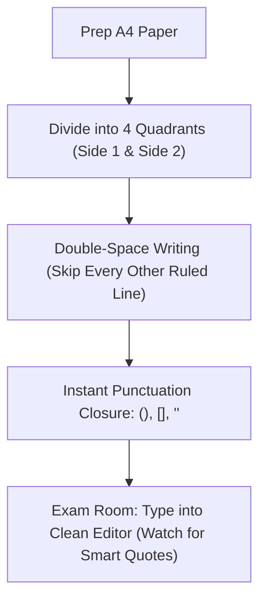

# Handwritten Code Cheat Sheet & Typographic Disambiguation Guide

This guide is designed for preparing physical handwritten cheat sheets for offline, no-IDE, and no-internet R programming exams.

---

## 1. R "Whitespace & Indentation Immunity"

> [!NOTE]
> **Unlike Python, R is not indentation-sensitive.** R completely ignores leading indentation, spaces around operators, and extra spaces inside parentheses.

* **No Tab/Space Counting:** You do not need to measure 2 or 4 spaces on physical paper. Write statements flushed against the margin or use simple visual hierarchy.
* **Safe Line Breaks:** In basic terminal editors (`micro`, `nano`, or the default R console), statements terminate at newlines or semicolons (`;`). If you must wrap a line on paper, **always break immediately after an operator or comma**:
  * Break after `+`, `*`, `~`, or `,`
  * Never break in the middle of a symbol name or between function names and `(`

---

## 2. Character Disambiguation Matrix

Under timed exam conditions, rushed handwriting causes severe character confusion. Use these unambiguous typographic conventions:

| Symbol / Character | The Exam Danger | Safe Handwritten Habit | Why It Matters |
|---|---|---|---|
| **`0` vs `O`** | `0` looks like capital `O` | **$\emptyset$** (Slash your zero) | Centers check `d$x1 == 0`, not letter `O`. |
| **`1` vs `l` vs `I`** | Vertical stick confusion | **$\mathbb{1}$** (Cap + base for `1`; looped cursive $\ell$ for `l`) | Distinguishes `stp[1]` from `stp[l]`. |
| **`2` vs `z`** | Curves flatten out | **$\text{đ}$** or **$\not{z}$** (Crossbar through `z`) | Distinguishes `enzyme` / `x2` / `x3`. |
| **`~` (Tilde)** vs **`-` (Minus)** | Wobbly lines blur | Exaggerate the wave: **$\sim$** vs straight **$-$** | `y ~ wp * sp` is a model formula; `-` is subtraction. |
| **`_` (Underscore)** vs **`-`** | Floating dashes | Draw `_` **below the baseline**; `-` centered | `factor_cols` vs `a - b`. |
| **`(` vs `[` vs `{`** | Curved shapes look identical | Draw `[` with **sharp $90^\circ$ corners**; `{` with a pointy center nib | `d[factor_cols]` (indexing) vs `mean(y)` (call) vs `{}` (block). |
| **`[[` (Double bracket)** | Merged sticks | Draw two clearly separated rectangular brackets: `[ [` | Used in `s[[2]][[1]]` for split-plot error extraction. |
| **`<-` (Assign) vs `<=`** | Squeezed characters | Space it slightly: `< -` vs `< =` | Prevents writing `if (d0 <= 1)` as assignment. |
| **`"` (Quotes)** | Ticks look like stray dots | Draw **double vertical ticks** tall and distinct | `read.csv("data.csv")` |

---

## 3. Physical Paper Layout Workflow

### Layout Principles:
1. **Double-Spacing:** Skip every other line on your ruled sheet. This provides clean space to annotate exam-specific column names without messy scribbles.
2. **Instant Pair Closure:** Whenever you write an opening token (`(`, `[`, `{`, `"`), immediately write its closing counterpart (`)`, `]`, `}`, `"`) before writing the contents.
3. **Four-Quadrant Organization:**
   * **Side A (Split-Plot Designs):**
     * Quadrant 1: [`crd.R`](file:///home/ht2905/projects/exp-design_2026-2027/src/concise/crd.R) — Completely Randomized Design
     * Quadrant 2: [`rcbd.R`](file:///home/ht2905/projects/exp-design_2026-2027/src/concise/rcbd.R) — Randomized Complete Block Design
   * **Side B (Response Surface Methodology):**
     * Quadrant 3: [`bbd.R`](file:///home/ht2905/projects/exp-design_2026-2027/src/concise/bbd.R) — Box-Behnken Design ($k = 3$)
     * Quadrant 4: [`ccd.R`](file:///home/ht2905/projects/exp-design_2026-2027/src/concise/ccd.R) — Central Composite Design ($k = 3, \alpha = 1.682$)

---

## 4. Offline Typing Workflow on Exam Day

Without an IDE or internet access, follow this defensive execution routine:

| Phase | Action | Watch Out For |
|---|---|---|
| **1. Editor Selection** | Use a simple text editor (`micro`, `nano`, or base R script window). | Disable word-wrap and auto-smart quotes. |
| **2. Quote Hygiene** | Always use ASCII straight quotes (`"` or `'`). | OS or office suite "curly quotes" (`“ ”`) trigger immediate `unexpected input` syntax errors in R. |
| **3. Dataset Verification** | Inspect the first 3 lines via `head(d, 3)`. | Check that column names match your script configuration (`y`, `wp`, `sp`, `block`, `x1`, `x2`, `x3`). |
| **4. Quick Smoke Test** | Run non-interactively or source line-by-line. | In R console, if prompt becomes `+`, a parenthesis or quote was left unclosed. Press `Esc` or `Ctrl+C` to break. |
