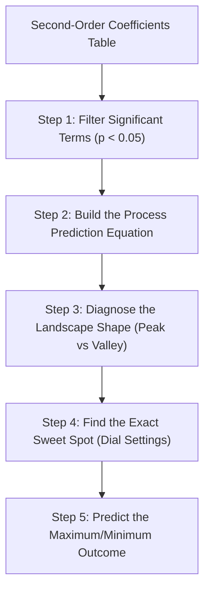

When you run a response surface script like [`bbd.R`](file:///home/ht2905/temp_exp-design/bbd.R) or [`ccd.R`](file:///home/ht2905/temp_exp-design/ccd.R), the computer prints a table of **Second-Order Coefficients** that looks like this:

```
            Estimate  Pr(>|t|)
(Intercept)   45.200   0.00000
x1             1.400   0.00001
x2             2.600   0.00000
x3            -1.025   0.00006
x1:x2         -1.300   0.00010
x1^2          -3.750   0.00000
x2^2          -4.550   0.00000
x3^2          -2.850   0.00000
```

Here is **exactly what you do with them**, broken down into **5 practical steps**:

---



---

### Step 1: Filter Out the Noise (Check the $p$-values)

Look straight at the **`Pr(>|t|)`** column for each coefficient:
* **If $p < 0.05$:** The term has a **real, statistically significant impact**. You keep and use it.
* **If $p > 0.05$:** The term is just **random background noise**. You know that this knob (or interaction) does not noticeably affect your output, so you can ignore it in practice.

---

### Step 2: Build Your "Process Simulation Formula"

These coefficients become the numbers in your process equation. Instead of doing expensive lab trials to guess what happens at different temperatures, you now have a mathematical twin on your computer:

$$\text{Yield} = 45.20 + 1.40(x_1) + 2.60(x_2) - 1.025(x_3) - 3.75(x_1^2) - 4.55(x_2^2) - 2.85(x_3^2) - 1.30(x_1 x_2)$$

* You can plug in **any combination of dial settings** ($x_1, x_2, x_3$) to immediately estimate your yield without going into the lab.

---

### Step 3: Diagnose the Shape of Your Landscape (Peak vs Valley)

Look specifically at the **squared terms** (`x1^2`, `x2^2`, `x3^2`):

| Quadratic Signs | Landscape Shape | What It Means for You |
|---|---|---|
| **All Negative** (e.g. $-3.75, -4.55, -2.85$) | **An inverted bowl (Mountain Peak)** | **Great for Maximizing Yield/Purity.** You have confirmed that an absolute maximum exists inside your process window. |
| **All Positive** (e.g. $+2.10, +1.85, +3.40$) | **An upright bowl (Valley)** | **Great for Minimizing Defects/Cost/Mass.** You have confirmed that an absolute minimum exists. |
| **Mixed Signs** (Some positive, some negative) | **A Saddle Point (Pringles chip / Mountain pass)** | There is no single sweet spot. Pushing factor 1 increases yield, but pushing factor 2 decreases it. |

---

### Step 4: Calculate the Exact "Sweet Spot" (Stationary Point)

You don't have to do the calculus by hand—the script uses these coefficients to set the slope to zero and find the peak:

1. **In Coded Coordinates:** The script solves for the exact peak:
   $$x_1 = 0.115, \quad x_2 = 0.289, \quad x_3 = -0.207$$
2. **Convert to Factory / Lab Dials:** Using your factor step sizes, this translates into real-world settings:
   * **Temperature:** $35.0 + (0.115 \times 5) = \mathbf{35.57^\circ\text{C}}$
   * **Enzyme Load:** $1.0 + (0.289 \times 0.5) = \mathbf{1.14\%}$
   * **Time:** $30.0 + (-0.207 \times 15) = \mathbf{26.9\text{ min}}$

---

### Step 5: Predict the Best Possible Outcome & Plan Confirmatory Runs

1. **Calculate the Target:** You plug those sweet-spot settings back into the equation:
   $$\text{Predicted Peak Yield} = \mathbf{45.76\%}$$
2. **Action in the Plant:** You take these three exact numbers ($35.6^\circ\text{C}$, $1.14\%$ enzyme, $26.9\text{ min}$) to the factory floor, run 3 verification batches, and verify that your real production yield hits $\sim 45.8\%$.

---

### Summary Checklist: What to Write on an Exam or Report

If an exam asks *"What do you do with the second-order model coefficients?"*, state:
1. **Identify Significant Effects:** Use $p$-values ($p < 0.05$) to see which main factors, interactions, and curvatures matter.
2. **Characterize Curvature:** Inspect quadratic terms ($\beta_{ii}$) to confirm whether the surface is a **maximum** (negative) or **minimum** (positive).
3. **Solve for the Optimal Dial Settings:** Calculate the stationary point to find the exact physical operating parameters.
4. **Predict the Optimum Output:** Estimate the expected maximum yield or minimum cost at those settings.