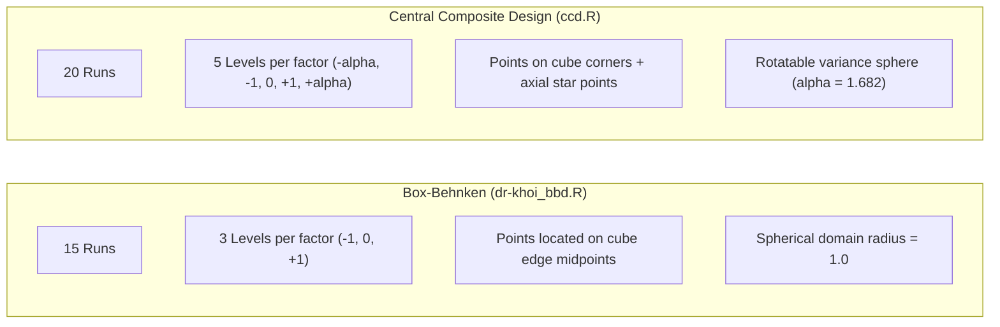

# Comparative Analysis: dr-khoi_bbd.R vs bbd.R and ccd.R

## Executive Summary & Core Findings

| Question / Dimension | Verdict | Evidence & Rationale |
|---|---|---|
| **Is Dr. Khoi's code meant for BBD or CCD?** | **BBD (Box-Behnken Design)** | • Uses `rsm::bbd(k=3, n0=3, ...)` (CCD requires `rsm::ccd()`). • Evaluates $N = 15$ runs (12 edge midpoints + 3 center points). A 3-factor CCD requires 20 runs. • Factors are strictly 3 levels ($-1, 0, +1$). CCD requires 5 levels ($-\alpha, -1, 0, +1, +\alpha$). • Response vector (15 points) matches the exact BBD dataset in [`data.csv`](file:///home/ht2905/projects/exp-design_2026-2027/datasets/bbd/data.csv). |
| **Standardization Status** | **Rich Text Format (RTF) Headers Removed** | The file [`dr-khoi_bbd.R`](file:///home/ht2905/projects/exp-design_2026-2027/src/dr-khoi_bbd.R) was originally saved from macOS TextEdit with RTF markup (`{\rtf1...}`), which caused R syntax errors. With the RTF headers stripped and `renv::use("rsm", attach=TRUE)` included, his original script runs cleanly. |
| **Numerical Equivalence with `bbd.R`** | **Identical Numerical Results** | Both [`dr-khoi_bbd.R`](file:///home/ht2905/projects/exp-design_2026-2027/src/dr-khoi_bbd.R) and [`bbd.R`](file:///home/ht2905/projects/exp-design_2026-2027/src/concise/bbd.R) fit the identical second-order response surface equation, yielding the exact same coefficients, lack-of-fit statistic ($F = 2.2778, \, p = 0.3196$), and stationary point ($35.57^\circ\text{C}, 1.14\%, 26.90\text{ min}$). |
| **Workflow Philosophy** | **Generator-First vs Data-First** | Dr. Khoi's code uses a **Generator-First** workflow (generating the experimental design in R via `bbd()` before collecting data). Your [`bbd.R`](file:///home/ht2905/projects/exp-design_2026-2027/src/concise/bbd.R) uses a **Data-First** workflow (reading collected tabular data from CSV and performing post-hoc surface optimization). |

---

## 1. Workflow Architecture Comparison

```mermaid
graph TD
    subgraph DrKhoi ["Dr. Khoi's Original Workflow (dr-khoi_bbd.R)"]
        D1["Call rsm::bbd(k=3, n0=3, coding=...)"] --> D2["Creates coded.data design object"]
        D2 --> D3["Hardcode response vector c(...) into object"]
        D3 --> D4["Fit rsm(response ~ SO(x1,x2,x3))"]
        D4 --> D5["Raw summary(rsm_result) console dump"]
    end

    subgraph YourBBD ["Your Workflow (bbd.R)"]
        Y1["Read external data.csv"] --> Y2["Compute midpoint & step dynamically"]
        Y2 --> Y3["Create coded columns x1, x2, x3 in data.frame"]
        Y3 --> Y4["Fit rsm(yield ~ SO(x1,x2,x3))"]
        Y4 --> Y5["Custom 8-Section Diagnostic Pipeline"]
        Y5 --> Y6["LOF Decision + Domain Check ||x0|| + Topology + y_opt"]
    end

    subgraph YourCCD ["Your CCD Workflow (ccd.R)"]
        C1["Read 20-run CCD data.csv"] --> C2["Rotatable alpha = 1.682"]
        C2 --> C3["Fit rsm on 5-level Factor Space"]
        C3 --> C4["Domain Boundary Diagnostic (||x0|| <= 1.682)"]
    end
```

---

## 2. Feature-by-Feature Matrix

| Feature | Dr. Khoi's [`dr-khoi_bbd.R`](file:///home/ht2905/projects/exp-design_2026-2027/src/dr-khoi_bbd.R) | Your [`bbd.R`](file:///home/ht2905/projects/exp-design_2026-2027/src/concise/bbd.R) | Your [`ccd.R`](file:///home/ht2905/projects/exp-design_2026-2027/src/concise/ccd.R) |
|---|---|---|---|
| **Design Family** | **Box-Behnken (BBD)** | **Box-Behnken (BBD)** | **Central Composite (CCD)** |
| **Role in Experiment** | Pre-experiment design generation | Post-experiment data analysis | Post-experiment data analysis |
| **Number of Factors ($k$)** | 3 (`temp`, `enzyme`, `time`) | 3 (`temp`, `enzyme`, `time`) | 3 (`temp`, `do`, `feed`) |
| **Total Experimental Runs** | 15 runs | 15 runs | 20 runs (8 factorial + 6 axial + 6 center) |
| **Factor Levels per Axis** | 3 levels ($-1, 0, +1$) | 3 levels ($-1, 0, +1$) | 5 levels ($-\alpha, -1, 0, +1, +\alpha$) |
| **Data Ingestion** | In-memory `c(...)` assignment | Ingests external `data.csv` | Ingests external `data.csv` |
| **Internal Data Structure** | `rsm::coded.data` | Standard `data.frame` | Standard `data.frame` |
| **Factor Transformation** | Defined via `coding = list(...)` | Computed via `mid` and `stp` | Computed via `mid` and `stp` |
| **Console Output** | Unformatted `summary()` printout | Structured 8-section report | Structured 8-section report |
| **Lack-of-Fit Interpretation** | Raw ANOVA table row | Formatted diagnostic + decision rule | Formatted diagnostic + decision rule |
| **Domain Bound Check** | None (manual inspection required) | Automated: $\|\mathbf{x}_0\| \le 1.0$ check | Automated: $\|\mathbf{x}_0\| \le 1.682$ check |
| **Surface Classification** | Eigenvalues printed without label | Evaluates eigenvalue signs $\to$ Peak/Valley/Saddle | Evaluates eigenvalue signs $\to$ Peak/Valley/Saddle |
| **Optimal Response ($\hat{y}_{\text{opt}}$)** | Not predicted in script | Automated via `predict(fit, ...)` | Automated via `predict(fit, ...)` |

---

## 3. Direct Comparison: `dr-khoi_bbd.R` vs `bbd.R`

Both scripts analyze the exact same process (enzymatic extraction of bioactive compounds):

### 3.1 Numerical Consistency
Running both scripts produces identical statistical parameter estimates:

| Model Parameter / Statistic | [`dr-khoi_bbd.R`](file:///home/ht2905/projects/exp-design_2026-2027/src/dr-khoi_bbd.R) | [`bbd.R`](file:///home/ht2905/projects/exp-design_2026-2027/src/concise/bbd.R) | Match Status |
|---|---|---|---|
| **Intercept ($\beta_0$)** | $45.20000$ | $45.20000$ | Exact match |
| **Linear Slopes ($\beta_1, \beta_2, \beta_3$)** | $1.400, \, 2.600, \, -1.025$ | $1.400, \, 2.600, \, -1.025$ | Exact match |
| **Interactions ($\beta_{12}, \beta_{13}, \beta_{23}$)** | $-1.300, \, 0.800, \, -0.850$ | $-1.300, \, 0.800, \, -0.850$ | Exact match |
| **Pure Quadratic ($\beta_{11}, \beta_{22}, \beta_{33}$)** | $-3.750, \, -4.550, \, -2.850$ | $-3.750, \, -4.550, \, -2.850$ | Exact match |
| **Goodness of Fit ($R^2$ / $R^2_{\text{adj}}$)** | $0.9988$ / $0.9968$ | $0.99884$ / $0.99676$ | Exact match |
| **Lack of Fit Diagnostic** | $F(3, 2) = 2.2778, \, p = 0.3196$ | $F(3, 2) = 2.2778, \, p = 0.3196$ | Exact match |
| **Coded Stationary Point ($\mathbf{x}_0$)** | $[0.11457, \, 0.28866, \, -0.20679]$ | $[0.11457, \, 0.28866, \, -0.20679]$ | Exact match |
| **Physical Stationary Point** | $35.57^\circ\text{C}, \, 1.14\%, \, 26.90\text{ min}$ | $35.57^\circ\text{C}, \, 1.14\%, \, 26.90\text{ min}$ | Exact match |
| **Eigenvalues ($\lambda_1, \lambda_2, \lambda_3$)** | $[-2.4914, \, -3.7290, \, -4.9297]$ | $[-2.4914, \, -3.7290, \, -4.9297]$ | Exact match |

### 3.2 Analytical Differences in Output Delivery
1. **Model Exploration vs Automation**:
   - Dr. Khoi relies on the default S3 method `summary.rsm()`. This prints the raw R summary block, ANOVA table, stationary point, and eigen-decomposition.
   - Your [`bbd.R`](file:///home/ht2905/projects/exp-design_2026-2027/src/concise/bbd.R) extracts the underlying model matrices directly and performs **automated decision logic**:
     - *Lack-of-Fit Decision*: Directly tests whether $p > 0.05$ and outputs `"ADEQUATE FIT"`.
     - *Domain Bound Check*: Calculates $d_0 = \|\mathbf{x}_0\| = 0.3731$ and alerts the user whether the point is `"Inside BBD domain (||x0|| <= 1.0)"` or an ungrounded extrapolation.
     - *Topology Interpretation*: Automatically verifies that all eigenvalues are negative and labels the surface as `"UNIQUE LOCAL MAXIMUM (Mountain Peak / Optimum)"`.
     - *Optimal Response*: Evaluates $\hat{y}_{\text{opt}} = 45.7614\%$ at the stationary point.
2. **Coupling to Data**:
   - `dr-khoi_bbd.R` hardcodes the 15 response numbers directly into the script body (`response_result <- c(...)`). Modifying the dataset requires editing code.
   - `bbd.R` decouples data from code by reading from [`data.csv`](file:///home/ht2905/projects/exp-design_2026-2027/datasets/bbd/data.csv).

---

## 4. Contrast: `dr-khoi_bbd.R` vs `ccd.R`

[`dr-khoi_bbd.R`](file:///home/ht2905/projects/exp-design_2026-2027/src/dr-khoi_bbd.R) and [`ccd.R`](file:///home/ht2905/projects/exp-design_2026-2027/src/concise/ccd.R) belong to **two entirely different experimental design families**:

### Why Dr. Khoi's Script Is Incompatible with CCD:
1. **Run Shortage**: A 3-factor CCD requires at least 20 runs ($2^3 + 2(3) + 6 = 20$). Dr. Khoi's script has only 15 runs.
2. **Absence of Axial (Star) Points**: In Dr. Khoi's code, factors only take 3 values ($30, 35, 40$). A rotatable CCD requires 5 values per factor (axial points placed at $\pm 1.682$ standard step sizes).
3. **Different Generator Function**: The `rsm` package provides two distinct functions: `bbd()` for Box-Behnken designs and `ccd()` for Central Composite designs. Dr. Khoi explicitly calls `bbd()`.
