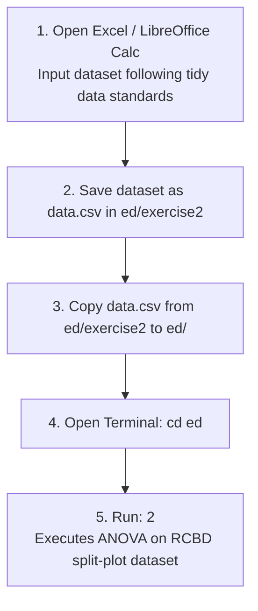

# ED Midterm Scripts Guide
## Script 01: CRD Split-Plot Analysis in R

## Scripts 02: RCBD Split-Plot Analysis in R

1. Open Excel/LibreOffice Calc. Input dataset, follow tidy data standards.
2. Save dataset as `data.csv` in `ed/exercise2` folder.
3. Copy `data.csv` from `ed/exercise2` to `ed`.
4. Open Terminal. Run: `cd ed`.
5. Run: `2` to run ANOVA on RCBD split-plot dataset.
