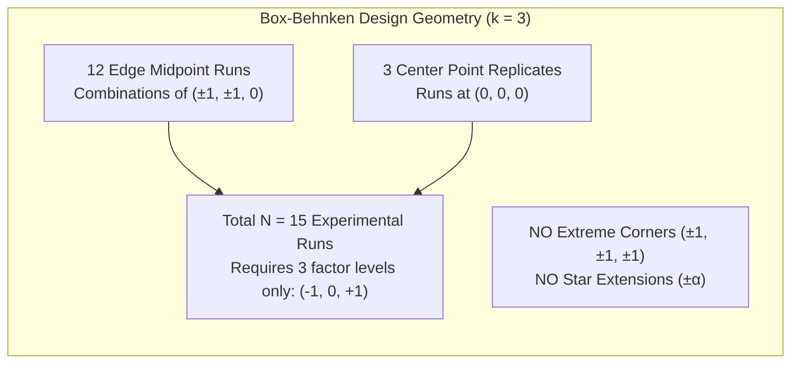

# Exercise 04: Box-Behnken Design (BBD) Analysis Guide

**Target Script:** [`midterm-review/exercise-04_bbd/bbd-analysis.R`](file:///home/ht2905/projects/exp-design_2026-2027/midterm-review/exercise-04_bbd/bbd-analysis.R)  
**Generic Script:** [`scripts/generic_bbd-analysis.R`](file:///home/ht2905/projects/exp-design_2026-2027/scripts/generic_bbd-analysis.R)  
**Dataset:** [`midterm-review/exercise-04_bbd/data.csv`](file:///home/ht2905/projects/exp-design_2026-2027/midterm-review/exercise-04_bbd/data.csv)

---

## 1. Biological Scenario & Experimental Objectives

A bioprocess engineering team is optimizing the downstream enzymatic cell lysis of recombinant *E. coli* expressing an industrial enzyme. The objective is to maximize **Protein Yield ($y$, mg / g dry cell weight)** while operating within safe physical boundaries that prevent thermal denaturation and unnecessary enzyme reagent cost.

Three continuous quantitative factors are studied:
1. **Lysis Temperature ($X_1$, $^\circ\text{C}$):** $30^\circ\text{C}$ to $40^\circ\text{C}$
2. **Lysozyme Concentration ($X_2$, mg/mL):** $0.5\text{ mg/mL}$ to $1.5\text{ mg/mL}$
3. **Incubation Time ($X_3$, min):** $15\text{ min}$ to $45\text{ min}$

---

## 2. Experimental Design Architecture: Why Wet Labs Prefer BBD

### The Two Major Practical Advantages of BBD:
1. **Biological Safety (No Extreme Treatment Combinations):**  
   In a full factorial or Central Composite Design (CCD), corner runs like $(+1, +1, +1)$ or axial extensions $(\pm 1.68)$ subject the system to the highest temperature ($40^\circ\text{C}$), highest enzyme ($1.5\text{ mg/mL}$), and longest time ($45\text{ min}$) simultaneously, causing severe enzyme aggregation and proteolytic cleavage. **BBD completely avoids corner points!**
2. **Operational Simplicity:**  
   BBD requires **only 3 levels** per factor ($-1, 0, +1$). Preparing 3 stock concentrations in the lab is much faster and less prone to pipetting errors than preparing the 5 distinct concentration levels required by a rotatable CCD.

---

## 3. Factor Coding Equations

Using the standard 2-step coding formula:
$$x_i = \frac{X_i - \text{Midpoint}}{\text{Half-Step}}$$

| Factor | Low Level ($-1$) | Center ($0$) | High Level ($+1$) | Half-Step ($\Delta X$) | Coding Equation |
| :--- | :---: | :---: | :---: | :---: | :---: |
| **Temperature ($X_1$)** | $30^\circ\text{C}$ | $35^\circ\text{C}$ | $40^\circ\text{C}$ | $\frac{40 - 30}{2} = 5^\circ\text{C}$ | $$x_1 = \frac{\text{Temp} - 35}{5}$$ |
| **Lysozyme ($X_2$)** | $0.5\text{ mg/mL}$ | $1.0\text{ mg/mL}$ | $1.5\text{ mg/mL}$ | $\frac{1.5 - 0.5}{2} = 0.5\text{ mg/mL}$ | $$x_2 = \frac{\text{Lysozyme} - 1.0}{0.5}$$ |
| **Time ($X_3$)** | $15\text{ min}$ | $30\text{ min}$ | $45\text{ min}$ | $\frac{45 - 15}{2} = 15\text{ min}$ | $$x_3 = \frac{\text{Time} - 30}{15}$$ |

---

## 4. Fitted Second-Order Model & Full Regression Table

The fitted full quadratic response surface model from `rsm`:
$$\hat{y} = 45.20 + 1.40 x_1 + 2.60 x_2 - 1.025 x_3 - 1.30 x_1 x_2 + 0.80 x_1 x_3 - 0.85 x_2 x_3 - 3.75 x_1^2 - 4.55 x_2^2 - 2.85 x_3^2$$

| Term | Estimate ($\hat{\beta}$) | Std. Error | $t$-value | $p$-value | Significance ($\alpha = 0.05$) |
| :--- | :---: | :---: | :---: | :---: | :--- |
| **Intercept ($\beta_0$)** | $45.2000$ | $0.1329$ | $340.06$ | $4.17 \times 10^{-12}$ | **Significant (***)** |
| **$x_1$ (Temp)** | $+1.4000$ | $0.0814$ | $17.20$ | $1.22 \times 10^{-5}$ | **Significant (***)** |
| **$x_2$ (Enzyme)** | $+2.6000$ | $0.0814$ | $31.94$ | $5.65 \times 10^{-7}$ | **Significant (***)** |
| **$x_3$ (Time)** | $-1.0250$ | $0.0814$ | $-12.59$ | $5.61 \times 10^{-5}$ | **Significant (***)** |
| **$x_1 x_2$** | $-1.3000$ | $0.1151$ | $-11.29$ | $9.51 \times 10^{-5}$ | **Significant (***)** |
| **$x_1 x_3$** | $+0.8000$ | $0.1151$ | $6.95$ | $0.00095$ | **Significant (***)** |
| **$x_2 x_3$** | $-0.8500$ | $0.1151$ | $-7.38$ | $0.00072$ | **Significant (***)** |
| **$x_1^2$** | $-3.7500$ | $0.1198$ | $-31.30$ | $6.25 \times 10^{-7}$ | **Significant (***)** |
| **$x_2^2$** | $-4.5500$ | $0.1198$ | $-37.98$ | $2.39 \times 10^{-7}$ | **Significant (***)** |
| **$x_3^2$** | $-2.8500$ | $0.1198$ | $-23.79$ | $2.45 \times 10^{-6}$ | **Significant (***)** |

- **Goodness-of-Fit:** $R^2 = 0.9988$, $R^2_{\text{adj}} = 0.9968$, Residual Std Error $s = 0.2302\ \text{mg/g}$ on $5\ \text{df}$.

---

## 5. ANOVA Decomposition & Lack-of-Fit Test

| Component | Df | Sum of Squares (SS) | Mean Square (MS) | $F$-value | $p$-value | Practical Interpretation |
| :--- | :---: | :---: | :---: | :---: | :---: | :--- |
| **First-Order (`FO`)** | $3$ | $78.165$ | $26.055$ | $491.60$ | $1.35 \times 10^{-6}$ | Linear slopes are highly significant. |
| **Two-Way Interaction (`TWI`)** | $3$ | $12.210$ | $4.070$ | $76.79$ | $0.000133$ | Factor combinations interact synergistically/antagonistically. |
| **Pure Quadratic (`PQ`)** | $3$ | $138.397$ | $46.132$ | $870.42$ | $3.25 \times 10^{-7}$ | Pronounced downward curvature; true peak exists. |
| **Residual Error** | $5$ | $0.265$ | $0.053$ | — | — | Total unexplained variation. |
| ↳ **Lack of Fit** | $3$ | $0.205$ | $0.0683$ | **2.28** | **0.3196** | **$p > 0.05 \implies$ Model is Adequate!** |
| ↳ **Pure Error** | $2$ | $0.060$ | $0.0300$ | — | — | Random variation from center point replicates ($n_0 = 3$). |

### Lack-of-Fit Decision Rule:
- $H_0$: Second-order quadratic surface is adequate ($F_{\text{LOF}} = \frac{0.0683}{0.0300} = 2.28$, $p = 0.3196$).
- Because $p = 0.3196 > 0.05$, we **fail to reject $H_0$**. The lack of fit is statistically insignificant, meaning the quadratic surface accurately models the true biological response without systematic bias.

---

## 6. Canonical Analysis & Optimal Settings

### Stationary Point Coordinates:
$$\mathbf{x}_0 = -\frac{1}{2}\mathbf{B}^{-1}\mathbf{b} = \begin{bmatrix} +0.1146 \\ +0.2887 \\ -0.2068 \end{bmatrix}$$

- **Domain Boundary Check:**  
  $$\|\mathbf{x}_0\| = \sqrt{0.1146^2 + 0.2887^2 + (-0.2068)^2} = \mathbf{0.3732} \le 1.0$$
  The stationary point is located well inside the tested experimental sphere. No extrapolation is needed.

### Decoded Natural Physical Settings:
- **Optimal Temperature ($X_1$):** $35 + (0.1146 \times 5) = \mathbf{35.57^\circ\text{C}}$
- **Optimal Lysozyme ($X_2$):** $1.0 + (0.2887 \times 0.5) = \mathbf{1.144\text{ mg/mL}}$
- **Optimal Incubation Time ($X_3$):** $30 + (-0.2068 \times 15) = \mathbf{26.90\text{ min}}$

### Eigenanalysis & Surface Topology:
- Eigenvalues: $\lambda_1 = -2.4914$, $\lambda_2 = -3.7290$, $\lambda_3 = -4.9297$.
- **Verdict:** Because **all three eigenvalues are strictly negative** ($\lambda_i < 0$), the response surface curves downward in every direction from the stationary point.
- **Topology:** A **UNIQUE LOCAL MAXIMUM (Mountain Peak)**.

### Predicted Maximum Yield:
$$\hat{y}_{\text{max}} = \mathbf{45.76\text{ mg/g}}$$
(Compared to $45.20\text{ mg/g}$ at the center point and $31.8\text{ mg/g}$ under suboptimal conditions).
