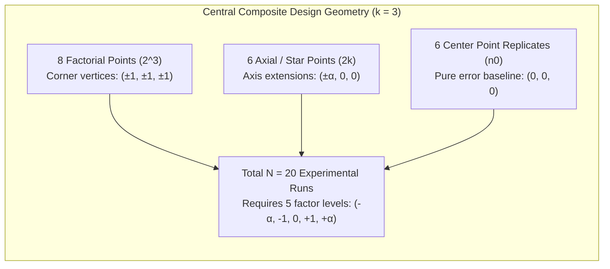

# Exercise 05: Central Composite Design (CCD) Analysis Guide

**Target Script:** [`midterm-review/exercise-05_ccd/ccd-analysis.R`](file:///home/ht2905/projects/exp-design_2026-2027/midterm-review/exercise-05_ccd/ccd-analysis.R)  
**Generic Script:** [`scripts/generic_ccd-analysis.R`](file:///home/ht2905/projects/exp-design_2026-2027/scripts/generic_ccd-analysis.R)  
**Dataset:** [`midterm-review/exercise-05_ccd/data.csv`](file:///home/ht2905/projects/exp-design_2026-2027/midterm-review/exercise-05_ccd/data.csv)

---

## 1. Biological Scenario & Experimental Objectives

A biopharmaceutical development group is optimizing upstream perfusion culture in Chinese Hamster Ovary (CHO) cells to maximize recombinant **Monoclonal Antibody (mAb) Titer ($y$, g/L)**.

Three quantitative process parameters are investigated:
1. **Culture Temperature ($X_1$, $^\circ\text{C}$):** Center = $35.0^\circ\text{C}$, Step = $2.0^\circ\text{C}$
2. **Dissolved Oxygen ($X_2$, % air saturation):** Center = $40.0\%$, Step = $10.0\%$
3. **Nutrient Feed Rate ($X_3$, g/L/day):** Center = $15.0\text{ g/L/d}$, Step = $3.0\text{ g/L/d}$

Because the cell line is robust within this operating window and the engineering team requires equal prediction precision in all directions from the center, a **Spherical Rotatable Central Composite Design (CCD)** was implemented.

---

## 2. Design Geometry: Rotatability & Run Structure

### Rotatability Condition:
A design is **rotatable** if the variance of the predicted response depends only on the distance from the design center, not on the direction. For a CCD with $k$ factors:
$$\alpha_{\text{rotatable}} = (2^k)^{1/4} = (2^3)^{0.25} = 8^{0.25} \approx \mathbf{1.6818 \approx 1.682}$$

Each factor is therefore evaluated at **5 distinct levels**:
$$-\alpha\ (-1.682), \quad -1.0, \quad 0, \quad +1.0, \quad +\alpha\ (+1.682)$$

---

## 3. Factor Coding Equations

Using the standard 2-step coding formula:
$$x_i = \frac{X_i - \text{Midpoint}}{\text{Half-Step}}$$

| Factor | Star Low ($-\alpha$) | Low ($-1$) | Center ($0$) | High ($+1$) | Star High ($+\alpha$) | Coding Equation |
| :--- | :---: | :---: | :---: | :---: | :---: | :---: |
| **Temperature ($X_1$)** | $31.64^\circ\text{C}$ | $33.0^\circ\text{C}$ | $35.0^\circ\text{C}$ | $37.0^\circ\text{C}$ | $38.36^\circ\text{C}$ | $$x_1 = \frac{\text{Temp} - 35.0}{2.0}$$ |
| **Dissolved Oxygen ($X_2$)** | $23.18\%$ | $30.0\%$ | $40.0\%$ | $50.0\%$ | $56.82\%$ | $$x_2 = \frac{\text{DO} - 40.0}{10.0}$$ |
| **Feed Rate ($X_3$)** | $9.95\text{ g/L/d}$ | $12.0\text{ g/L/d}$ | $15.0\text{ g/L/d}$ | $18.0\text{ g/L/d}$ | $20.05\text{ g/L/d}$ | $$x_3 = \frac{\text{Feed} - 15.0}{3.0}$$ |

---

## 4. Fitted Second-Order Model & Full Regression Table

The fitted full quadratic response surface model from `rsm`:
$$\hat{y} = 6.500 + 0.349 x_1 - 0.261 x_2 + 0.188 x_3 + 0.223 x_1 x_2 - 0.133 x_1 x_3 + 0.095 x_2 x_3 - 0.797 x_1^2 - 0.656 x_2^2 - 0.698 x_3^2$$

| Term | Estimate ($\hat{\beta}$) | Std. Error | $t$-value | $p$-value | Significance ($\alpha = 0.05$) |
| :--- | :---: | :---: | :---: | :---: | :--- |
| **Intercept ($\beta_0$)** | $6.5000$ | $0.0136$ | $477.59$ | $< 2.2 \times 10^{-16}$ | **Significant (***)** |
| **$x_1$ (Temp)** | $+0.3487$ | $0.0090$ | $38.62$ | $3.24 \times 10^{-12}$ | **Significant (***)** |
| **$x_2$ (DO)** | $-0.2614$ | $0.0090$ | $-28.95$ | $5.63 \times 10^{-11}$ | **Significant (***)** |
| **$x_3$ (Feed)** | $+0.1884$ | $0.0090$ | $20.87$ | $1.42 \times 10^{-9}$ | **Significant (***)** |
| **$x_1 x_2$** | $+0.2225$ | $0.0118$ | $18.86$ | $3.81 \times 10^{-9}$ | **Significant (***)** |
| **$x_1 x_3$** | $-0.1325$ | $0.0118$ | $-11.23$ | $5.43 \times 10^{-7}$ | **Significant (***)** |
| **$x_2 x_3$** | $+0.0950$ | $0.0118$ | $8.05$ | $1.11 \times 10^{-5}$ | **Significant (***)** |
| **$x_1^2$** | $-0.7969$ | $0.0088$ | $-90.67$ | $6.52 \times 10^{-16}$ | **Significant (***)** |
| **$x_2^2$** | $-0.6555$ | $0.0088$ | $-74.58$ | $4.58 \times 10^{-15}$ | **Significant (***)** |
| **$x_3^2$** | $-0.6979$ | $0.0088$ | $-79.41$ | $2.45 \times 10^{-15}$ | **Significant (***)** |

- **Goodness-of-Fit:** $R^2 = 0.9995$, $R^2_{\text{adj}} = 0.9991$, Residual Std Error $s = 0.0334\ \text{g/L}$ on $10\ \text{df}$.

---

## 5. ANOVA Decomposition & Lack-of-Fit Test

| Component | Df | Sum of Squares (SS) | Mean Square (MS) | $F$-value | $p$-value | Practical Interpretation |
| :--- | :---: | :---: | :---: | :---: | :---: | :--- |
| **First-Order (`FO`)** | $3$ | $3.0789$ | $1.0263$ | $921.64$ | $1.64 \times 10^{-12}$ | Linear terms strongly drive antibody accumulation. |
| **Two-Way Interaction (`TWI`)** | $3$ | $0.6087$ | $0.2029$ | $182.21$ | $5.03 \times 10^{-9}$ | Strong coupling between oxygenation and temperature. |
| **Pure Quadratic (`PQ`)** | $3$ | $18.7035$ | $6.2345$ | $5598.67$ | $< 2.2 \times 10^{-16}$ | Strong downward curvature dominating all 3 factors. |
| **Residual Error** | $10$ | $0.0111$ | $0.0011$ | — | — | Total unexplained experimental noise. |
| ↳ **Lack of Fit** | $5$ | $0.0073$ | $0.00147$ | **1.93** | **0.2439** | **$p > 0.05 \implies$ Model is Adequate!** |
| ↳ **Pure Error** | $5$ | $0.0038$ | $0.00076$ | — | — | Random variation across 6 center point replicates. |

### Lack-of-Fit Decision Rule:
- $H_0$: The second-order response surface model is adequate ($F_{\text{LOF}} = \frac{0.00147}{0.00076} = 1.93$, $p = 0.2439$).
- Because $p = 0.2439 > 0.05$, we **fail to reject $H_0$**. The second-order surface captures the true curvature without systematic bias.

---

## 6. Canonical Analysis & Optimal Settings

### Stationary Point Coordinates:
$$\mathbf{x}_0 = -\frac{1}{2}\mathbf{B}^{-1}\mathbf{b} = \begin{bmatrix} +0.1876 \\ -0.1599 \\ +0.1063 \end{bmatrix}$$

- **Domain Boundary Check:**  
  $$\|\mathbf{x}_0\| = \sqrt{0.1876^2 + (-0.1599)^2 + 0.1063^2} = \mathbf{0.2684} \le \alpha\ (1.682)$$
  The stationary point lies well inside the rotatable experimental sphere ($\|\mathbf{x}_0\| \approx 0.27 \ll 1.68$).

### Decoded Natural Physical Settings:
- **Optimal Temperature ($X_1$):** $35.0 + (0.1876 \times 2.0) = \mathbf{35.38^\circ\text{C}}$
- **Optimal Dissolved Oxygen ($X_2$):** $40.0 + (-0.1599 \times 10.0) = \mathbf{38.40\%}$
- **Optimal Feed Rate ($X_3$):** $15.0 + (0.1063 \times 3.0) = \mathbf{15.32\text{ g/L/day}}$

### Eigenanalysis & Surface Topology:
- Eigenvalues: $\lambda_1 = -0.5932$, $\lambda_2 = -0.6653$, $\lambda_3 = -0.8918$.
- **Verdict:** Because **all three eigenvalues are strictly negative** ($\lambda_i < 0$), the response surface curves downward in all directions.
- **Topology:** A **UNIQUE LOCAL MAXIMUM (Mountain Peak)**.

### Predicted Maximum Titer:
$$\hat{y}_{\text{max}} = \mathbf{6.56\text{ g/L}}$$
(A significant gain over suboptimal boundary conditions such as $3.14\text{ g/L}$).
