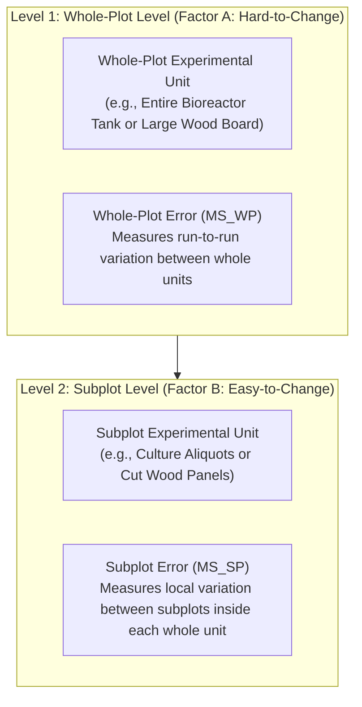

# Chapter 01: Split-Plot Design and Analysis
*The Dual-Error ANOVA Architecture in Excel and Base R Terminal*

---

## 1. What Defines a Split-Plot Design?

A **Split-Plot Design** is an experimental design specifically used when some factors are difficult or expensive to change, while other factors are easy to change.

### The Two Classes of Factors
1. **Hard-to-Change (HTC) Factor (Whole-Plot Factor, $A$):**  
   A factor whose settings take substantial time, energy, or equipment capacity to adjust.  
   *Examples:* Operating temperature of a large incubator, autoclave cycle duration, bioreactor pH setpoint, soil preparation technique.
2. **Easy-to-Change (ETC) Factor (Subplot Factor, $B$):**  
   A factor whose settings can be changed rapidly, locally, and independently on smaller sub-samples.  
   *Examples:* Nutrient media formulation, enzyme type, stain type, seed variety, sampling time point.

### The Two Levels of Experimental Units
In a standard Completely Randomized Design (CRD), there is only one size of experimental unit. In a Split-Plot Design, there are **two distinct sizes of experimental units**:
- **Whole-Plot Unit (WP Unit):** The large physical unit that receives one setting of the HTC factor (e.g., an entire incubator run, a full 50-L bioreactor tank, a large wooden board).
- **Subplot Unit (SP Unit):** The smaller physical subunit created by dividing the whole-plot unit (e.g., individual culture flasks inside the incubator, aliquots from the bioreactor, cut panels of the board).



---

## 2. Why Split-Plot Requires Two Error Terms

To understand why split-plot requires two error terms, we look at the **degrees of freedom** and the **expected variation**:

### A. Whole-Plot Level (Between Whole Plots)
Suppose we test Factor A at $a = 2$ levels with $r = 3$ replicates.
- You only perform $a \times r = 2 \times 3 = \mathbf{6}$ independent whole-plot runs.
- Total whole-plot degrees of freedom = $6 - 1 = \mathbf{5}$.
- Factor A degrees of freedom = $a - 1 = 2 - 1 = \mathbf{1}$.
- This leaves only $5 - 1 = \mathbf{4}$ degrees of freedom to estimate the experimental error between whole plots ($WP\ Error$).
- **Whole-Plot Error ($MS_{WP}$)** measures run-to-run variation between whole units treated with the same level of Factor A.

### B. Subplot Level (Within Whole Plots)
Within each whole-plot unit, you test Factor B at $b = 4$ levels.
- The 4 subplots inside the same whole plot experience identical whole-plot conditions (e.g., the same incubator fluctuations).
- Therefore, comparisons between levels of Factor B are not affected by whole-plot run-to-run noise.
- **Subplot Error ($MS_{SP}$)** measures the local random variation between subplots inside the same whole plot.
- Because local variation is smaller and has more degrees of freedom ($df = 12$), **$MS_{SP}$ is substantially smaller than $MS_{WP}$**.

### C. The Expected Mean Squares (EMS) & F-Test Rules

| Mean Square | What It Estimates (Components of Variance) | Correct F-Ratio | Denominator Used |
| :--- | :--- | :---: | :--- |
| **$MS_A$** | $\sigma^2_{SP} + b\sigma^2_{WP} + \frac{rb\sum \alpha_i^2}{a-1}$ | $F_A = \frac{MS_A}{MS_{WP}}$ | **$MS_{WP}$ (Whole-Plot Error)** |
| **$MS_{WP}$** | $\sigma^2_{SP} + b\sigma^2_{WP}$ | — | *(Acts as baseline for Factor A)* |
| **$MS_B$** | $\sigma^2_{SP} + \frac{ra\sum \beta_j^2}{b-1}$ | $F_B = \frac{MS_B}{MS_{SP}}$ | **$MS_{SP}$ (Subplot Error)** |
| **$MS_{AB}$** | $\sigma^2_{SP} + \frac{r\sum\sum (\alpha\beta)_{ij}^2}{(a-1)(b-1)}$ | $F_{AB} = \frac{MS_{AB}}{MS_{SP}}$ | **$MS_{SP}$ (Subplot Error)** |
| **$MS_{SP}$** | $\sigma^2_{SP}$ | — | *(Acts as baseline for B and AB)* |

> [!IMPORTANT]
> **The Decision Rule:**
> - To test **Factor A (Whole-Plot Factor)**: Divide by **$MS_{WP}$** with degrees of freedom $(a-1, \, a(r-1))$.
> - To test **Factor B (Subplot Factor)**: Divide by **$MS_{SP}$** with degrees of freedom $(b-1, \, a(r-1)(b-1))$.
> - To test **Interaction $A \times B$**: Divide by **$MS_{SP}$** with degrees of freedom $((a-1)(b-1), \, a(r-1)(b-1))$.

---

## 3. General Degrees of Freedom (DF) Arithmetic

Let:
- $a = \text{number of levels of Factor A}$
- $b = \text{number of levels of Factor B}$
- $r = \text{number of whole-plot replicates per level of A}$
- Total whole plots = $a \times r$
- Total observations $N = a \times b \times r$

| Source of Variation | Formula for DF | Example ($a=2, b=4, r=3, N=24$) |
| :--- | :---: | :---: |
| **Factor A (Whole Plot)** | $a - 1$ | $2 - 1 = \mathbf{1}$ |
| **Whole-Plot Error ($WP\ Error$)** | $a(r - 1)$ | $2(3 - 1) = \mathbf{4}$ |
| *(Total Whole-Plot DF)* | $ar - 1$ | $2(3) - 1 = \mathbf{5}$ |
| **Factor B (Subplot)** | $b - 1$ | $4 - 1 = \mathbf{3}$ |
| **Interaction ($A \times B$)** | $(a - 1)(b - 1)$ | $(1)(3) = \mathbf{3}$ |
| **Subplot Error ($SP\ Error$)** | $a(r - 1)(b - 1)$ | $2(2)(3) = \mathbf{12}$ |
| **Total Variation** | $abr - 1 = N - 1$ | $24 - 1 = \mathbf{23}$ |

Notice the exact balance:
$$\text{DF}_{Total} = \text{DF}_A + \text{DF}_B + \text{DF}_{AB} + \text{DF}_{WP} + \text{DF}_{SP}$$
$$23 = 1 + 4 + 3 + 3 + 12$$

---

## 4. Solving Split-Plot in Microsoft Excel: The Two-Step ToolPak Method

Microsoft Excel's Data Analysis ToolPak does not have a single dedicated "Split-Plot" button. However, you can generate the exact Split-Plot ANOVA table using the following **Two-Step ToolPak Procedure**:

### Step 1: Run "Anova: Single Factor" on Whole-Plot Averages
1. Compute the average response of each whole plot (e.g. 6 bioreactor or board averages).
2. Go to **Data > Data Analysis > Anova: Single Factor** and run it on these averages.
3. **The Scaling Rule:** Multiply the resulting Sums of Squares by $b$ (number of subplots per whole plot):
   $$SS_A = b \times SS_{Between}$$
   $$SS_{WP\ Error} = b \times SS_{Within}$$

### Step 2: Run "Anova: Two-Factor With Replication" on Raw Data
1. Arrange the raw data as a two-factor grid (Rows = Factor A, Columns = Factor B, with $r$ rows per sample).
2. Go to **Data > Data Analysis > Anova: Two-Factor With Replication**.
3. Extract from the ToolPak output:
   - $SS_{Total}$
   - $SS_{Columns}$ (which corresponds to $SS_B$)
   - $SS_{Interaction}$ (which corresponds to $SS_{AB}$)

### Step 3: Compute Subplot Error by Subtraction
1. Calculate Subplot Error Sum of Squares:
   $$SS_{SP\ Error} = SS_{Total} - SS_A - SS_{WP\ Error} - SS_B - SS_{AB}$$
2. Calculate Subplot Error Degrees of Freedom:
   $$DF_{SP\ Error} = DF_{Total} - DF_A - DF_{WP\ Error} - DF_B - DF_{AB}$$
3. Compute Mean Square:
   $$MS_{SP\ Error} = \frac{SS_{SP\ Error}}{DF_{SP\ Error}}$$
4. Compute $F$-ratios and p-values using the Excel formula `=F.DIST.RT(F, df1, df2)`.

---

## 5. Solving Split-Plot in Base R Terminal

In R Terminal, you do not need external packages. Base R includes the `aov()` function with the `Error()` model specification.

### Base R Syntax Template

```r
# 1. Define vectors
# Factor A (Whole Plot): e.g., 2 levels replicated 12 times each
A <- factor(rep(c("A1", "A2"), each = 12))

# Factor B (Subplot): e.g., 4 levels repeated 6 times
B <- factor(rep(c("B1", "B2", "B3", "B4"), times = 6))

# UNIQUE Whole-Plot Identifier: Each whole plot must have a unique ID!
# If you have 6 whole plots, IDs must run 1 to 6:
wp <- factor(rep(1:6, each = 4))

# Response vector (24 measurements)
y <- c( ... )

# 2. Combine into a dataframe
dat <- data.frame(wp, A, B, y)

# 3. Fit Split-Plot Model
# Error(wp) tells R that whole-plot units have their own error term
fit <- aov(y ~ A * B + Error(wp), data = dat)

# 4. Display the ANOVA Summary Table
summary(fit)
```

### Deconstructing the R Console Output

When you type `summary(fit)`, R produces two distinct output sections:

```
Error: wp
          Df Sum Sq Mean Sq F value Pr(>F)
A          1  SS_A   MS_A    F_A     p_A  
Residuals  4  SS_WP  MS_WP                

Error: Within
          Df Sum Sq Mean Sq F value Pr(>F)
B          3  SS_B   MS_B    F_B     p_B  
A:B        3  SS_AB  MS_AB   F_AB    p_AB 
Residuals 12  SS_SP  MS_SP                
```

1. **`Error: wp` Section:**
   - Evaluates the Whole-Plot level.
   - `Residuals` here is **$MS_{WP}$**.
   - `F value` for Factor A is calculated as $\frac{MS_A}{MS_{WP}}$.
2. **`Error: Within` Section:**
   - Evaluates the Subplot level.
   - `Residuals` here is **$MS_{SP}$**.
   - `F value` for Factor B is calculated as $\frac{MS_B}{MS_{SP}}$.
   - `F value` for Interaction `A:B` is calculated as $\frac{MS_{AB}}{MS_{SP}}$.

