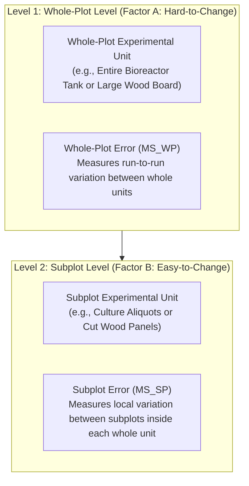

# Chapter 01: Split-Plot Design and Analysis
*Complete Guide Across All Three Workflows: Base R Terminal (CSV-Based), Excel ToolPak, and LibreOffice Calc*

---

## 1. What Defines a Split-Plot Design?

A **Split-Plot Design** is an experimental design specifically used when some factors are difficult or expensive to change, while other factors are easy to change.

### The Two Classes of Factors
1. **Hard-to-Change (HTC) Factor (Whole-Plot Factor, $A$):**  
   A factor whose settings require substantial time, energy, or equipment capacity to adjust.  
   *Examples:* Operating temperature of a large incubator, autoclave cycle duration, bioreactor pH setpoint, large wood panel pretreatment.
2. **Easy-to-Change (ETC) Factor (Subplot Factor, $B$):**  
   A factor whose settings can be changed rapidly, locally, and independently on smaller sub-samples.  
   *Examples:* Nutrient media formulation, enzyme type, stain type, seed variety, sampling time point.

### The Two Levels of Experimental Units
In a standard Completely Randomized Design (CRD), there is only one size of experimental unit. In a Split-Plot Design, there are **two distinct sizes of experimental units**:
- **Whole-Plot Unit (WP Unit):** The large physical unit that receives one setting of the HTC factor (e.g., an entire incubator run, a full 50-L bioreactor tank, a large wooden board).
- **Subplot Unit (SP Unit):** The smaller physical subunit created by dividing the whole-plot unit (e.g., individual culture flasks inside the incubator, aliquots from the bioreactor, cut panels of the board).



---

## 2. Why Split-Plot Requires Two Error Terms

To understand why split-plot requires two error terms, we look at the **degrees of freedom** and the **expected variation**:

### A. Whole-Plot Level (Between Whole Plots)
Suppose we test Factor A at $a = 2$ levels with $r = 3$ replicates.
- You only perform $a \times r = 2 \times 3 = \mathbf{6}$ independent whole-plot runs.
- Total whole-plot degrees of freedom = $6 - 1 = \mathbf{5}$.
- Factor A degrees of freedom = $a - 1 = 2 - 1 = \mathbf{1}$.
- This leaves only $5 - 1 = \mathbf{4}$ degrees of freedom to estimate the experimental error between whole plots ($WP\ Error$).
- **Whole-Plot Error ($MS_{WP}$)** measures run-to-run variation between whole units treated with the same level of Factor A.

### B. Subplot Level (Within Whole Plots)
Within each whole-plot unit, you test Factor B at $b = 4$ levels.
- The 4 subplots inside the same whole plot experience identical whole-plot conditions (e.g., the same incubator fluctuations).
- Therefore, comparisons between levels of Factor B are not affected by whole-plot run-to-run noise.
- **Subplot Error ($MS_{SP}$)** measures the local random variation between subplots inside the same whole plot.
- Because local variation is smaller and has more degrees of freedom ($df = 12$), **$MS_{SP}$ is substantially smaller than $MS_{WP}$**.

### C. The Expected Mean Squares (EMS) & F-Test Rules

| Mean Square | What It Estimates (Components of Variance) | Correct F-Ratio | Denominator Used |
| :--- | :--- | :---: | :--- |
| **$MS_A$** | $\sigma^2_{SP} + b\sigma^2_{WP} + \frac{rb\sum \alpha_i^2}{a-1}$ | $F_A = \frac{MS_A}{MS_{WP}}$ | **$MS_{WP}$ (Whole-Plot Error)** |
| **$MS_{WP}$** | $\sigma^2_{SP} + b\sigma^2_{WP}$ | — | *(Acts as baseline for Factor A)* |
| **$MS_B$** | $\sigma^2_{SP} + \frac{ra\sum \beta_j^2}{b-1}$ | $F_B = \frac{MS_B}{MS_{SP}}$ | **$MS_{SP}$ (Subplot Error)** |
| **$MS_{AB}$** | $\sigma^2_{SP} + \frac{r\sum\sum (\alpha\beta)_{ij}^2}{(a-1)(b-1)}$ | $F_{AB} = \frac{MS_{AB}}{MS_{SP}}$ | **$MS_{SP}$ (Subplot Error)** |
| **$MS_{SP}$** | $\sigma^2_{SP}$ | — | *(Acts as baseline for B and AB)* |

---

## 3. General Degrees of Freedom (DF) Arithmetic

Let:
- $a = \text{number of levels of Factor A}$
- $b = \text{number of levels of Factor B}$
- $r = \text{number of whole-plot replicates per level of A}$
- Total whole plots = $a \times r$
- Total observations $N = a \times b \times r$

| Source of Variation | Formula for DF | Example ($a=2, b=4, r=3, N=24$) |
| :--- | :---: | :---: |
| **Factor A (Whole Plot)** | $a - 1$ | $2 - 1 = \mathbf{1}$ |
| **Whole-Plot Error ($WP\ Error$)** | $a(r - 1)$ | $2(3 - 1) = \mathbf{4}$ |
| *(Total Whole-Plot DF)* | $ar - 1$ | $2(3) - 1 = \mathbf{5}$ |
| **Factor B (Subplot)** | $b - 1$ | $4 - 1 = \mathbf{3}$ |
| **Interaction ($A \times B$)** | $(a - 1)(b - 1)$ | $(1)(3) = \mathbf{3}$ |
| **Subplot Error ($SP\ Error$)** | $a(r - 1)(b - 1)$ | $2(2)(3) = \mathbf{12}$ |
| **Total Variation** | $abr - 1 = N - 1$ | $24 - 1 = \mathbf{23}$ |

Notice the exact balance:
$$\text{DF}_{Total} = \text{DF}_A + \text{DF}_B + \text{DF}_{AB} + \text{DF}_{WP} + \text{DF}_{SP}$$
$$23 = 1 + 4 + 3 + 3 + 12$$

---

## 4. Tidy Data Standards for R (How to Structure Your CSV in LibreOffice)

To analyze data in R without tears, you must follow the **Tidy Data Standard** (Hadley Wickham):

```
========================================================================================
                                TIDY DATA RULES FOR R
========================================================================================
1. Each COLUMN is a single VARIABLE (e.g., Whole-Plot ID, Factor A, Factor B, Response).
2. Each ROW is a single OBSERVATION (one unique experimental run / measurement).
3. The FIRST ROW contains clean, lowercase column headers with NO SPACES:
   e.g., wp, temp, feed, titer   (NOT "Whole Plot #", NOT "Temp (°C)")
4. Each CELL contains only one single value (numbers or simple text codes).
========================================================================================
```

### Contrast: The Wrong Way vs. The Tidy Way

#### ❌ The Wrong Way (Wide Matrix / Human Reading Format)
In spreadsheets, people often enter data in a two-dimensional grid:

| Bioreactor | Temp | Feed 1 | Feed 2 | Feed 3 | Feed 4 |
| :---: | :---: | :---: | :---: | :---: | :---: |
| 1 | 32C | 5.00 | 6.62 | 9.45 | 6.02 |
| 2 | 32C | 3.95 | 6.00 | 6.86 | 4.26 |

*Why this fails in R:* R does not know that "Feed 1", "Feed 2", etc. are levels of a factor called `feed`. It treats them as 4 separate unrelated variables!

#### ✅ The Tidy Way (Long Format for R)
Every single measurement gets its own row:

```csv
wp,temp,feed,titer
1,32C,1,5.00
1,32C,2,6.62
1,32C,3,9.45
1,32C,4,6.02
2,32C,1,3.95
2,32C,2,6.00
2,32C,3,6.86
2,32C,4,4.26
3,32C,1,4.76
...
```

### How to Create & Export This CSV in LibreOffice Calc:
1. Open terminal on your CachyOS system and launch LibreOffice Calc:
   ```bash
   localc &
   ```
2. Type your clean headers in row 1: `wp`, `temp`, `feed`, `titer`.
3. Enter your data row by row (24 rows of observations).
4. Save the file: **File > Save As...**
   - File name: `split_plot_data.csv`
   - File type: Select **Text CSV (.csv)**.
   - Check the box **"Edit filter settings"** if prompted, and ensure Field Delimiter is `,` (comma) and Character Set is `Unicode (UTF-8)`.
   - Save directly in your working directory.

---

## 5. Method 1: The Base R Way (CSV-Based & Zero-Knowledge Friendly)

This is your exact script to type into R Terminal. It reads your newly created CSV file, converts the design columns into categorical factors, fits the Split-Plot model, and prints the ANOVA table.

### Ready-Made Base R Script:

```r
# ==============================================================
# BASE R SPLIT-PLOT WORKFLOW (FROM CSV)
# ==============================================================

# 1. Read your CSV file into an R data frame
# (Make sure R's working directory is where your file is saved)
dat <- read.csv("split_plot_data.csv")

# 2. Check the first few rows to ensure import succeeded
head(dat)

# 3. CRITICAL STEP: Convert columns to categorical factors!
# By default, numbers (like 1, 2, 3) are treated as continuous numeric math.
# We MUST tell R they are categorical design labels using factor():
dat$wp   <- factor(dat$wp)    # Unique Whole-Plot ID (e.g. 1 to 6)
dat$temp <- factor(dat$temp)  # Factor A (HTC factor)
dat$feed <- factor(dat$feed)  # Factor B (ETC factor)

# 4. Fit the Split-Plot ANOVA Model
# Syntax: aov(Response ~ WP_Factor * SP_Factor + Error(WP_ID), data = dat)
model <- aov(titer ~ temp * feed + Error(wp), data = dat)

# 5. Print the complete ANOVA summary table
summary(model)
```

### Explaining Every Single Line (For Complete Beginners):
- `read.csv("split_plot_data.csv")`: Imports the spreadsheet file into R as a table object called `dat`.
- `head(dat)`: Shows the first 6 rows so you can visually verify that your numbers and headers loaded cleanly.
- `dat$wp <- factor(dat$wp)`: The `$` operator extracts a single column. `factor(...)` tells R: *"Do not treat 1, 2, 3 as quantities to add or multiply; treat them as group labels (categories)."*
- `Error(wp)`: This is the magic phrase for Split-Plot designs. It tells R that observations belonging to the same `wp` share an error variance, splitting the ANOVA into two tiers automatically.
- `summary(model)`: Computes and formats the official Split-Plot ANOVA table with exact Sums of Squares, Mean Squares, $F$-values, and p-values.

### How to Read the Output in R Terminal:
```
Error: wp
          Df Sum Sq Mean Sq F value Pr(>F)
temp       1  12.06  12.056   2.914  0.163
Residuals  4  16.55   4.137               

Error: Within
          Df Sum Sq Mean Sq F value   Pr(>F)    
feed       3  39.09  13.029   45.94 7.47e-07 ***
temp:feed  3   0.88   0.295    1.04     0.41    
Residuals 12   3.40   0.284                     
---
Signif. codes:  0 ‘***’ 0.001 ‘**’ 0.01 ‘*’ 0.05 ‘.’ 0.1 ‘ ’ 1
```
- In `Error: wp`: Factor `temp` is tested against `Residuals` ($MS_{WP} = 4.137$).
- In `Error: Within`: Factor `feed` and interaction `temp:feed` are tested against `Residuals` ($MS_{SP} = 0.284$).

---

## 6. Method 2: The Expected Excel ToolPak Way

If the exam specifically requires you to write down the steps for Microsoft Excel's Analysis ToolPak, here is the official 2-step procedure:

1. **Step 1: Run "Anova: Single Factor" on Whole-Plot Averages**
   - Compute the average response of each whole plot.
   - Go to **Data > Data Analysis > Anova: Single Factor**.
   - Select the averages.
   - **The Scaling Rule:** Multiply the resulting Sums of Squares by $b$ (number of subplots per whole plot):
     $$SS_A = b \times SS_{Between}, \quad SS_{WP\ Error} = b \times SS_{Within}$$

2. **Step 2: Run "Anova: Two-Factor With Replication" on Raw Data**
   - Arrange the raw data into a grid (Rows = Factor A, Columns = Factor B, with $r$ rows per sample).
   - Go to **Data > Data Analysis > Anova: Two-Factor With Replication**.
   - Set **Rows per sample** = $r$.
   - Extract: $SS_{Total}$, $SS_{Columns}$ ($SS_B$), and $SS_{Interaction}$ ($SS_{AB}$).

3. **Step 3: Calculate Subplot Error by Subtraction**
   - $SS_{SP\ Error} = SS_{Total} - SS_A - SS_{WP\ Error} - SS_B - SS_{AB}$
   - $DF_{SP\ Error} = DF_{Total} - DF_A - DF_{WP\ Error} - DF_B - DF_{AB}$
   - $MS_{SP\ Error} = \frac{SS_{SP\ Error}}{DF_{SP\ Error}}$
   - Calculate p-values via `=F.DIST.RT(F_stat, df1, df2)`.

---

## 7. Method 3: The LibreOffice Calc Way (Linux / CachyOS)

Since you are running CachyOS, you have LibreOffice Calc installed (`localc`). LibreOffice Calc includes a built-in statistical analysis tool that mirrors Excel's ToolPak:

1. **Step 1: Whole-Plot Analysis on Means**
   - Compute whole-plot averages in two columns (representing the two levels of Factor A).
   - In LibreOffice Calc, go to:  
     **Data > Statistics > Analysis of Variance (ANOVA)**
   - Select **Type: Single Factor**, select your whole-plot averages, and pick an output cell.
   - Extract `SS Between` and `SS Within`. Multiply both by $b = 4$ to obtain $SS_A$ and $SS_{WP\ Error}$.

2. **Step 2: Two-Factor Analysis on Raw Data**
   - Arrange the raw data into a grid with rows grouped by Factor A and columns representing Factor B.
   - Go to **Data > Statistics > Analysis of Variance (ANOVA)**.
   - Select **Type: Two Factor**, enter **Rows per sample: 3**, and select the grid.
   - Read $SS_{Total}$, $SS_{Columns}$ ($SS_B$), and $SS_{Interaction}$ ($SS_{AB}$).

3. **Step 3: Formula Calculations**
   - Compute Subplot Error SS by subtraction: `=Total_SS - SS_A - SS_WP - SS_B - SS_AB`.
   - Compute $MS_{SP} = SS_{SP} / DF_{SP}$.
   - Compute p-values using `=F.DIST.RT(F_stat, df1, df2)` (identical to Excel).

---

## Summary Comparison of the Three Approaches

| Feature | Base R Terminal (from CSV) | Excel ToolPak | LibreOffice Calc |
| :--- | :--- | :--- | :--- |
| **Data Preparation** | Type tidy CSV in LibreOffice $\rightarrow$ `read.csv()` | Format into two separate custom tables | Format into two separate custom tables |
| **Execution Steps** | **1 step** (`aov()` with `Error(wp)`) | 3 steps (Single + Two-Factor + Subtraction) | 3 steps (Single + Two-Factor + Subtraction) |
| **Risk of Error** | **Zero** (R routes errors automatically) | High (forgetting scaling factor $b$ or subtraction) | High (same manual subtraction steps) |
| **Exam Recommendation** | **Primary choice (100% recommended)** | Know the theory in case asked for ToolPak steps | Practical fallback for spreadsheet verification |
