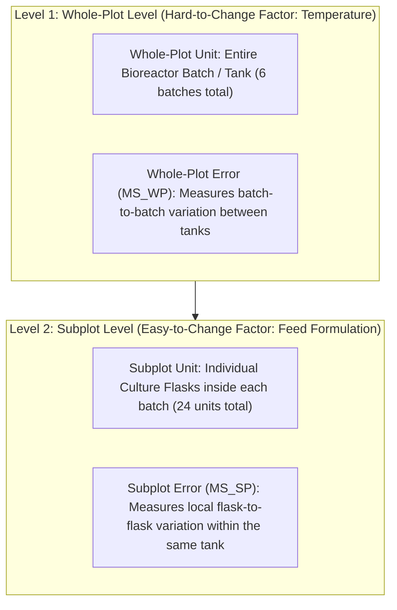

# Chapter 01: Split-Plot Design and Analysis
*From Core Wet-Lab Intuition to Complete Step-by-Step Execution in Excel ToolPak and Base R*

---

## 1. What is a Split-Plot Design? (The Practical Dilemma)

In standard textbooks, experiments are presented as completely randomized: if you want to test 2 temperatures and 4 feeds with 3 replicates ($2 \times 4 \times 3 = 24$ runs), you are supposed to completely randomize the order of all 24 runs.

### Why This is Physically Impossible in a Wet Lab:
Imagine setting up a 50-Liter fermenter or large incubator:
- Run 1 at $37^\circ\text{C}$
- Run 2 at $30^\circ\text{C}$
- Run 3 at $37^\circ\text{C}$
- Run 4 at $30^\circ\text{C}$...
Heating up, cooling down, and stabilizing a 50-L vessel takes 24 to 48 hours per change. Doing this 24 times would take months and waste enormous power!

### The Sensible Engineering Solution:
1. Turn the vessel to $37^\circ\text{C}$.
2. While that whole vessel is at $37^\circ\text{C}$, divide the broth into 4 separate culture flasks or vessels, giving each one of the 4 Feeds (Feed 1, 2, 3, 4).
3. Repeat this for a total of 6 vessel batches (3 batches at $32^\circ\text{C}$ and 3 batches at $37^\circ\text{C}$).



This is a **Split-Plot Design**:
- **Whole-Plot Factor ($A$):** The Hard-to-Change factor applied to the big unit (Temperature).
- **Subplot Factor ($B$):** The Easy-to-Change factor applied to the smaller sub-units (Feed).

---

## 2. Why Regular ANOVA is Mathematically Invalid for Split-Plot

> [!CAUTION]
> **The Most Dangerous Mistake in the Midterm:**  
> If you run a standard Two-Way ANOVA on this experiment, you will get an automatic zero on the analysis portion. Here is why:

### The Two Different Error Variances:
1. **At the Whole-Plot Level (Tanks):**  
   How many independent temperature batches were run? **Only 6 batches in total!**  
   Because there were only 3 tanks at $32^\circ\text{C}$ and 3 tanks at $37^\circ\text{C}$, you only have $6 - 2 = \mathbf{4\text{ degrees of freedom}}$ to estimate experimental error between tanks. Big industrial tanks have noticeable batch-to-batch noise ($\sigma^2_{WP}$ is large).
2. **At the Subplot Level (Flasks inside a tank):**  
   Inside the *same* tank, all 4 flasks experience the exact same temperature fluctuations. Comparing Feeds against each other is shielded from tank-to-tank noise. Flask-to-flask error ($\sigma^2_{SP}$) is tiny!

### What Regular ANOVA Does Wrong (Pooling Errors):
Standard Two-Way ANOVA pools the large tank noise and tiny flask noise into a single average error with $16$ degrees of freedom ($MS_{Pooled} = 1.25$).  
If Temperature ($MS = 12.06$) is tested against this artificially small pooled error:
$$F = \frac{12.06}{1.25} = \mathbf{9.67}, \quad p = \mathbf{0.0067} \quad (\text{Falsely Significant!})$$

In reality, when tested against the true batch-to-batch tank noise ($MS_{WP} = 4.14$):
$$F = \frac{12.06}{4.14} = \mathbf{2.91}, \quad p = \mathbf{0.163} \quad (\text{NOT Significant!})$$
Standard ANOVA commits a **Type I Error (False Positive)**—it claims temperature works when the observed difference was just normal tank-to-tank variation!

---

## 3. The Arithmetic of the Split-Plot ANOVA Table

You do not need matrix algebra to build the table. You only need basic arithmetic:

Let:
- $a = \text{number of levels of Factor A (e.g., 2 temperatures)}$
- $b = \text{number of levels of Factor B (e.g., 4 feeds)}$
- $r = \text{number of whole-plot replicates (e.g., 3 tanks per temperature)}$
- Total observations $N = a \times b \times r = 2 \times 4 \times 3 = 24$.

### Degrees of Freedom ($df$) Rules:
1. $\text{DF}_{Total} = N - 1 = 24 - 1 = \mathbf{23}$ (Total independent pieces of data in the experiment).
2. $\text{DF}_A = a - 1 = 2 - 1 = \mathbf{1}$ (1 independent comparison between the 2 temperatures).
3. $\text{DF}_{WP\ Error} = a(r - 1) = 2(3 - 1) = \mathbf{4}$  
   *(Notice: Whole-Plot Total DF = $1 + 4 = 5 = 6\text{ tanks} - 1$. There are only 4 DF to estimate tank-to-tank error!)*
4. $\text{DF}_B = b - 1 = 4 - 1 = \mathbf{3}$ (3 independent comparisons among the 4 feeds).
5. $\text{DF}_{AB} = (a - 1)(b - 1) = (1)(3) = \mathbf{3}$ (Interaction combinations).
6. $\text{DF}_{SP\ Error} = \text{DF}_{Total} - \text{DF}_A - \text{DF}_{WP} - \text{DF}_B - \text{DF}_{AB} = 23 - 1 - 4 - 3 - 3 = \mathbf{12}$

> [!TIP]
> **Comparing Error Degrees of Freedom: Why Subplots Win:**
> - $\text{DF}_{WP\ Error} = \mathbf{4}$ (Low value $\implies$ Low precision, large critical threshold $F_{crit} = 7.71$).
> - $\text{DF}_{SP\ Error} = \mathbf{12}$ (High value $\implies$ High precision, low critical threshold $F_{crit} = 3.49$).
> - **Statistical Takeaway:** A high value of error degrees of freedom is always good because it provides high statistical power to detect real differences. The subplot factor is tested with 3 times as many degrees of freedom ($12$ vs $4$)!

### Mean Squares ($MS$) & The Two $F$-Tests:
$$MS = \frac{SS}{df}$$

| Term Being Tested | Numerator | Denominator (The Error Term) | Reason |
| :--- | :---: | :---: | :--- |
| **Factor A (Temperature)** | $MS_A$ | **$MS_{WP}$ (Whole-Plot Error)** | Tested against tank-to-tank batch noise. |
| **Factor B (Feed)** | $MS_B$ | **$MS_{SP}$ (Subplot Error)** | Tested against local flask-to-flask noise. |
| **Interaction ($A \times B$)** | $MS_{AB}$ | **$MS_{SP}$ (Subplot Error)** | Tested against local flask-to-flask noise. |

---

## 4. Track 1: The Expected Excel ToolPak Method (Step-by-Step)

Because Microsoft Excel does not have a single "Split-Plot" button, your professor expects you to construct the Split-Plot table using the **Two-Step ToolPak Method**.

### Why the Scaling Factor $b$ Exists (Simple Arithmetic Explanation)
When you average the 4 flasks in a tank, you get an average $\bar{y}$.  
By basic math, an average of 4 numbers has **one-fourth the variance** of individual numbers:
$$\text{Variance of a mean} = \frac{\text{Variance of individual numbers}}{4}$$
Therefore, when Excel runs ANOVA on tank averages, the resulting Sum of Squares is **4 times too small**!  
To bring it back to the scale of individual measurements, **you must multiply the Sum of Squares by $b = 4$**.

---

### Step-by-Step Excel Instructions:

#### Step 1: Calculate Tank Means & Run Single Factor ANOVA
1. In Excel, compute the average of each of the 6 tanks (e.g., `=AVERAGE(C2:F2)`).
2. Arrange the 6 averages into two columns:
   - Column 1 ($32^\circ\text{C}$): Tank 1, Tank 2, Tank 3 means
   - Column 2 ($37^\circ\text{C}$): Tank 4, Tank 5, Tank 6 means
3. Go to **Data > Data Analysis > Anova: Single Factor**. Select these two columns.
4. ToolPak outputs:
   - Between Groups SS = $3.014$
   - Within Groups SS = $4.137$
5. **Multiply by $b = 4$:**
   $$SS_{Temp} = 4 \times 3.014 = \mathbf{12.056}$$
   $$SS_{WP\ Error} = 4 \times 4.137 = \mathbf{16.550}$$

#### Step 2: Run Two-Factor ANOVA on Raw Data Grid
1. Arrange raw data into a grid: Rows = Temperature (3 rows for $32^\circ\text{C}$, 3 rows for $37^\circ\text{C}$), Columns = the 4 Feeds.
2. Go to **Data > Data Analysis > Anova: Two-Factor With Replication**.
   - Set **Rows per sample: 3**.
3. From the output table, extract three numbers:
   - $SS_{Total} = \mathbf{71.98}$
   - $SS_{Columns} (\text{Feed}) = \mathbf{39.09}$
   - $SS_{Interaction} = \mathbf{0.88}$

#### Step 3: Compute Subplot Error by Subtraction
In an empty cell in Excel:
$$SS_{SP\ Error} = SS_{Total} - SS_{Temp} - SS_{WP\ Error} - SS_{Feed} - SS_{Interaction}$$
$$SS_{SP\ Error} = 71.98 - 12.056 - 16.550 - 39.09 - 0.88 = \mathbf{3.40}$$
$$MS_{SP\ Error} = \frac{3.40}{12} = \mathbf{0.284}$$

#### Step 4: Compute P-Values via Formula
- For Temp: $F = \frac{12.056}{4.137} = 2.91 \implies$ `=F.DIST.RT(2.91, 1, 4)` $\rightarrow \mathbf{0.163}$
- For Feed: $F = \frac{13.029}{0.284} = 45.94 \implies$ `=F.DIST.RT(45.94, 3, 12)` $\rightarrow \mathbf{7.47 \times 10^{-7}}$
- For Interaction: $F = \frac{0.295}{0.284} = 1.04 \implies$ `=F.DIST.RT(1.04, 3, 12)` $\rightarrow \mathbf{0.410}$

---

## 5. Track 2: The R Way via CSV (Your Exam Weapon)

This is how you can solve Question 1 in 30 seconds using R Terminal on your laptop:

### Step 1: Create a Tidy CSV in LibreOffice Calc
Open LibreOffice Calc (`localc &`), type your data row by row, and save as `split_plot.csv`:

```csv
wp,temp,feed,titer
1,32C,1,5.00
1,32C,2,6.62
1,32C,3,9.45
1,32C,4,6.02
2,32C,1,3.95
...
6,37C,4,3.44
```

### Step 2: The 5-Line Base R Script
Open R Terminal (`R`) in the same folder and type:

```r
# 1. Read your LibreOffice CSV file
dat <- read.csv("split_plot.csv")

# 2. Tell R that these numbers are group categories (NOT continuous math)
dat$wp   <- factor(dat$wp)    # Unique Tank ID (1 to 6)
dat$temp <- factor(dat$temp)  # Factor A
dat$feed <- factor(dat$feed)  # Factor B

# 3. Fit Split-Plot Model
# Error(wp) tells R to use whole-plot error for temp and subplot error for feed!
fit <- aov(titer ~ temp * feed + Error(wp), data = dat)

# 4. View results
summary(fit)
```

### What R Prints Out:
```
Error: wp
          Df Sum Sq Mean Sq F value Pr(>F)
temp       1  12.06  12.056   2.914  0.163
Residuals  4  16.55   4.137               

Error: Within
          Df Sum Sq Mean Sq F value   Pr(>F)    
feed       3  39.09  13.029   45.94 7.47e-07 ***
temp:feed  3   0.88   0.295    1.04     0.41    
Residuals 12   3.40   0.284                     
```
Notice how R's output matches the ToolPak table perfectly, without doing any manual scaling or subtraction!

