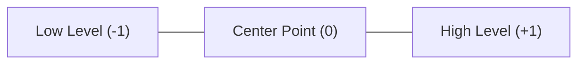
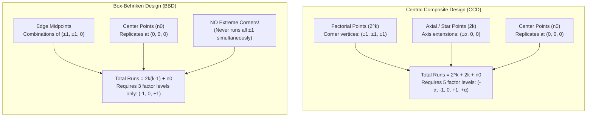

# Chapter 02: Response Surface Methodology (RSM), CCD & BBD
*Second-Order Modeling, Factor Coding, and Eigenanalysis Explained with Basic Arithmetic*

---

## 1. Why Do We Need Second-Order Models? (The Hilltop Concept)

Imagine hiking on a mountain trail:
- If a mathematical model is **first-order (linear)**:
  $$y = \beta_0 + \beta_1 x_1 + \beta_2 x_2$$
  This describes a **completely flat, tilted ramp**. If you walk along a ramp, it goes up or down forever. It has **no peak, no valley, and no optimum**.
- To model a **mountain peak (maximum yield)** or a **valley basin (minimum impurities)**, the ground must bend and curve downwards:
  $$\text{Yield} = \text{Intercept} + \text{Slopes} - (\text{Curvature}) \times x^2$$
  The squared term ($x^2$) is what introduces **curvature**!

### The Second-Order Model in Words:
$$\hat{y} = \beta_0 + \underbrace{\sum \beta_i x_i}_{\text{Linear Slopes}} + \underbrace{\sum \beta_{ii} x_i^2}_{\text{Curvature terms}} + \underbrace{\sum\sum \beta_{ij} x_i x_j}_{\text{Twist / Interaction terms}}$$

- **Negative quadratic term (e.g., $-3.75 x_1^2$):** Bends downwards like a dome $\implies$ Produces a **peak**!
- **Positive quadratic term (e.g., $+3.75 x_1^2$):** Bends upwards like a bowl $\implies$ Produces a **valley**.

---

## 2. Factor Coding Math Explained with Simple Arithmetic

In a biology experiment, your factors might be:
- Temperature: $30^\circ\text{C}$ to $40^\circ\text{C}$
- Enzyme concentration: $0.5\text{ mg/mL}$ to $1.5\text{ mg/mL}$
- Time: $15\text{ min}$ to $45\text{ min}$

These factors have completely different numerical scales. If you put them directly into an equation, a 1-unit change in temperature ($1^\circ\text{C}$) is tiny compared to a 1-unit change in enzyme ($1\text{ mg/mL}$ is doubling the enzyme!).  
To treat all factors equally and fairly, we convert them into **dimensionless coded numbers ($x_i$)** centered at $0$:



### The Coding Formula (Simple 2-Step Arithmetic):
$$x_i = \frac{X_i - \text{Midpoint}}{\text{Half-Step}}$$

1. **Find the Midpoint (Center, $0$):**
   $$\text{Midpoint} = \frac{\text{High} + \text{Low}}{2}$$
2. **Find the Half-Step (Distance to $+1$):**
   $$\text{Half-Step} = \frac{\text{High} - \text{Low}}{2}$$

#### Concrete Example:
For Temperature ($30^\circ\text{C}$ to $40^\circ\text{C}$):
- $\text{Midpoint} = \frac{40 + 30}{2} = 35^\circ\text{C}$
- $\text{Half-Step} = \frac{40 - 30}{2} = 5^\circ\text{C}$
- **Formula:**
  $$x_1 = \frac{\text{Temp} - 35}{5}$$
  - If Temp = $40^\circ\text{C} \implies x_1 = \frac{40 - 35}{5} = \mathbf{+1}$
  - If Temp = $35^\circ\text{C} \implies x_1 = \frac{35 - 35}{5} = \mathbf{0}$
  - If Temp = $30^\circ\text{C} \implies x_1 = \frac{30 - 35}{5} = \mathbf{-1}$

### How to Decode Back to Physical Units:
If R tells you the optimal coded value is $x_{1,0} = +0.115$:
$$\text{Optimal Temp} = \text{Midpoint} + (\text{Coded Value} \times \text{Half-Step})$$
$$\text{Optimal Temp} = 35 + (0.115 \times 5) = 35 + 0.575 = \mathbf{35.58^\circ\text{C}}$$

---

## 3. CCD vs. BBD: Why Wet Labs Prefer BBD

To fit a second-order model with curvature ($x^2$), each factor must be tested at **a minimum of 3 distinct levels** (low, medium, high).



### The 2 Big Reasons Wet-Lab Scientists Prefer Box-Behnken (BBD):
1. **Safety from Severe Cell Death / Protein Degradation:**  
   In a CCD, you test extreme corner combinations like $(+1, +1, +1)$ or axial extensions $(\pm 1.68)$. In a biological lysis experiment, running at the highest temperature, highest enzyme, and longest time simultaneously will denature or aggregate your protein. **BBD completely avoids extreme corners!**
2. **Fewer Concentrations to Prepare:**  
   BBD only requires **3 factor levels** ($-1, 0, +1$). In contrast, a CCD requires **5 factor levels** ($-\alpha, -1, 0, +1, +\alpha$). Preparing 3 stock concentrations in the lab is much easier and faster than preparing 5!

---

## 4. Lack of Fit Test: Why $p > 0.05$ is Good News

In standard ANOVA, $p < 0.05$ is what you want (it means your treatment had a significant effect).  
**In the Lack of Fit test, this is completely reversed!**

### What Lack-of-Fit Asks:
The total residual variation is split into two pieces:
$$\text{Residual Error} = \text{Lack of Fit} + \text{Pure Error}$$

1. **Pure Error:** Random variation between identical replicate runs at the center point $(0, 0, 0)$. This is pure, un-modeled lab noise.
2. **Lack of Fit:** The distance between the fitted curve and the actual data points.
3. **The Test Statistic:**
   $$F_{LOF} = \frac{MS_{Lack\ of\ fit}}{MS_{Pure\ error}}$$

- **If the model fits the data well:** The distance between the curve and the points is no bigger than normal lab noise. $F_{LOF} \approx 1.0 \implies \mathbf{p > 0.05}$.  
  **Conclusion:** Fail to reject $H_0$. The model fits the real world accurately!
- **If the model fits poorly:** The curve misses the data by a huge margin. $F_{LOF} \gg 1.0 \implies \mathbf{p < 0.05}$.  
  **Conclusion:** Reject $H_0$. Your quadratic equation failed to describe the biology.

> [!IMPORTANT]
> **Exam Rule:** For Lack of Fit, you **WANT $p > 0.05$**!

---

## 5. Eigenanalysis: How to Tell if You Found a Mountain Peak

When R fits your model, it calculates the **Stationary Point ($\mathbf{x}_0$)**—the exact coordinates where the surface slopes become completely flat (derivative = $0$).

Now, is that flat spot a **mountain peak (optimum)**, a **valley basin (minimum)**, or a **mountain pass / saddle**?  
R performs an **Eigenanalysis**, calculating numbers called **eigenvalues ($\lambda_1, \lambda_2, \lambda_3$)**:

| Eigenvalues ($\lambda_i$) | Physical Meaning | Geometric Shape | Optimization Result |
| :--- | :--- | :--- | :--- |
| **All Negative** ($\lambda_1 < 0, \lambda_2 < 0, \lambda_3 < 0$) | In every direction you step, the surface curves downwards | Mountain Peak (Dome) | **Local Maximum (True Optimum!)** — Highest yield |
| **All Positive** ($\lambda_1 > 0, \lambda_2 > 0, \lambda_3 > 0$) | In every direction you step, the surface curves upwards | Valley Basin (Bowl) | **Local Minimum** — Useful if minimizing impurities or cost |
| **Mixed Signs** (Some positive, some negative) | Curves down in one direction, up in another direction | Mountain Pass (Horse Saddle) | **Saddle Point** — No unique optimum |
| **Zero or Near-Zero** ($\lambda \approx 0$) | Surface is completely flat along that axis | Stationary Ridge / Trough | **Ridge System** — Inconclusive single point |

In our practice problem, R outputs:
$$\lambda_1 = -2.49, \quad \lambda_2 = -3.73, \quad \lambda_3 = -4.93$$
Because **all three eigenvalues are negative**, you have definitively proven that your stationary point is an **unambiguous local maximum (optimum)**!

---

## 6. The Complete CSV-Based R Script for Question 2

Create `bbd.csv` in LibreOffice Calc with coded columns `x1,x2,x3,yield` and run:

```r
library(rsm)

# 1. Read your LibreOffice CSV file
dat <- read.csv("bbd.csv")

# 2. Fit Second-Order (SO) response surface model
fit <- rsm(yield ~ SO(x1, x2, x3), data = dat)

# 3. Print complete regression output, ANOVA, Lack-of-Fit, & Stationary point
summary(fit)

# 4. Predict yield at the optimal coordinates (x1=0.115, x2=0.289, x3=-0.207):
predict(fit, data.frame(x1 = 0.1145743, x2 = 0.2886621, x3 = -0.2067901))
```

