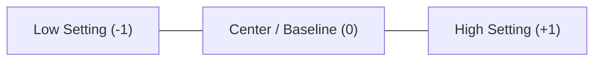
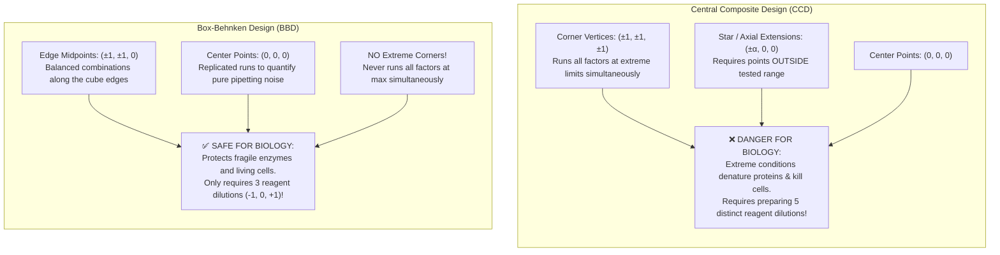

# Chapter 02: Response Surface Methodology (RSM), CCD & BBD
*The Biologist's Guide: Optimizing Wet-Lab Processes Without Intimidating Math or Equations*

---

## 1. Why Do Biologists Need Response Surfaces? (The Hilltop Concept)

In wet-lab biology, almost nothing behaves like a straight line:
- If you increase temperature, enzymes work faster at first. But heat them too much, and the proteins **denature and precipitate**, causing yield to drop to zero!
- If you increase substrate or nutrient concentration, cell growth accelerates until **substrate inhibition or toxicity** kicks in.

This natural rise-and-fall creates a curved biological **hilltop (an upside-down bowl)** where the optimal yield lives.

### Why Standard Linear Models Fail:
A standard straight-line equation describes a flat, tilted ramp:
- If you walk along a ramp, it goes up or down forever.
- A flat ramp has **no peak, no valley, and no optimum condition**.

### How RSM Captures Biological Reality:
To find an optimal peak, our statistical model must bend:

$$\text{Yield} = \text{Baseline} + \text{Slopes (Direction)} - \text{Curvature (The Bend)} + \text{Interactions (Synergy)}$$

- **Slopes (First-Order):** Tells you which general direction increases yield (e.g., "more enzyme generally helps").
- **Curvature (The Bend):** Bends the surface downwards into a dome so it has a definite **peak**.
- **Interactions (Synergy):** Captures how factors work together (e.g., enzyme concentration might work great at $35^\circ\text{C}$ but get destroyed at $40^\circ\text{C}$).

---

## 2. Factor Coding: Normalizing Your Lab Bench Protocol

In a typical wet-lab experiment, your factors have completely different physical units:
- Temperature: $30^\circ\text{C}$ to $40^\circ\text{C}$
- Lysozyme enzyme: $0.5\text{ mg/mL}$ to $1.5\text{ mg/mL}$
- Incubation time: $15\text{ min}$ to $45\text{ min}$

A 1-unit change in temperature ($1^\circ\text{C}$) is tiny, whereas a 1-unit change in enzyme ($1.0\text{ mg/mL}$) is double the concentration!  
To treat all bench parameters equally, RSM standardizes your incubator and pipette settings onto a simple **3-point coded dial**:



### The 2-Step Bench Translation (No Heavy Math):
1. **Find your Center (Coded 0):** The midpoint between your high and low bench settings.
2. **Find your Step Size (The distance to +1):** Half the distance from low to high.

| Bench Parameter | Low ($-1$) | Center ($0$) | High ($+1$) | Step Size ($1$ Coded Unit) |
| :--- | :---: | :---: | :---: | :---: |
| **Lysis Temp** | $30^\circ\text{C}$ | **$35^\circ\text{C}$** | $40^\circ\text{C}$ | $5^\circ\text{C}$ |
| **Lysozyme Conc** | $0.5\text{ mg/mL}$ | **$1.0\text{ mg/mL}$** | $1.5\text{ mg/mL}$ | $0.5\text{ mg/mL}$ |
| **Incubation Time** | $15\text{ min}$ | **$30\text{ min}$** | $45\text{ min}$ | $15\text{ min}$ |

### How to Read R's Optimal Answer in Physical Lab Units:
When R calculates your optimal condition, it gives you coded coordinates (e.g., $x_1 = +0.115$).  
To set your lab incubator, simply **start at the Center and take that fraction of a step**:

$$\text{Optimal Setting} = \text{Center Value} + (\text{R's Coded Coordinate} \times \text{Step Size})$$

- **Optimal Temp:** $35^\circ\text{C} + (+0.115 \times 5^\circ\text{C}) = \mathbf{35.58^\circ\text{C}}$
- **Optimal Lysozyme:** $1.0\text{ mg/mL} + (+0.289 \times 0.5\text{ mg/mL}) = \mathbf{1.14\text{ mg/mL}}$
- **Optimal Time:** $30\text{ min} + (-0.207 \times 15\text{ min}) = \mathbf{26.90\text{ min}}$

No matrix inversion or calculus needed—just one simple step from your baseline!

---

## 3. CCD vs. BBD: Why Wet Labs Strongly Prefer Box-Behnken (BBD)

To detect curvature and locate a biological peak, you must test each factor at a minimum of 3 levels (Low, Center, High). Two common experimental designs exist:



### The 2 Major Wet-Lab Advantages of BBD:
1. **Safety from Severe Cell Death & Protein Inactivation:**  
   In a CCD, you are forced to run extreme corner combinations like $(+1, +1, +1)$—maximum temperature, maximum enzyme, and maximum time all at once. In a real wet lab, that completely aggregates antibodies or fries cells. **BBD completely avoids extreme corners**, keeping conditions safely within biologically viable ranges.
2. **Pipetting Simplicity at the Lab Bench:**  
   BBD only requires **3 stock dilutions** ($-1, 0, +1$). In contrast, a CCD requires **5 stock dilutions** ($-\alpha, -1, 0, +1, +\alpha$), which is much more tedious and prone to pipetting errors. Furthermore, for 3 factors, BBD requires only **15 runs** compared to 20 for CCD!

---

## 4. The Lack-of-Fit Test: Is Your Model Lying to You?

When you fit a response surface in R, the software splits unexplained variation into two parts:
1. **Pure Laboratory Noise (Pure Error):** Differences between your replicate tubes at the exact same center point $(0, 0, 0)$. This is natural biological variation and pipette noise.
2. **Model Error (Lack of Fit):** How far the fitted surface is from the actual experimental data points.

### The Biologist's Golden Rule for Lack-of-Fit:
In normal ANOVA, you hunt for $p < 0.05$ (to prove a treatment had a real effect).  
**In the Lack-of-Fit test, this is completely flipped:**

- If **$p > 0.05$ (Good News!):** There is **no significant lack of fit**. The distance between your model and your data is no bigger than normal pipetting noise. Your response surface model is valid and trustworthy!
- If **$p < 0.05$ (Bad News):** The model fails to follow the biology. Your quadratic surface misses real trends.

> [!IMPORTANT]
> **Exam Quick-Check:** For the Lack of Fit test, you **WANT $p > 0.05$**!

---

## 5. Finding the Peak: Reading Eigenvalues Like a Biologist

When you run `summary(fit)` in R, the software finds the **Stationary Point** (where the surface slopes become flat).

To find out whether that flat spot is a **maximum peak** or a **useless saddle**, you do not need matrix algebra. Simply look at the **signs ($+$ or $-$)** of R's **eigenvalues** (`$values`):

| Eigenvalue Signs | Wet-Lab Interpretation | Biological Surface Shape | Verdict |
| :--- | :--- | :--- | :--- |
| **All Negative ($-$)** | In every direction you move, yield drops | **Mountain Peak (Dome)** | **Target Achieved!** True maximum yield. |
| **All Positive ($+$)** | In every direction you move, yield increases | **Valley Basin (Bowl)** | **Local Minimum** (useful if minimizing impurities). |
| **Mixed Signs ($+$ and $-$)** | Goes up in one direction, down in another | **Saddle Point (Pringles chip)** | **Inconclusive** — No unique optimal peak. |
| **Zero or Near-Zero ($0$)** | Surface is completely flat along that axis | **Stationary Ridge** | Ridge system; multiple equivalent recipes. |

### Concrete Biological Example:
In our cell lysis experiment, R outputs:
$$\text{Eigenvalues: } -2.49, \quad -3.73, \quad -4.93$$

Because **all three values are negative**, you have definitively proven that your stationary point is an **unambiguous biological peak (maximum yield)**!

---

## 6. The Complete 3-Step R Script for the Midterm

Save your 4-column data (`x1, x2, x3, yield`) as `bbd.csv` in LibreOffice Calc, open R Terminal, and run:

```r
library(rsm)

# 1. Read your tidy CSV file
dat <- read.csv("bbd.csv")

# 2. Fit the Second-Order (SO) response surface model
# SO() automatically tests linear slopes, curvature, and factor synergy!
fit <- rsm(yield ~ SO(x1, x2, x3), data = dat)

# 3. View the complete biological output: ANOVA, Lack-of-Fit, & Optimal Coordinates
summary(fit)

# 4. Predict yield at the optimal recipe:
predict(fit, data.frame(x1 = 0.1145743, x2 = 0.2886621, x3 = -0.2067901))
```
